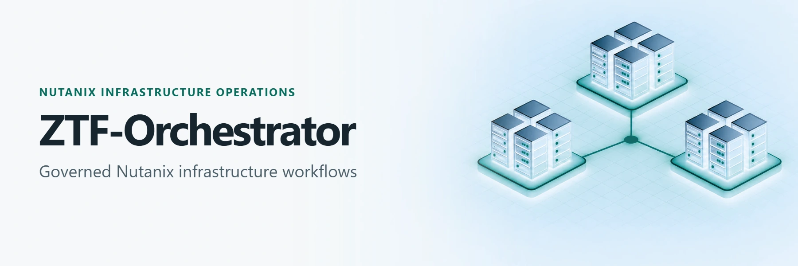
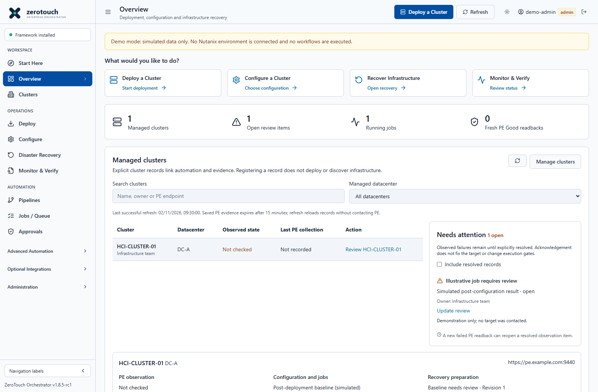
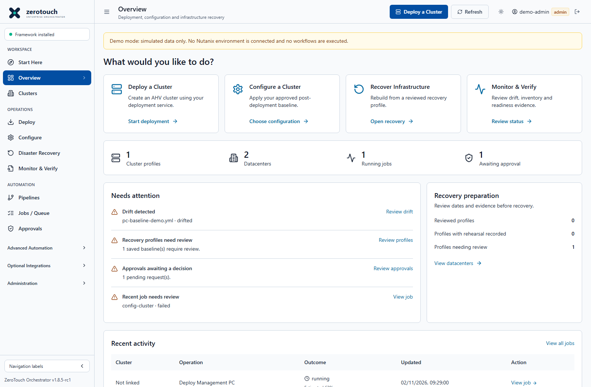
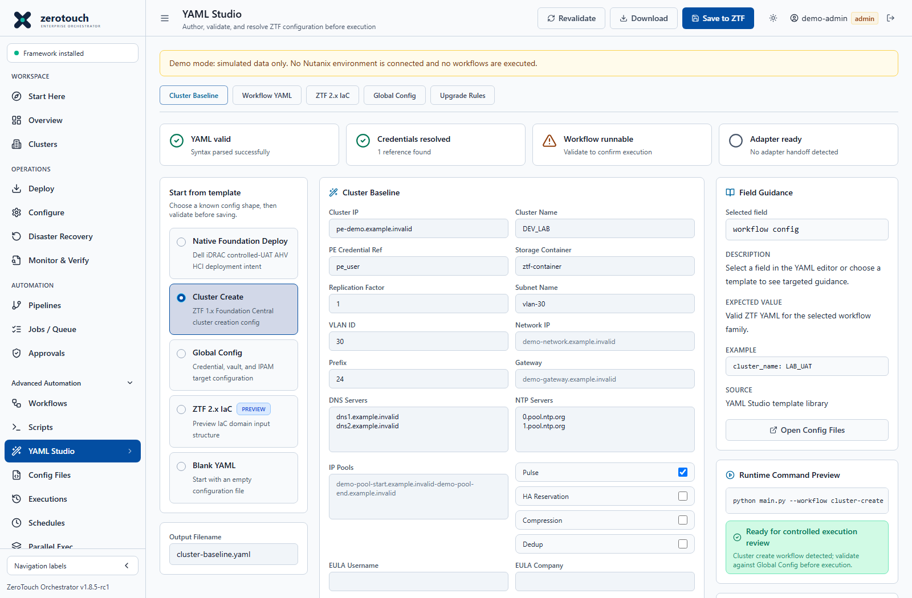
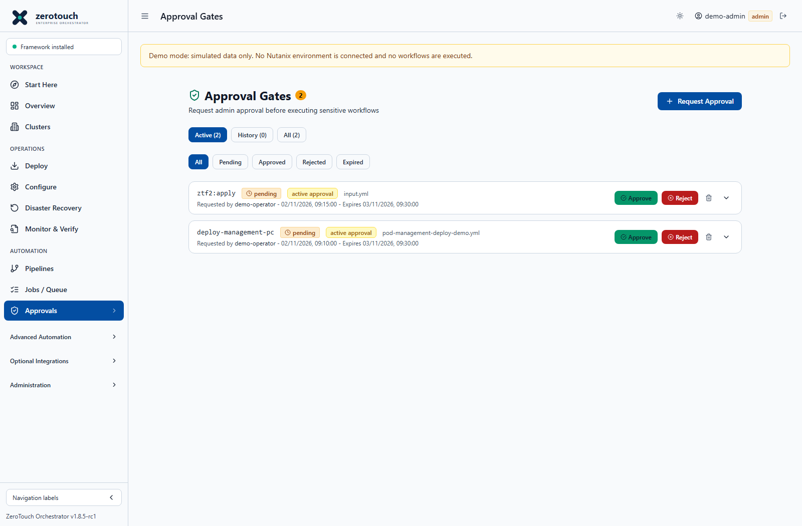
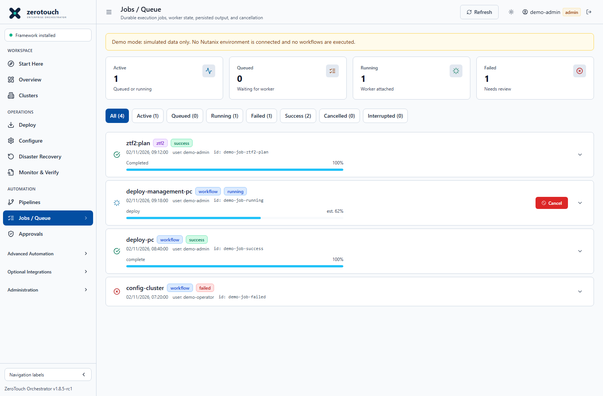
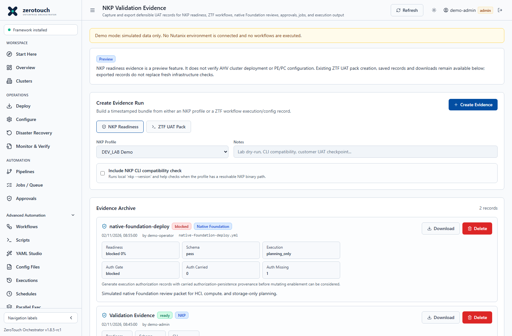
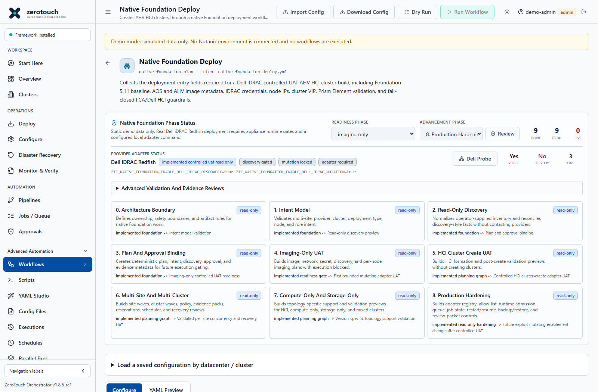
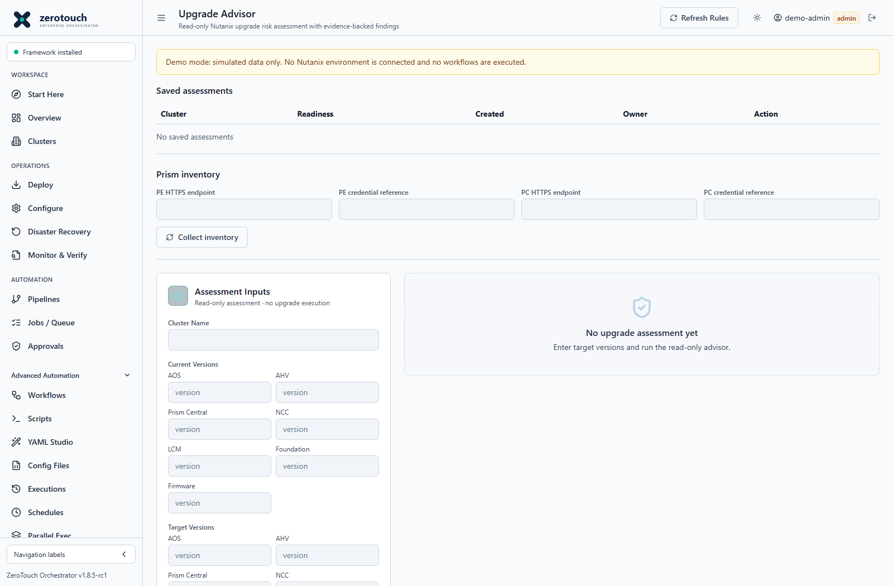
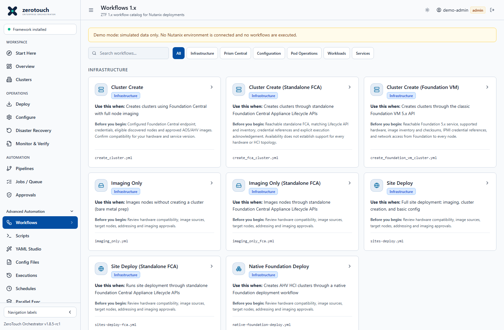

# ZTF-Orchestrator · v1.8.5-rc1



Prepare cluster configuration, run governed ZTF 1.x pipelines, and recover
Nutanix infrastructure from reviewed profiles through one web console.

**[Try the Demo](https://virtuarchitect.github.io/ZTF-Orchestrator/demo/)** |
**[Project Site](https://virtuarchitect.github.io/ZTF-Orchestrator/)** |
**[Quick Start](docs/start-here.md)** |
**[Download](#appliance-downloads)** |
**[Documentation](#deployment-guides)**

[Stable v1.8.4](https://github.com/VirtuArchitect/ZTF-Orchestrator/releases/tag/v1.8.4) |
[Release candidate v1.8.5-rc1](https://github.com/VirtuArchitect/ZTF-Orchestrator/releases/tag/v1.8.5-rc1) |
[Current source and appliance status](docs/current-status.md)

[](https://virtuarchitect.github.io/ZTF-Orchestrator/demo/)

*Light-mode Overview captured from the interactive demo. All displayed records
are simulated; screenshots and videos do not establish hardware validation.*

## Current Repository Status

Reviewed **19 November 2026** against application source
[`f33c9ed`](https://github.com/VirtuArchitect/ZTF-Orchestrator/commit/f33c9ed02fc40cd40e3399fd96d5ca5a8fa386a2).
The corresponding consolidated appliance build is `v1.8.5-rc1-f33c9ed`.
Source changes, container images, offline update ZIPs and QCOW2 appliances are
separate deliverables. Check the exact package version and checksum with your
release maintainer; older packages are immutable.

`v1.8.5-rc1` is the current prerelease. The latest stable release remains v1.8.4.
GitHub's **Latest** label refers to the stable release. Use the
[release-document website](https://virtuarchitect.github.io/ZTF-Orchestrator/releases/)
and [repository release directory](docs/releases/README.md) for versioned notes.

**ZTF 1.x remains the pipeline executor.** Native opt-in, NKP and ZTF 2.x console
setup/execution are retired. Existing Native pipeline definitions remain visible
and require administrator review and explicit conversion before execution.
Historical jobs, approvals, saved records and recovery snapshots are retained.
Retirement does not remove baked runtime dependencies or stored data; see
[console integration retirement](docs/console-retirement.md).

## What ZTF-Orchestrator Does

ZTF-Orchestrator adds guided inputs, reviewable YAML, approvals, durable job logs,
verification and recovery coordination around
[ZeroTouch Framework](https://github.com/nutanixdev/zerotouch-framework) automation.
It is an independent community project, not affiliated with or supported by
Nutanix. Production use requires environment-specific validation and sign-off.

| Capability | Current operator experience | Guide |
|---|---|---|
| Deploy clusters | Foundation VM / Foundation Central configuration, image inventory, target review and governed deployment jobs | [Deploy a cluster](docs/start-here.md#deploy-a-cluster) |
| Author configuration | YAML Studio with datacenter/cluster context, task library, guided forms, explicit authoring checks and reviewed pipeline handoff | [YAML Studio](docs/admin-guide.md#yaml-studio) |
| Run post-configuration | Sequential ZTF 1.x workflows/scripts with step names, saved configuration and failure gates | [Pipelines](docs/user-guide.md) |
| Recover infrastructure | Recover Cluster / Resume Recovery, versioned profiles, stage status and preserved completed work | [Disaster Recovery](docs/disaster-recovery.md) |
| Operate and govern | Managed clusters, owned review items, approvals, sessions, durable job logs and audit history | [Cluster operations](docs/cluster-operations.md) |
| Verify and maintain | PE collection diagnostics, evidence age, drift, Upgrade Advisor and guided offline appliance updates | [Health reporting](docs/pe-health-reporting.md) / [Updates](docs/guided-appliance-updates.md) |

### Configuration and credentials

Organize credentials and Config Files by datacenter, cluster and shared service.
Existing reference keys and selected-vault lookup remain unchanged. Groups are
organizational labels, not access boundaries or automatic target/credential mappings.
See [credential groups](docs/credential-groups.md) and
[Config Files groups](docs/config-file-groups.md).

YAML Studio checks syntax, workflow shape and declared credential references.
Reference presence does not prove authentication; authoring validation does not
run live preflight. Saving or handing off a file starts no job. Execution and
approval remain in the existing workflow and pipeline paths.

### Specialist configuration

| Workflow | Connection and operating boundary |
|---|---|
| [AHV Uplink Migration](docs/ahv-uplink-migration.md) | PE-direct discovery and pinned CVM SSH; per-host NIC keep/move assignments, optional new bridge, read-only preflight, independent approval and sequential verification |
| [Enable DARE](docs/dare-workflow.md) | PE-direct v2 APIs with an existing Local KMS; no PC required, read-only discovery/preflight, independent approval and encryption-state verification |
| [VS0 MTU](docs/change-virtual-switch-mtu.md) | Per-host preflight, approval and verification; follow the workflow's own transport and rollback rules |
| [Cluster Storage Standard](docs/cluster-storage-standard.md) | Reviewed container creation and dependency-gated default-container cleanup |
| [CVM / iDRAC credential rotation](docs/credential-rotation.md) | Guarded password changes with replacement-login checks; host IPMI credential synchronization remains a manual follow-up |
| [Unregister PE from PC](docs/unregister-pe-from-pc.md) | Exact-identity review, independent approval and PC-side verification; PE-side cleanup remains separate |

Uplink migration and DARE **live writes default to off** pending validation on
representative hardware and API versions. Their PE-direct paths support a
reasoned, audited, per-run TLS exception bound to independent approval. TLS
verification defaults to on, and SSH host-key verification remains required.
Other workflows retain their own trust policies.

**DARE enablement is irreversible.** Validate licensing, key-manager prerequisites
and key recovery independently. Rolling back the Orchestrator cannot disable
encryption. Mocked tests do not establish hardware or workload compatibility.

## Core Operator Workflow

1. Start with **Start Here** and choose Deploy, Configure, Recover Infrastructure
   or Monitor & Verify.
2. Prepare saved credential references and organize Config Files for the target.
3. Author/import YAML and validate it. Review exact targets and settings; run
   read-only preflight where available.
4. Save the configuration and review its pipeline handoff or workflow action.
5. Obtain the required approval and confirmation before execution.
6. Follow **Jobs / Queue** for the actual pipeline step, reported Foundation
   phase/percentage, failed stage and persisted output. Missing telemetry remains
   unreported; job success is not a cluster-health claim.
7. Verify the requested result, preserve evidence and complete the handoff.

Administrators can review signed-in users, total sessions, last activity and
expiry under **Administration > Users > Sessions** and revoke individual
sessions with audit logging. Unexpired sessions alone do not prove current use.
See [session management](docs/session-management.md).

## Disaster Recovery Preparation and Rehearsal

> Backups preserve what you need to recover. Recovery profiles coordinate
> rebuilding the infrastructure you recover onto.

Use **Disaster Recovery > Recover Cluster** to select a reviewed profile, or
**Resume Recovery** to continue an existing run without repeating completed work.
Profiles link a Foundation VM deployment YAML and a post-configuration pipeline.

The governed sequence remains:

1. Review datacenter prerequisites, profile revision and exact physical targets.
2. Approve re-foundation and monitor the deployment job.
3. Complete the approved initial-access bootstrap when required.
4. Record fresh PE identity, membership and health evidence.
5. Run the remaining configuration steps, verify and accept the rebuilt cluster.
6. Hand off workload restoration to the backup/application team.

If an eligible final **step 08 (PE-to-PC registration)** fails, reconcile PE/PC
state and provide fresh health evidence before an explicit step 08-only retry.
Completed steps 01-07 and existing approval records remain intact. This is not
a general replay or automatic retry after an uncertain registration response.

Both recovery and rehearsal can overwrite selected nodes. Cancellation does not
undo an accepted remote operation. VM/data restoration, incident containment,
forensics and final workload acceptance remain separate responsibilities.

[Recovery setup](docs/disaster-recovery-setup.md) |
[Recovery profile maintenance](docs/recovery-profile-management.md) |
[Recovery rehearsal checklist](docs/recovery-rehearsal-checklist.md) |
[Part 15: start-to-finish recovery](https://virtuarchitect.github.io/ZTF-Orchestrator/tutorials/?part=15)

## Appliance Downloads

Use versioned artifacts from the matching GitHub Release, Actions run or durable
artifact store. The
[Google Drive appliance folder](https://drive.google.com/drive/folders/1c-W8vFsLkbkz6Z4C9HEVPyEnZ1EWZs2C)
is an additional distribution location; verify the artifact's version and checksum.

| Artifact | Purpose |
|---|---|
| QCOW2 appliance | Deploy a new Ubuntu VM on AHV; use the matching Standard, Airgap or Minimal build metadata |
| Offline update ZIP | Update an existing compatible appliance through the guided host service |
| Docker image / image tar | Versioned container runtime; a loaded image is not an applied update |
| Checksums and manifest | Verify package integrity and exact source/image identity |

### Guided appliance update

Open **Administration > Appliance Ops > Updates**. Review storage, upload the
complete ZIP, check readiness, approve the exact version, then back up, install
and verify. The host service requires explicit one-time installation; importing
a package does not execute its installer. The application has no Docker socket.

Retain the latest verified database/data backup pair, rollback image and
configuration. Verify the running image, `/health` identity and preserved records
after cutover. Follow [guided appliance updates](docs/guided-appliance-updates.md)
and [Docker build identity](docs/docker-build-identity.md).

## Installation and First Login

| Environment | Start here |
|---|---|
| New AHV appliance, including air-gapped sites | [AHV Appliance Deployment Quick Guide (PDF)](docs/manuals/ZTF-Orchestrator-AHV-Appliance-Deployment-Quick-Guide.pdf) and [Part 16](https://virtuarchitect.github.io/ZTF-Orchestrator/tutorials/?part=16) |
| Existing Ubuntu VM / team server | [Installation guide](docs/installation-guide.md) and [appliance kit](appliance/README.md) |
| Local Docker trial | Compose with PostgreSQL; commands below |
| Manual / Windows / Linux / macOS | [Installation guide](docs/installation-guide.md) |
| Offline runtime and updates | [Air-gapped installation](docs/installation-guide.md) and [guided updates](docs/guided-appliance-updates.md) |

For a new appliance, provision `ztfadmin` and an SSH public key **before first
boot**. At a site without DHCP, use the VM console to set and verify the static
IP before trying SSH. Follow the Quick Guide for Netplan permissions, sudo
verification and retrieval or reset of the separate web-console admin password.

For a fresh local Docker checkout:

```bash
git clone https://github.com/VirtuArchitect/ZTF-Orchestrator.git
cd ZTF-Orchestrator
cp .env.example .env
# Edit .env and set a unique POSTGRES_PASSWORD before first start.
docker compose up -d
docker compose logs -f ztf-orchestrator
```

Open **http://127.0.0.1:15001** for the default Compose deployment. The application
listens on port 5001 inside the container. Store the generated first-run web
password securely and manage accounts under **Administration > Users**. For an
existing deployment, use its pinned Compose profile and reviewed update procedure;
do not replace its `.env` with the example.

If initial credentials are unavailable, follow the deployment guide's trusted
maintenance/reset procedure. Preserve accounts and the active storage backend;
deleting `users.json` is not a PostgreSQL password-reset procedure.

## Runtime and Architecture

The ZTF 1.x launcher uses `python main.py --workflow ...` / `--script ...` and
pins the bundled framework to **v1.5.2**. ZTF 2.x is not a compatible replacement
for that CLI. Retained integration code or baked runtimes do not re-enable
retired console execution. Built-in specialist adapters have separate documented
preflight, approval and enablement gates.

<details>
<summary>Retained integration runtime and historical records</summary>

The former **Scripts 2.x** surface submitted `ztf2:plan` jobs for actions such as
**Create Security Groups**. These console actions are now retired. Default
images still retain the ZTF 2.x `v2.0.0` checkout at
`/opt/zerotouch-framework-2x` and CLI at `/opt/ztf2-python/bin/ztf` for inspection
and rollback compatibility. Retained files are not an available execution lane;
data/runtime removal is a separate reviewed phase.

</details>

```text
Browser: React, TypeScript, Tailwind CSS
    | REST API + Server-Sent Events
Flask: authentication, roles, validation, approval and audit
    |-- YAML Studio, config library, pipelines, recovery coordination
    |-- PostgreSQL documents, sessions and audit (Docker/appliance)
    |-- JSON file backend (simple/manual installations)
    `-- Durable jobs -> ZTF 1.x workflows/scripts or guarded specialist adapters
                           -> Foundation / Prism / approved CVM SSH targets
```

Docker/appliance builds include the framework runtime and dependencies. Updating
baked frameworks requires a reviewed image rebuild; an in-app reinstall is not
an update of a git checkout. See [Docker build identity](docs/docker-build-identity.md),
[PostgreSQL backend](docs/postgresql-backend.md), [.env.example](.env.example) and
the [architecture index](docs/architecture/README.md).

Native Foundation engine planning and controlled-UAT research remain separately
scoped in the [engine roadmap](docs/foundation-engine-roadmap.md); they are not
a claim of a generally available replacement deployment engine.

## Security and Validation

Deploy on a trusted internal network. Compose binds to loopback by default;
team access requires a reviewed reverse proxy, TLS and firewall configuration.
Session authentication, roles, workflow/script allowlists, safe YAML parsing,
path checks, approval binding and audit logging protect execution paths.
Do not publish credentials, private keys or unredacted target logs.

CI runs backend tests with coverage, Python dependency auditing, TypeScript/build
checks and the production frontend dependency audit before protected merges.
Main-branch CI also builds and smoke-tests the container. Mocked tests, local
Docker checks, reported operational use and target hardware acceptance are
separate evidence categories. This is not vendor certification or a third-party
penetration-test attestation.

For procedures and evidence requirements, use the
[runbook index and control matrix](docs/runbooks/README.md),
[governance index](docs/governance/README.md), [UAT index](docs/uat/README.md),
[testing index](docs/testing/README.md) and
[demo and simulator guide](docs/demo/README.md).
See [SECURITY.md](SECURITY.md), the
[security assessment](docs/security/SECURITY_ASSESSMENT.md),
[reverse-proxy guide](docs/nginx-tls.md) and [systemd guide](docs/systemd.md).

## Demo and User Guide Videos

Explore the [interactive demo](https://virtuarchitect.github.io/ZTF-Orchestrator/demo/)
with simulated configuration, jobs, approvals, recovery and monitoring data.
It never connects to infrastructure or executes cluster changes.

Start with [00. ZTF-Orchestrator Overview](https://virtuarchitect.github.io/ZTF-Orchestrator/tutorials/?part=00),
then choose the relevant chapter from [User Guide Videos](https://virtuarchitect.github.io/ZTF-Orchestrator/tutorials/).
[Part 15](https://virtuarchitect.github.io/ZTF-Orchestrator/tutorials/?part=15)
covers profile-based recovery; [Part 16](https://virtuarchitect.github.io/ZTF-Orchestrator/tutorials/?part=16)
covers appliance deployment and SSH setup; [Part 17](https://virtuarchitect.github.io/ZTF-Orchestrator/tutorials/?part=17)
covers Ubuntu disk expansion. Dated videos may show historical navigation or
retired integrations; use current operator guides for execution scope.
See [video transcripts and captions](docs/user-guide-videos.md).

<details>
<summary>Historical light-mode screenshot gallery (2 November 2026)</summary>

These captures predate the latest YAML Studio and console retirement changes.
They retain their original provenance and illustrate historical navigation,
including retired integrations. The main Overview image above is also a
simulated demo capture, not live validation.

| Dashboard | YAML Studio |
|---|---|
|  |  |

| Approvals | Jobs and Queue |
|---|---|
|  |  |

| Validation Evidence | Native Foundation Planning |
|---|---|
|  |  |

| Upgrade Advisor | Workflow Catalog |
|---|---|
|  |  |

[Screenshot provenance](docs/assets/readme/v1.8.5-rc1/README.md)

</details>

## Development

Use the Python/runtime requirements in the [installation guide](docs/installation-guide.md)
and a Node.js version compatible with the locked Vite toolchain for frontend
work. Node.js is not required to run the pre-built application.

```bash
python -m pytest tests/test_release_integrity.py -q
python -m pytest -q
npm ci
npm run build
npm run build:demo
npm run smoke:visual
git diff --check
```

Frontend development uses `npm run dev` (port 5173) alongside `python server.py`
(manual API port 5001). The Vite proxy forwards API and health requests to Flask.
Follow [TESTING_GUIDE.md](TESTING_GUIDE.md), [SECURITY_REVIEW.md](SECURITY_REVIEW.md)
and [repository instructions](AGENTS.md).

## Deployment Guides

| Guide | Purpose |
|---|---|
| [Start Here](docs/start-here.md) | Choose deployment, configuration, recovery or monitoring |
| [Current source and package status](docs/current-status.md) | Release channels, exact build identity and historical package boundaries |
| [Installation](docs/installation-guide.md) | Docker, appliance, manual and offline procedures |
| [AHV Quick Guide (PDF)](docs/manuals/ZTF-Orchestrator-AHV-Appliance-Deployment-Quick-Guide.pdf) | Static IP before SSH, key provisioning, sudo and web admin access |
| [Administrator guide](docs/admin-guide.md) | Console configuration and operation |
| [User guide](docs/user-guide.md) | Workflows, scripts, pipelines and saved configuration |
| [Infrastructure recovery](docs/infrastructure-recovery.md) | Rebuild preparation and acceptance boundaries |
| [Recovery setup](docs/disaster-recovery-setup.md) | Datacenters, prerequisites, deployment YAML and pipeline linkage |
| [PE health reporting](docs/pe-health-reporting.md) | Certificate/SAN, credential and connectivity errors; evidence expiry and clocks |
| [Live PE drift monitoring](docs/live-pe-drift-monitoring.md) | Read-only collection, scheduling and trust requirements |
| [Upgrade Advisor](docs/nutanix-upgrade-risk-advisor.md) | Evidence-backed readiness assessment; no cluster updates |
| [Session management](docs/session-management.md) | Administrator session inventory, activity and revocation |
| [Console retirement](docs/console-retirement.md) | Supported execution and retained historical records |
| [Manual downloads](docs/manuals/README.md) | PDF and editable guide sources with provenance |

## Maintainer and Changelog

Developed and maintained by **ZTF-Orchestrator maintainers**.
See [CHANGELOG.md](CHANGELOG.md) for version history and
[release notes](release-notes-v1.8.5-rc1.txt) for the candidate's release record.
