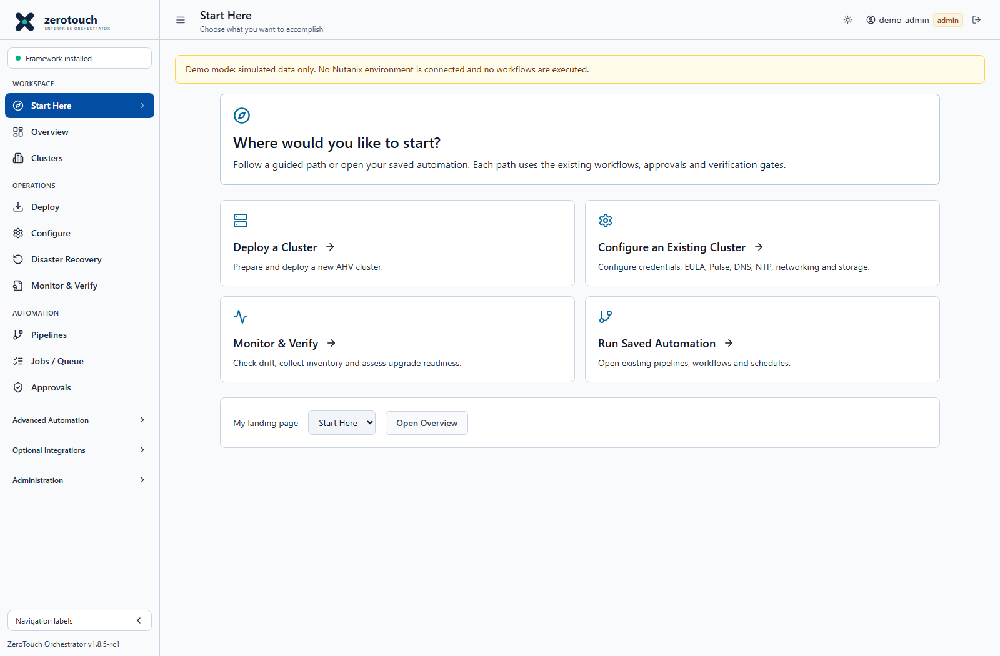
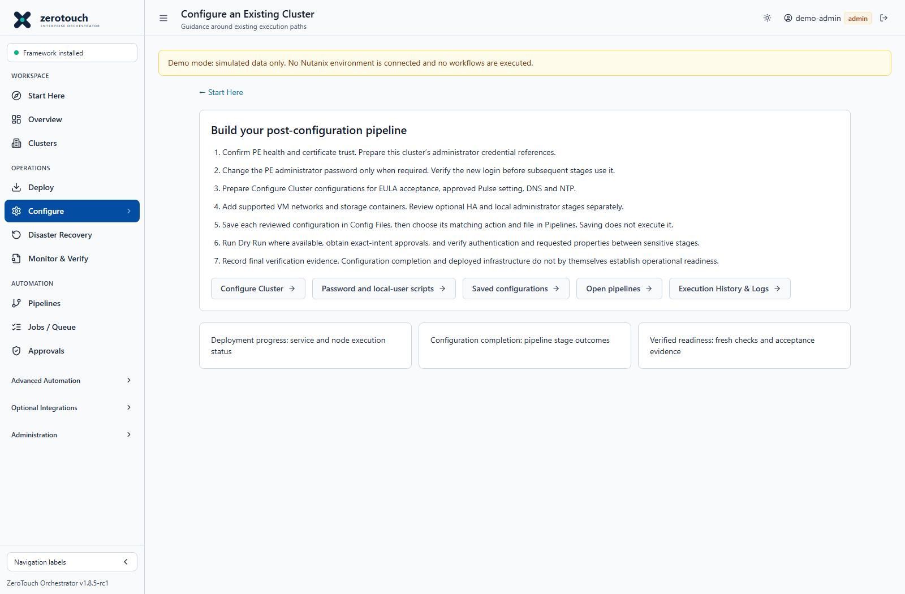

# ZTF-Orchestrator Admin Guide

## Build #72 operator update - 26 November 2026

[Verified Standard, Airgap and Minimal downloads, checksums and first-boot instructions](appliance-build-72.md)
use application source `f9eee7e`. Fresh QCOW2 appliances enable reviewed Foundation VM
deployment by default and establish a versioned rollback baseline without manual
retagging. Administrator authorization, exact deployment confirmation, configured
approvals and preflight remain required. Existing environment overrides are retained;
an update ZIP does not rerun factory bootstrap. No startup action deploys a cluster.

Use [pipeline datacenter/cluster organization](pipeline-organization.md),
[workflow execution settings](workflow-execution-settings.md) and
[PE TLS options](pe-tls-options.md) for current controls. Pipelines, approvals,
completed recovery work and the eligible step 08-only recovery retry are preserved.
[Video currency notes](video-current-guidance.md) identify dated narration that
must be read with current written procedures.

Earlier execution and transport review: 21 November 2026 against application source `db16219`. The earlier illustrated manual review was 19 November 2026 at `f33c9ed`; its original edition remains a dated reference. Use the [current PDF collection and dated Word/PDF editions](manuals/README.md), [current build status](current-status.md) and [light-mode screenshot provenance](assets/guide/2026-11-19/README.md).

ZTF 1.x remains the pipeline executor. Native pipeline executor opt-in, NKP and ZTF 2.x console execution are retired; references below to earlier integration screens are historical. See [console retirement](console-retirement.md). Current operations include YAML Studio, Recover Cluster/Resume Recovery and guarded step 08-only retry. PE-direct uplink/DARE retain approval and verification; packaged builds enable the four reviewed network/encryption application paths; explicit false overrides retain planning mode. v1.8.5-rc1 remains prerelease; v1.8.4 remains Latest stable. Obtain exact commit-specific packages through the release maintainer.

The [revision 3 cluster deployment process](cluster-deployment-process.md)
provides the diagram, text equivalent and acceptance gates. The PDF manual
includes its overview and enlarged stage views in a landscape appendix.

This guide is for administrators who install, configure, operate, govern, and
support ZTF-Orchestrator in a trusted internal environment. It covers the major
features, their administrative purpose, common use cases, operating boundaries,
and the screens admins should use during normal operations, controlled UAT,
incident recovery, and audit review.

ZTF-Orchestrator is an independent community operations layer for Nutanix
automation workflows. It is not affiliated with or supported by Nutanix.
Production use requires environment-specific validation, change approval,
backup planning, and operational signoff.

## Scope And Operating Model

The new [Disaster Recovery section](disaster-recovery.md) groups saved Foundation
VM rebuild baselines and post-configuration pipelines by datacenter. It adds
versioned profiles, governed execution, explicit health/acceptance evidence and
rehearsal records. The refreshed 156-page illustrated PDF includes Disaster Recovery,
the approved bootstrap-before-health sequence, current navigation and guided
appliance updates. The linked procedures describe their validation boundaries.
The separate [illustrated recovery setup guide](disaster-recovery-setup.md),
reviewed against `a3c9c79` on 2 November 2026, adds datacenter creation,
Foundation VM/pipeline linking and baseline review without deployment. Its
generic simulated screenshots and PDF/Word editions remain a focused setup supplement.
The [User Guide Videos](user-guide-videos.md) series includes an introductory overview.

ZTF-Orchestrator provides a browser-based control plane for preparing,
validating, executing, and auditing Nutanix automation work. It complements the
underlying automation engines and infrastructure APIs rather than replacing
them.

| Layer | Role |
|---|---|
| ZTF-Orchestrator | Admin console, RBAC, configuration authoring, approvals, schedules, queues, evidence, audit, and governance records. |
| ZeroTouch Framework 1.x | Legacy workflow and script execution engine for allowlisted Nutanix operations. |
| Retained ZeroTouch Framework 2.x | Historical runtime/records only; new console execution is retired. |
| Retained NKP integration | Historical artifacts/records only; new console setup/execution is retired. |
| Prism Central, Prism Element, Foundation Central, FCA, NKP, and provider APIs | Target systems that perform infrastructure actions when approved and supported. |

Administrative responsibilities include:

- Installing and updating the Orchestrator.
- Selecting the correct storage backend.
- Managing users, roles, runtime paths, and governance settings.
- Defining global configuration, credentials, IPAM metadata, and provider
  references.
- Controlling workflow execution through approvals, queues, and schedules.
- Preserving audit records, validation evidence, and backup/restore posture.
- Maintaining clear boundaries between demo, lab, controlled UAT, and
  production-validated claims.

## Deployment Profiles

Choose the deployment model based on the team size, persistence needs, and
validation target.

| Deployment model | Best use case | Admin notes |
|---|---|---|
| Local workstation | Lab testing, demos, single-operator evaluation. | File-backed state is simple but should not be treated as shared production state. |
| Docker Compose with PostgreSQL | Small internal team deployment with durable state. | Recommended for governed team use because users, jobs, approvals, schedules, evidence, and audit records are durable. |
| AHV or VM appliance | Operationally packaged deployment for infrastructure teams. | Use appliance update and backup procedures; track Installed Build metadata. |
| Kubernetes starter manifests | Platform teams that want to adapt deployment into an existing cluster. | Treat manifests as starters and apply local hardening, ingress, TLS, and storage review. |
| Air-gapped deployment | Disconnected environments with internal Git/PyPI or prebuilt bundles. | Stage framework checkouts, Python wheels, update packages, images, checksums, and evidence exports separately. |

Use the Installation Guide for build and deployment commands. Use this Admin
Guide for what to configure and operate after installation.

## First-Time Admin Checklist

1. Install or deploy ZTF-Orchestrator using the selected deployment profile.
2. Confirm the app starts and `/health` reports healthy.
3. Sign in with the first-run admin credentials and rotate the password.
4. Configure storage and backup expectations before onboarding other users.
5. Configure ZTF 1.x, ZTF 2.x, and optional NKP runtime paths in Settings.
6. Confirm the Dashboard readiness indicators match the intended runtime.
7. Create named admin, operator, and viewer accounts.
8. Configure Global Config credential references, vault metadata, and IPAM
   metadata.
9. Create or import baseline YAML through YAML Studio or Config Files.
10. Define approval rules for governed or destructive work.
11. Run non-mutating validation or dry-run paths before approving live changes.
12. Retain job and target-verification evidence for handover. Use the Preview evidence tool only for its supported specialist sources.
13. Configure backup, restore, and disaster recovery procedures.
14. Document local boundaries, unsupported features, and residual risks.

## Roles And Permissions

Administrators manage reusable permission profiles and multi-select datacenter/cluster assignments in **Administration > Access Control**. Existing Operator/Viewer accounts have no implicit target grants. See [scoped operations access](scoped-operations-access.md); Global Config labels alone do not authorize access.

ZTF-Orchestrator uses role-based access control. All protected screens require
a valid session token.

| Role | Intended user | Capabilities |
|---|---|---|
| Admin | Platform owner, lead operator, or trusted maintainer. | Full access to settings, users, approvals, jobs, configs, evidence, audit log, backup restore, and cleanup actions. |
| Operator | Infrastructure operator with explicit assigned scope. | Assigned cluster/pipeline summaries; only explicitly granted drafts, change requests, exact reviewed pipeline execution and own-run cancellation. No raw credentials/YAML/logs, arbitrary authoring, approvals or destructive recovery. |
| Viewer | Reviewer or stakeholder with explicit assigned scope. | Assigned cluster/pipeline summaries and sanitised run/recovery status only. No execution, writes, approvals, credentials, raw configuration, raw logs or exports. |

Use the lowest role that allows the work. Admin accounts should be limited and
protected because they can change runtime settings, manage users, approve work,
and restore backups.

## Navigation Overview

The sidebar groups day-to-day work into operating areas.

| Area | Screens | Admin purpose |
|---|---|---|
| Workspace | Start Here, Overview, Clusters | Choose a journey and inspect saved cluster profiles. |
| Operations | Deploy, Configure, Disaster Recovery, Monitor & Verify | Follow the relevant deployment, post-configuration, rebuild or monitoring path. |
| Automation | Pipelines, Jobs / Queue, Approvals | Review approved sequences, running work and exact approvals. |
| Advanced Automation | Workflows, Scripts, YAML Studio, Config Files, Executions, Schedules, Parallel Exec, Recovery Runs, Rehearsals, Drift Detection, Upgrade Advisor, NKP Validation Evidence (Preview) | Open specialist tools and retained records directly. |
| Optional Integrations | NKP Framework, Workflows 2.x, Scripts 2.x, ZTF 2.x IaC (Preview) | Evaluate explicitly labelled integration paths within their implementation limits. |
| Administration | Setup & Install, Global Config, Appliance Ops, Users, Audit Log, Settings | Maintain runtimes, credentials, trust, accounts, backups and the appliance. |

## Start Here and Deployment Guidance

Users without a saved landing preference open **Start Here** after login.
Choose Deploy a Cluster, Configure an Existing Cluster, Monitor & Verify, or
Run Saved Automation. **My landing page** stores a per-user browser preference;
experienced users can select **Overview**. Specialist tools remain accessible
under **Advanced Automation**. This navigation does not replace execution gates.

Deploy a Cluster provides seven guidance stages: choose the method, connect,
define the cluster, validate, review and approve, deploy and monitor, and
continue to post-configuration. Choose the service actually available at the
site: classic Foundation VM, integrated Foundation Central, or standalone FCA.
The matching existing workflow owns validation, exact YAML approval and live
submission. Selecting a guidance stage is not evidence that its work passed.

**Save and continue later** saves only the selected method and guidance position
in this user's browser. Use **Download Config** or Config Files to retain actual
inputs. **Continue to Post-Configuration** opens guidance and links to Configure
Cluster, Scripts and Pipelines; it does not create or execute a pipeline or
select a target automatically. Follow [the complete journey](start-here.md).

Administrators can open **Configure → Enable Data-at-Rest Encryption (DARE)** to
review a read-only Prism preflight and request independent approval for software
encryption with Native KMS (Local). Packaged builds enable reviewed application by default; explicit false overrides retain planning mode. See the
[DARE wizard guide](dare-workflow.md) for prerequisites and verification.

## Overview Dashboard

The Dashboard is the operational cockpit. Admins should use it at the start of
each maintenance window and during incident response. Its leading cards are
Deploy, Configure, Recover and Monitor. Recorded attention/activity and recovery
preparation are shown first; expand **Platform details and advanced operational visibility** for the
retained panels below. Profile counts do not imply discovery or target health.

Key functions:

| Function | What it tells admins | Use case |
|---|---|---|
| Runtime readiness | Whether ZTF, ZTF 2.x, and NKP paths are detected. | Confirm the appliance or container is ready after install, update, or restore. |
| Deployment inventory | Count of configs, profiles, jobs, and operational records. | Understand whether a deployment is empty, active, or accumulating evidence. |
| Operations queue | Active, queued, running, failed, cancelled, or stale jobs. | Triage blocked workflows or verify no work is running before maintenance. |
| Governance state | Pending approvals and policy pressure. | Avoid running controlled tasks without authorization. |
| Validation evidence | Recent evidence capture posture. | Check whether UAT or change records have supporting artifacts. |
| Schedule posture | Enabled schedules, next-run times, and schedule failures. | Confirm repeatable drift checks or recurring jobs are healthy. |
| Storage and backup posture | Backend mode, backup metadata, and database state where available. | Confirm recovery readiness before risky changes. |

Operational use cases:

- Morning readiness check for an operations team.
- Pre-change review before running a workflow.
- Maintenance freeze confirmation before updates or restore work.
- Incident triage when a job, approval, or schedule is stuck.

## Setup And Install

Setup & Install helps admins bootstrap or repair the framework runtimes.

| Runtime lane | Purpose | Admin guidance |
|---|---|---|
| ZTF 1.x Legacy | Supports the existing workflow and script catalog through the legacy CLI model. | Use for Foundation Central, Prism Element, Prism Central, pod, workload, NDB, and script workflows that depend on ZTF 1.x. |
| ZTF 2.x IaC | Supports the separate plan/apply IaC lane. | Configure independently; do not treat it as a drop-in replacement for ZTF 1.x. |
| NKP Framework (historical) | Console setup and execution are retired; review retained records only. |

Admin use cases:

- First installation of framework runtimes.
- Re-detecting a runtime after appliance update or host restore.
- Repairing a missing dependency in a lab environment.
- Confirming that Docker or appliance baked runtimes are visible.

In Docker and appliance deployments, bundled runtimes may be baked into the
image rather than mutable Git checkouts. Updating those runtimes normally means
rebuilding or updating the image, not running an in-place `git pull`.

## Global Config

Global Config builds the shared `global.yml` consumed by ZeroTouch Framework
workflows and scripts.

Feature areas:

| Area | Purpose | Use cases |
|---|---|---|
| Credentials | Define named credential references such as `pc_user`, `foundation_central`, `pe_user`, `ncm_user`, `cvm_credential`, and service-account references. | Standardize workflow references and avoid repeatedly editing credentials into every workflow YAML. |
| Vault settings | Record selected credential-source metadata. | Prepare for local, environment-backed, HashiCorp Vault, CyberArk, Azure Key Vault, AWS Secrets Manager, Delinea, BeyondTrust, or custom API integration patterns. |
| IPAM settings | Record address-source metadata. | Align static, CSV, reservation-file, NetBox, Nautobot, phpIPAM, Infoblox, BlueCat, EfficientIP, Microsoft DHCP/IPAM, or custom API patterns. |
| YAML preview | Show the generated `global.yml` before saving or downloading. | Review exact output before writing to the configured ZTF runtime. |

Important boundary:

Provider selections write configuration metadata. They do not automatically
prove live credential retrieval, mutating IP allocation, or vendor-provider
integration. Live provider behavior requires configured, permitted, and
validated adapters in the target environment.

Admin best practices:

- Use named credential references consistently across workflows.
- Avoid storing secrets in public documentation, screenshots, or exported
  artifacts.
- Review generated YAML before saving.
- Treat `global.yml` changes as change-controlled when used for shared
  operations.

## Config Files

Organize YAML/JSON by datacenter, cluster and purpose using the shared credential
group catalogue. Grouping does not rename files or change execution references.
See [Config file grouping](config-file-groups.md) for label saves, filtered
workflow/pipeline selection, shared templates and Ungrouped behavior.

Config Files is the shared library for YAML and JSON files used by workflows,
scripts, schedules, pipelines, drift checks, NKP operations, and evidence
records.

Key functions:

| Function | Admin value |
|---|---|
| Create or upload files | Seed reusable configs for common sites, clusters, or validation tasks. |
| Edit and save | Keep reviewed config content in one location. |
| Automatic backups | Preserve prior versions before overwrites. |
| Download | Export reviewed configs for change tickets or peer review. |
| Restore | Recover a previous config version after a bad edit. |
| Delete | Remove obsolete configs after confirmation. |

Use cases:

- Store a known-good cluster rebuild YAML.
- Preserve separate configs for lab, UAT, and production-like targets.
- Restore a config after an accidental edit.
- Download the exact config used in a change window.

Admin guidance:

- Keep filenames meaningful and environment-neutral where possible.
- Do not store local usernames, lab IPs, or secrets in public artifacts.
- Use Validation Evidence for formal handover rather than relying on a config
  file alone.

## YAML Studio

YAML Studio prepares configuration without executing infrastructure actions.

1. Choose a datacenter and cluster group, or enter a manual target. Groups are
   organizational labels. A matching managed cluster can prefill its PE address
   and reference; review those values before saving.
2. Choose a task from the library: initial admin access, EULA/Pulse, DNS/NTP,
   DSIP, HA, rebuild reservation, storage, Prism title or PE registration to PC.
   Specialist AHV uplink and DARE operations open their existing governed wizards.
3. Complete the guided fields and review the generated YAML. Boolean and policy
   choices require explicit input. Advanced YAML uses the edited document as the
   source of truth. Switching back requires confirmation before replacing edits.
4. Validate syntax, task shape and declared credential references. These checks
   do not authenticate credentials, contact PE/PC or establish live readiness.
   Live preflight remains **Not run**. Password values are not fetched by the
   operational Studio. Keep credentials in Global Config.
5. Save a task-specific filename. The selected group labels the file in Config
   Files. Existing files must be opened for review before overwrite; changes made
   in another session require reloading. Export drafts before leaving the page:
   task drafts are retained only in page memory.
6. Select an existing ZTF 1.x pipeline and review every existing step plus the
   proposed append. Confirm **Append saved step** to change the future pipeline
   definition only. Duplicate or stale handoffs are rejected. If the current
   approval policy requires direct-job execution, Studio explains the block and
   leaves that policy unchanged. Open Workflows to use its approval path.

Handoff does not submit jobs, request or consume approvals, change existing steps,
convert executors, or modify recovery run snapshots and completed work. The
step-08-only recovery retry remains in the existing recovery flow. Viewers can
prepare, validate and export drafts; only administrators/operators can save and
hand off configurations.

**Additional authoring tools** retains the existing full script generators,
cluster baseline editor, Foundation Central cluster YAML, Global Config and
upgrade-rule authoring. Retired integration templates are not offered. Existing
validation/save/export API callers without a task ID retain their prior behavior.
The public demo simulates authoring and browser-memory handoff only; its checks
are labeled as simulated and are not live validation.

## Workflows 1.x

Workflows 1.x covers the legacy ZeroTouch Framework workflow catalog. These
workflows execute through the guarded `python main.py --workflow` model after
validation, optional dry run, and any required approvals.

Workflow families:

| Workflow | Purpose | Primary use cases |
|---|---|---|
| Cluster Create | Creates clusters using Foundation Central with node imaging and cluster formation. | Greenfield cluster deployment, rebuild from known-good cluster input, lab/UAT cluster creation. |
| Cluster Create (Standalone FCA) | Submits cluster creation through standalone Foundation Central Appliance Lifecycle APIs. | FCA-based cluster creation where Lifecycle API handoff is validated and acknowledged. |
| Imaging Only | Images nodes without forming a cluster. | Bare-metal preparation, node re-imaging, staged rebuild preparation. |
| Imaging Only (Standalone FCA) | Submits imaging through standalone FCA Lifecycle APIs. | FCA-controlled imaging where cluster formation happens later. |
| Pod Imaging | Combines imaging and cluster creation for pod deployment. | Pod deployment and multi-cluster site patterns. |
| Pod Imaging (Standalone FCA) | Runs pod imaging through standalone FCA Lifecycle APIs. | FCA-based pod deployment handoff. |
| Site Deploy | Deploys a full site with imaging, cluster creation, and basic config. | Multi-site or edge-site rollout. |
| Site Deploy (Standalone FCA) | Runs site deployment through standalone FCA Lifecycle APIs. | FCA-based site deployment under explicit acknowledgement. |
| Native Foundation Deploy | Plans native Foundation deployment with controlled-UAT guardrails. | Dell iDRAC controlled-UAT AHV HCI deployment planning, review packet creation, evidence capture. |
| Configure Cluster | Applies Day-1 and Day-2 cluster settings. | AD, storage, VLANs, NTP/DNS, and HA standardization. |
| Post-Foundation Baseline | Applies or records safe post-foundation Prism Element baseline actions. | EULA/Pulse, health checks, PC registration, HA, DSIP, DNS, NTP, and storage baseline after creation. |
| PE Monitoring Baseline | Plans monitoring, alerting, and evidence checks. | NCC evidence, SMTP, alert contacts, SNMPv3, and syslog planning. |
| AHV Security Hardening | Plans Prism Element, CVM, and AHV hardening controls. | Security hardening checklist, evidence capture, and manual/blocked control tracking. |
| PE Network Baseline | Plans virtual switch and VM network settings. | Standard network setup after rebuild or deployment. |
| PE Certificate Baseline | Plans CSR and certificate replacement steps. | Certificate refresh workflows and evidence-only certificate validation. |
| Hardware OOB Baseline | Plans vendor out-of-band hardware baseline tasks. | BMC inventory evidence and future credential/BIOS/Secure Boot mapping review. |
| Deploy Prism Central | Deploys Prism Central VM instances. | Initial management-plane deployment or rebuild. |
| Configure Prism Central | Configures Prism Central services. | AD, SAML, security policies, NKE, Objects, DR, and Flow policy setup. |
| Pod Config | Configures pod and edge site clusters at scale. | Nutanix Validated Design style pod operations. |
| Deploy Management PC | Deploys Prism Central and NCM management instances. | Management plane deployment for multi-site operations. |
| Configure Management PC | Initializes Prism Central and NCM. | Post-deployment registration, policies, and cluster connections. |
| Calm VM Workloads | Deploys application workloads through Calm DSL blueprints. | Controlled workload deployment after infrastructure readiness. |
| Edge AI Workload | Deploys Edge-AI application workloads. | Specialized edge AI or ML workload rollout. |
| NDB Deploy | Deploys and configures Nutanix Database Service. | Database platform provisioning and cluster registration. |
| LCM Update | Runs lifecycle management update workflows. | Governed update workflows with reviewed YAML and approvals. |

Execution controls:

- Workflow IDs are allowlisted.
- YAML is parsed before execution.
- Destructive or special handoff workflows can require explicit
  acknowledgement text.
- Approval-bound workflows require a matching approved request.
- Jobs run through durable queue records rather than browser-bound sessions.
- Logs, return codes, task IDs, and metadata are retained.

## Workflows 2.x And ZTF 2.x IaC

This console integration is retired. Current ZTF 1.x workflows and scripts remain the supported pipeline execution path. Retained ZTF 2.x templates, state metadata, approvals and jobs are historical records; they do not provide a current plan, apply or destroy option. New mutating requests to the retired integration are rejected with HTTP 410. Preserve existing records and follow [console retirement](console-retirement.md) when reviewing older configurations.

## Scripts 1.x

Scripts 1.x exposes allowlisted ZTF 1.x script actions. Admins use scripts for
narrow operational changes that do not require a full workflow.

Script categories and common use cases:

| Category | Examples | Use cases |
|---|---|---|
| Authentication | Add AD Server, create role mapping, configure SAML IDP, add users/groups/roles. | Standardize identity integration after cluster or PC deployment. |
| Networking | Create/delete PE or PC subnets, manage VPCs, add DNS and NTP servers. | Rebuild network baselines, add tenant networks, correct post-deploy network settings. |
| Storage | Create/delete containers, object stores, and buckets. | Restore baseline storage objects after rebuild or deploy new service capacity. |
| Compute | Create/delete VMs and power-transition VMs. | Controlled VM provisioning or cleanup through reviewed config. |
| Images | Upload/delete disk, ISO, and OVA images. | Prepare image catalog for workload restore or deployment. |
| Security | Create/delete Flow security policy objects, address groups, service groups, and categories. | Reapply segmentation prerequisites after rebuild. |
| Kubernetes | Create NKE cluster, enable NKE. | Platform bootstrap where legacy script support is validated. |
| Database | Configure NDB and register clusters. | Prepare database services after infrastructure readiness. |
| Prism Central | Deploy PC, register PE, enable microsegmentation, Objects, DR, Foundation Central, Marketplace, and related objects. | Rebuild management plane services or standardize PC configuration. |
| Prism Element | Accept EULA, update Pulse, configure HA, rebuild capacity, DSIP. | Post-foundation baseline and recovery readiness. |
| System | Update CVM Foundation. | Maintain Foundation components where supported. |

Admin guidance:

- Prefer workflows when multiple dependent scripts need to run together.
- Prefer scripts for narrow, well-understood changes.
- Use dry-run or validation where available.
- Use Jobs / Queue to monitor output and target task IDs.
- Capture Validation Evidence after UAT-significant script runs.

## Scripts 2.x

This console integration is retired. Current ZTF 1.x workflows and scripts remain the supported pipeline execution path. Retained ZTF 2.x templates, state metadata, approvals and jobs are historical records; they do not provide a current plan, apply or destroy option. New mutating requests to the retired integration are rejected with HTTP 410. Preserve existing records and follow [console retirement](console-retirement.md) when reviewing older configurations.

## Jobs And Queue

Jobs / Queue is the execution control center.

Key functions:

| Function | Admin value |
|---|---|
| Queue list | Shows queued, running, completed, failed, cancelled, and interrupted work. |
| Expanded logs | Provides retained stdout/stderr style context for troubleshooting. |
| Progress and task IDs | Helps correlate Orchestrator jobs with target Nutanix tasks. |
| Cancellation | Lets admins interrupt supported queued or running work. |
| History metadata | Preserves user, config, approval, runtime, and trace metadata. |

Use cases:

- Monitor a cluster deployment during a change window.
- Prove whether a workflow actually started.
- Diagnose failed framework execution.
- Capture task IDs for Prism, Foundation Central, or change records.
- Confirm the queue is empty before maintenance or restore.

## Execution History

Execution History gives a durable view of completed workflow and script runs.

Use it to:

- Review who launched a workflow and when.
- Confirm status, return code, and selected config.
- Find prior output when preparing a handover.
- Link completed work to Validation Evidence.
- Compare repeated executions of the same workflow.

Administrators should retain history long enough to satisfy internal change
and audit requirements.

## Approvals

Approvals provide the governance layer for controlled work.

The navigation bubble shows the pending approval count. A blue `0` means no
requests are pending. Pending requests use an amber count. While checking, the
bubble shows `…`; `?` means the count is unavailable.

Common approval use cases:

| Approval target | Why it matters |
|---|---|
| Destructive or mutating workflows | Prevent accidental imaging, deletion, or configuration drift. |
| ZTF 2.x apply or destroy | Bind approval to exact plan evidence and hashes. |
| Historical NKP approvals | Retained for review; new NKP execution is retired. |
| Retained Native Foundation review records | Historical design/evidence records; native console execution is retired. |
| Disaster recovery rebuild workflow | Ensure containment, authorization, scope, and restore prerequisites are approved before rebuilding infrastructure. |

Admin guidance:

- Require approvals for high-impact changes.
- Bind approvals to config hashes, plan IDs, job IDs, evidence IDs, or change
  tickets where available.
- Do not approve work based only on a verbal summary when the exact YAML or
  plan evidence is available.
- Retain approval records for audit and UAT traceability.

## Pipelines

Pipelines group repeatable operational steps into a named sequence.

Use cases:

- Run a baseline sequence after cluster creation.
- Separate validation, configuration, and evidence steps.
- Standardize edge-site deployment activities.
- Prepare a repeatable DR rebuild sequence with human approval gates between
  phases.

Admin guidance:

- Keep pipeline steps small enough to troubleshoot.
- Avoid hiding risky actions inside broad pipeline names.
- Capture evidence after significant phases.
- Use approvals for destructive, recovery, or customer-impacting steps.

Use narrowly scoped configurations for password change, EULA/Pulse, DNS/NTP,
networking, storage, optional HA/local administrators and PC registration.
Require fresh replacement-password authentication before using the new reference.
Omit `new_pe_admin_credential` after that first stage; its password substep then
reports SKIP. Container verification reads requested supported properties and
fails on missing or mismatched results without repairing existing containers.
See [PE post-configuration verification](pe-post-configuration-verification.md).

**Create Local Users (PE)** is a separate administrator-confirmed Script step.
Use distinct matching credential references and inspect partial target state
before retrying. [Stage-specific diagnostics](pe-local-users.md#failure-diagnostics)
distinguish trust, SAN identity, network, HTTP access, creation and role failures.
Verify enabled state and both required roles after the run; see the
[read-only account verification procedure](pe-local-users.md#independent-read-only-verification).

## Schedules

Schedules allow repeatable jobs to run at configured times.

Use cases:

- Periodic drift checks.
- Repeated validation or evidence tasks.
- Routine health or readiness checks.
- Scheduled non-destructive reports.

Admin guidance:

- Avoid scheduling destructive or environment-mutating tasks without strong
  governance.
- Review schedule failures on the Dashboard and Schedules page.
- Disable schedules before maintenance, restore, or incident response if they
  could interfere with recovery.
- Confirm timezone selection and next-run time after creation.

## Parallel Execution

Parallel Execution coordinates similar work across multiple targets.

Use cases:

- Multi-site validation.
- Edge-site baseline comparison.
- Repeated config checks across clusters.
- Controlled rollout waves where parallelism is intentionally limited.

Admin guidance:

- Start with low parallelism until target behavior is validated.
- Consider blast radius, maintenance windows, and rate limits.
- Use job history and evidence to record per-target outcomes.
- Avoid using parallel execution as a shortcut around approvals.

## Drift Detection

Drift Detection compares expected configuration intent with observed or stored
state signals.

Use cases:

- Detect unexpected config edits.
- Review whether a cluster remains aligned with baseline after handover.
- Support compliance or operational review.
- Feed a corrective workflow or change request.

Admin guidance:

- Treat drift as an investigation signal, not automatically as a bug.
- Confirm source data and time window before taking corrective action.
- Capture evidence before and after remediation.
- Use schedules for recurring non-destructive drift checks.

**Live Prism Element** collects DNS, NTP and Pulse afresh on manual and scheduled
runs. Stored Snapshot and Last Applied do not poll PE. Use the pencil **Edit
schedule** control to update an existing policy, then Run now and verify the next
UTC trigger. Trust, IP/SAN, network and HTTP failures remain Unknown, not Matched.
Follow [live collection and diagnostics](live-pe-drift-monitoring.md) and the
[persistent Docker trust procedure](pe-certificate-trust.md).

## NKP Validation Evidence (Preview)

Validation Evidence remains available for supported ZTF packs and historical downloads. Record the exact source, version, collection time and validation boundary. Earlier screenshots may show an NKP source selector; new NKP evidence submissions are retired. Existing results remain historical evidence and do not establish current live target compatibility.

## NKP Framework

NKP console setup and execution are retired. Saved profiles, binary records, historical jobs and approvals remain available for authenticated review where retained read endpoints allow it. Do not launch safe phases, upload binaries, create profiles or submit new NKP jobs from earlier instructions. New mutating requests to the retired integration are rejected with HTTP 410. Retaining an NKP runtime in an appliance is separate from offering an executable console integration. See [console retirement](console-retirement.md).

## Upgrade Advisor

Upgrade Advisor helps administrators assess upgrade risk from maintained rules.

Use cases:

- Review known upgrade constraints before changing AOS, Prism Central, AHV, or
  related components.
- Attach upgrade risk notes to a change record.
- Identify prerequisites before scheduling LCM or platform updates.

Admin guidance:

- Treat advisory output as a planning aid, not vendor certification.
- Cross-check target versions against official vendor documentation.
- Preserve the assessment with Validation Evidence or change records when used
  for governed maintenance.

Configure verified PE/PC HTTPS endpoints and existing credential references, then
**Collect inventory**. Review collection time and partial Unknowns; manually
verify NCC, LCM, firmware and Foundation versions. PC product-header collection
does not prove authenticated API permission. Enter targets, run the assessment,
review every readiness action, then **Save assessment snapshot** and export.
Reopening a saved assessment preserves its historical inputs/findings; it does
not collect fresh inventory. See [Upgrade Advisor operations](nutanix-upgrade-risk-advisor.md).

## Appliance Operations

Appliance Ops supports AHV or VM-based appliance administration.

Feature areas:

| Feature | Purpose |
|---|---|
| Appliance readiness | Review first-boot, runtime, storage, update, and framework state. |
| Update package handling | Stage connected or air-gapped update packages. |
| Installed Build metadata | Identify exact version, source ref, commit, image, and update package. |
| Backup posture | Review required pre-update backup state and restore prerequisites. |
| NKP and ZTF compatibility signals | Confirm baked or configured framework versions after update. |

Use cases:

- Validate a fresh appliance deployment.
- Confirm exact running build before support or UAT.
- Apply an offline update package in a disconnected environment.
- Review pre-update backup status before maintenance.
- Recover from a failed appliance update using documented runbooks.

Admin guidance:

- Keep appliance update packages, Docker image tars, QCOW2 images, GitHub
  Release assets, and internal artifact storage clearly separate.
- Always record Installed Build metadata after an update.
- Do not treat an offline update package as a full appliance image.

For source rebuilds use the versioned Compose image and the source-aligned build
arguments; stale release overrides are rejected. Compare the actual container
image, `/health` installed identity and Settings > About after cutover. A footer
or staged request alone cannot prove the requested image is running. Follow
[Docker build identity](docker-build-identity.md). Before updating, budget disk
space for both pre-update backups and image extraction; imported package caches
inside the data volume can make each snapshot large. Preserve a verified backup
pair and rollback image before any targeted retention cleanup.

## Settings

Settings is the main administrative control panel.

Common sections:

| Section | Purpose | Admin guidance |
|---|---|---|
| Runtime | Configure ZTF path, ZTF 2.x path and command, Python executable, config directory, and related runtime settings. | Verify after install, update, restore, or path changes. |
| Governance | Configure approval requirements and controlled execution posture. | Require approval for high-impact work. |
| Storage | Review active backend, database location, retention, and PostgreSQL backup operations. | Use PostgreSQL for durable team deployments. |
| Notifications | Configure webhook notification target for workflow or script completion. | Use allowed host controls and avoid insecure HTTP outside labs. |
| About | Show version and Installed Build metadata. | Use for support, UAT records, and update verification. |

Admin use cases:

- Point Orchestrator at reviewed framework checkouts.
- Configure backup and restore operations.
- Set notification webhook behavior.
- Confirm the exact patch or appliance build.
- Review storage mode before declaring a deployment production-assessable.

## Users

The Users page is admin-only.

Capabilities:

- Create user accounts.
- Assign admin, operator, or viewer roles.
- Reset passwords.
- Review account access.

Admin guidance:

- Use named accounts rather than shared accounts.
- Keep admin role assignments minimal.
- Remove or downgrade accounts after short-term projects.
- Rotate passwords after first installation, personnel changes, or suspected
  exposure.

Open **Administration > Users > Sessions** as an administrator to review
server-side unexpired sign-ins, signed-in users, total sessions and recently
active users. Recently active means sign-in or an explicit reported trusted
interaction in a visible console tab within five minutes; background polling
does not count. Reports are throttled to once per 30 seconds per mounted console
activity reporter, and never extend expiry. Unexpired sessions do not prove a
browser is open. Legacy activity can be **Not tracked**.

Use **Revoke** to confirm removal of one sign-in using its safe session UUID;
revoking **This session** signs you out. Revocation is audited. In-flight requests
may finish and durable jobs continue. See [Session management](session-management.md)
for the procedure, API, PostgreSQL migration and rollback boundaries.

## Audit Log

The Audit Log is admin-only and shows structured application events.

Use cases:

- Review authentication events.
- Investigate failed or unauthorized actions.
- Correlate configuration edits with job submissions.
- Support UAT and change-control review.
- Investigate incident timelines.

Admin guidance:

- Preserve audit logs before restore or cleanup.
- Do not rely on the Audit Log as the only system of record for external
  change approval.
- Export or retain relevant evidence outside the app for long-term audit needs.

## Security Administration

ZTF-Orchestrator is designed for trusted internal networks. It should not be
directly exposed to the internet.

Core controls:

- Session-based authentication with expiring bearer tokens.
- bcrypt password hashing.
- Role-based protected routes.
- API rate limits on login, execution, and install-sensitive paths.
- Workflow and script allowlists.
- YAML safe parsing.
- Path traversal protections around config file operations.
- Subprocess execution through argument lists rather than shell strings.
- Security headers including CSP-related controls.
- Docker Compose host binding to localhost by default.

Admin hardening checklist:

1. Put nginx or an equivalent reverse proxy with TLS in front of team
   deployments.
2. Restrict network access to trusted administration networks.
3. Rotate first-run credentials immediately.
4. Use PostgreSQL for durable shared state.
5. Back up database and VM/container state before updates.
6. Keep secrets out of exported docs, screenshots, public issues, release
   notes, and generated artifacts.
7. Review webhook host restrictions before enabling notifications.
8. Run controlled UAT before representing a workflow as production validated.

## Backup, Restore, And Disaster Recovery

ZTF-Orchestrator stores operational state that must be recoverable:

- Users and sessions.
- Settings and runtime configuration.
- Config files and automatic backups.
- Execution history and job logs.
- Approvals and schedules.
- Validation evidence.
- Audit events.
- PostgreSQL backups.

Minimum DR objectives:

| Objective | Admin decision |
|---|---|
| RPO | How much Orchestrator state loss is acceptable. |
| RTO | How quickly the admin console must be restored. |
| Backup location | Where database, VM/container, and exported evidence backups are stored. |
| Restore environment | Where the service will be restored if the primary host is unavailable. |
| Secret rotation | Which credentials must rotate after restore or incident. |
| Evidence retention | Which evidence exports must survive outside the app. |

Use cases:

- Restore the Orchestrator after appliance failure.
- Roll back from a failed update.
- Recover PostgreSQL-backed state after database corruption.
- Rebuild a disconnected deployment from update packages and retained backups.
- Preserve evidence after an infrastructure incident.

Related runbooks:

- `docs/runbooks/RB-002-backup-restore.md`
- `docs/runbooks/RB-003-upgrade-rollback.md`
- `docs/runbooks/RB-010-database-recovery.md`
- `docs/governance/DISASTER-RECOVERY.md`

## Disaster Recovery Cluster Rebuild Use Case

For preparation, capability limits, acceptance gates, and rehearsal evidence,
see the [Infrastructure Recovery Guide](infrastructure-recovery.md) and
[Recovery Rehearsal Checklist](recovery-rehearsal-checklist.md). Recovery of the
Orchestrator itself is covered separately in
[Disaster Recovery of ZTF-Orchestrator](governance/DISASTER-RECOVERY.md).

ZTF-Orchestrator can be part of a broader disaster recovery process for
rebuilding affected Nutanix infrastructure from known-good baselines.

Appropriate positioning:

> ZTF-Orchestrator automates the infrastructure rebuild and validation phase of
> a broader disaster recovery process. It does not perform malware remediation,
> forensic investigation, backup recovery, or ransomware detection.

Example scenario:

1. A cluster is affected by ransomware, malware, severe misconfiguration, or a
   destructive operational event.
2. Security and infrastructure teams isolate the environment, preserve evidence,
   and decide that the cluster should be rebuilt rather than trusted in place.
3. The recovery lead approves a predefined rebuild process and selects a
   reviewed ZTF-Orchestrator workflow or pipeline.
4. ZTF-Orchestrator uses approved configuration to coordinate imaging,
   reinstallation, baseline configuration, and validation where supported.
5. Supported workflow mappings reapply reviewed settings such as DNS, NTP,
   VM networks, storage containers, and Prism registration. Operators complete
   manual monitoring, certificate, and hardening controls where executable
   mappings are unavailable; evidence-only steps do not apply those controls.
6. Validation gates confirm cluster health, API reachability, time sync,
   expected services, and configuration posture.
7. Backup, DR, or application teams restore workloads only after the rebuilt
   infrastructure is accepted.

Recommended workflow pattern:

| Phase | Human process | ZTF-Orchestrator capability |
|---|---|---|
| Declare and contain | Incident commander freezes changes and confirms containment. | Disable schedules and confirm no jobs are running. |
| Authorize rebuild | Change owner approves rebuild scope and target baseline. | Approval Gate records authorization and binds reviewed config. |
| Reinstall or reimage | Infrastructure owner confirms hardware, images, and network data. | Cluster Create, Imaging Only, Site Deploy, FCA handoff, or Native Foundation controlled-UAT planning where applicable. |
| Apply baseline | Platform owner selects known-good config. | Configure Cluster, Post-Foundation Baseline, PE Network Baseline, Monitoring Baseline, Certificate Baseline, and Security Hardening evidence. |
| Validate | Operators and reviewers confirm readiness. | Dry run, Jobs / Queue, Execution History, Drift Detection, Validation Evidence. |
| Handover | Backup or application team starts workload restore. | Evidence bundle exported for change record and recovery handover. |

Controls to require:

- Explicit incident and rebuild authorization.
- Known-good configuration source.
- Backup and workload restore owner identified.
- Secrets rotated where compromise is possible.
- Evidence captured before and after rebuild.
- Target-side tasks verified in Prism, Foundation Central, FCA, or NKP tools as
  applicable.

## Native Foundation Controlled-UAT Boundary

Native pipeline execution and its former console opt-in are retired. Saved native pipeline definitions remain visible but are blocked from execution. Administrators may review actions and YAML before explicitly converting a pipeline to ZTF 1.x; existing recovery snapshots and step 08-only retry retain their own approval and reconciliation requirements.

The dedicated Native Foundation Deploy workflow remains separate from that retired pipeline executor. Its planning/review APIs do not perform hardware writes. A constrained controlled-UAT adapter path has separate deployment flags, reviewed absolute adapter command, exact intent/approval and target validation requirements. Planning or review success does not activate it. Foundation VM, Foundation Central and Standalone FCA remain distinct deployment-service workflows. No documentation entry enables a mutation gate. See [console retirement](console-retirement.md) and [Start Here](start-here.md).

## Operational Runbooks

Administrators should keep runbooks close to the work. The repository includes
standard runbooks for common operational events.

| Runbook | Use case |
|---|---|
| RB-001 Start, Stop, Restart | Routine service administration. |
| RB-002 Backup and Restore | Normal backup and restore procedures. |
| RB-003 Upgrade Rollback | Failed update or rollback planning. |
| RB-004 ZTF Workflow Execution | Standard governed workflow execution. |
| RB-005 Failed Job Recovery | Recover or triage failed jobs. |
| RB-006 Emergency Stop | Freeze execution during incidents. |
| RB-007 Air-Gapped Update | Update disconnected deployments. |
| RB-008 NKP Safe Phase Execution | Governed NKP phase operations. |
| RB-009 User RBAC Management | User and role administration. |
| RB-010 Database Recovery | PostgreSQL restore and database recovery. |
| RB-011 Security Incident | Security incident response for the Orchestrator. |
| RB-012 Decommission | Retiring a deployment safely. |
| RB-013 Test FCA Port From CVM | Foundation Central connectivity validation. |

Use runbooks for execution detail. Use this Admin Guide to understand feature
intent and operating boundaries.

## Common Administrative Scenarios

### Onboard A New Operator

1. Create a named operator account.
2. Confirm the user can log in.
3. Review role limitations.
4. Provide access to the relevant runbooks.
5. Have the operator run a non-mutating validation or dry run first.

### Prepare A New Cluster Deployment

1. Confirm runtime readiness on Dashboard.
2. Create or update Global Config.
3. Generate workflow YAML in YAML Studio.
4. Save the config in Config Files.
5. Run validation or dry run.
6. Request approval if required.
7. Launch through Workflows.
8. Monitor Jobs / Queue.
9. Capture Validation Evidence.

### Rebuild A Cluster After An Incident

1. Confirm incident containment outside ZTF-Orchestrator.
2. Freeze schedules and unrelated jobs.
3. Select a known-good rebuild config.
4. Obtain approval for rebuild scope.
5. Run imaging, cluster creation, or site deployment workflow as appropriate.
6. Apply post-foundation, network, monitoring, certificate, and security
   baselines.
7. Validate cluster readiness and capture evidence.
8. Hand over to backup or application recovery teams.

### Investigate A Failed Workflow

1. Open Jobs / Queue and inspect the failed job.
2. Check return code, output, detected task IDs, config file, and approval
   binding.
3. Check target system task status.
4. Review Audit Log for related errors.
5. Preserve logs and config.
6. Use RB-005 before retrying.

### Prepare For An Appliance Update

1. Confirm no jobs are running.
2. Create or verify PostgreSQL and VM/container backups.
3. Record Installed Build metadata.
4. Stage update package and checksums.
5. Apply update through the documented appliance workflow.
6. Validate `/health`, login, Dashboard readiness, Jobs, Approvals, Config
   Files, Audit Log, Settings, and Validation Evidence.
7. Record new Installed Build metadata.

## Evidence And Claim Boundaries

Use precise language in admin records, customer communications, and public
artifacts.

| Claim | Safe wording |
|---|---|
| Demo UI | "Static demo with simulated data." |
| Dry run | "Validation or planning output; not proof of target mutation." |
| Controlled UAT | "Validated for the named environment, hardware, version, and scope captured in evidence." |
| Native Foundation plan | "Read-only planning and evidence packet unless a controlled-UAT adapter path is explicitly enabled and validated." |
| Disaster recovery | "Infrastructure rebuild and validation orchestration as part of a broader DR process." |
| Ransomware scenario | "Post-containment rebuild from known-good baseline; not malware remediation or forensic tooling." |
| Vendor support | "Independent community operations layer; not vendor-affiliated or vendor-supported." |

## Admin Definition Of Done

An administrative change is complete when:

- The requested setting, user, workflow, schedule, backup, or evidence action is
  implemented.
- Relevant validation or dry-run checks are complete.
- Jobs have terminal status, or skipped execution is documented.
- Smoke checks prove the main changed path works.
- Security-sensitive changes are reviewed.
- Evidence, approvals, audit records, and residual risks are documented.

## Related Documentation

- `README.md`
- `docs/user-guide.md`
- `docs/installation-guide.md`
- `docs/appliance-update-manager.md`
- `docs/governance/README.md`
- `docs/governance/DISASTER-RECOVERY.md`
- `docs/production-readiness-boundary.md`
- `docs/security/SECURITY_ASSESSMENT.md`
- `docs/runbooks/README.md`
- `docs/testing/README.md`
- `docs/uat/README.md`

## Unregister a PE from PC

Use the administrator-only [Unregister PE from PC wizard](unregister-pe-from-pc.md) to generate reference-only YAML, review the exact PC/PE identity and request a separate administrator approval. Removal requires an exact UUID confirmation and single-use approval. PC task completion and inventory absence are verified; PE-side cleanup and dependent-service checks remain separate. Unsupported v4.2 APIs fail closed.

## Current PE TLS options and virtual switch creation

The per-operation [PE TLS options](pe-tls-options.md) allow an explicitly reviewed HTTPS certificate-verification exception for supported PE operations. HTTPS encryption is retained; the PE server certificate does not authenticate identity while verification is bypassed. Prefer verification whenever the PE certificate is trusted. Saved plans retain their reviewed policy, changing it requires a fresh plan and approval, and an HTTPS exception never bypasses PC or SSH trust.

[Create Virtual Switch](create-virtual-switch.md) is a separate action under Configure. It creates empty cluster-local OVS bridges through pinned CVM SSH, reports observed MTU, and moves no physical NICs. Use its read-only preflight, independently approved exact plan, exact confirmation and per-host readback. Packaged builds enable reviewed creation by default; explicit false overrides retain planning mode. Validate the exact target before production use. To attach NICs later, use the separate [AHV Uplink Migration](ahv-uplink-migration.md) workflow with its own preflight and approval.
