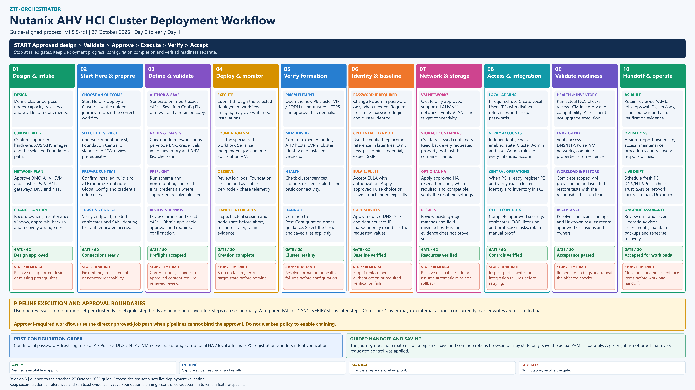

# AHV HCI cluster deployment process

**Revision 3 | 27 October 2026 | v1.8.5-rc1**

Use this process to prepare, deploy, configure and accept an AHV HCI cluster.
Start with **Start Here > Deploy a Cluster**, then use the selected service's
existing execution workflow. Stop at failed gates and inspect actual target
state before retrying. Deployment progress, configuration completion and
verified operational readiness are separate outcomes.

[Full-resolution PNG](assets/process-flows/cluster-deployment-v3.png) ·
[Editable SVG](assets/process-flows/cluster-deployment-v3.svg) ·
[Administrator and User Guide with landscape appendix](manuals/README.md)

## Stage sequence and acceptance gates

| Stage | Actions | Gate before proceeding |
| --- | --- | --- |
| **01 Design and intake** | Define nodes, capacity, resilience and workloads. Review hardware, AOS/AHV and Foundation compatibility. Approve addressing, VLANs, DNS/NTP, ownership, maintenance and recovery arrangements. | Design approved; prerequisites resolved. |
| **02 Start Here and prepare** | Choose Foundation VM, Foundation Central or standalone FCA. Confirm runtime and installed build. Configure endpoint and credential references, establish certificate trust and SAN identity, and test authenticated access. | Connections and runtime ready. |
| **03 Define and validate** | Generate/import exact YAML and save it separately. Review node roles/positions, per-node BMC references, image inventory and AHV ISO checksum. Run applicable schema, preflight and read-only IPMI checks. Review exact targets and obtain required approval/confirmation. | Preflight accepted; approval matches the requested content. |
| **04 Deploy and monitor** | Submit through the selected workflow. Imaging can overwrite node installations. Serialize independent jobs on one Foundation VM. Inspect Foundation sessions, job logs and available node/phase telemetry. | Creation complete; actual target state reconciled before any retry. |
| **05 Verify formation** | Open PE through trusted HTTPS. Confirm cluster identity, expected nodes, AHV hosts, CVMs and installed versions. Check services, storage, resilience and alerts before the post-configuration handoff. | Fresh independent evidence shows the cluster is healthy. |
| **06 Identity and baseline** | Change the PE admin password only if required and verify fresh replacement authentication and cluster identity. Use the replacement credential reference in later files; omit `new_pe_admin_credential` and expect password SKIP. Apply authorized EULA/Pulse choices and required DNS/NTP/data-services IP; read back results. | Required authentication and baseline verification pass. |
| **07 Network and storage** | Create approved supported VM networks and containers. Verify network/VLAN connectivity and every explicitly requested supported container property. Apply compatible HA reservations only if required. | Resources match the approved configuration; missing evidence or field mismatches remain failures. |
| **08 Access and integration** | If required, create local PE administrators using distinct credential references and unique passwords. Verify each account is enabled and has Cluster Admin and User Admin roles. Register PE when PC is ready and verify exact PE identity/inventory. Complete applicable security, certificates, OOB, licensing and protection controls with evidence. | Accounts, integrations and required controls verified. |
| **09 Validate readiness** | Run actual NCC checks and review LCM inventory/compatibility. Verify access, DNS/NTP/Pulse, VM networks, storage and resilience. Complete scoped workload and isolated restore tests with the backup team. Resolve significant findings and Unknown results; record approved exclusions. | Operational acceptance passed. |
| **10 Handoff and operate** | Retain reviewed YAML, job/approval identifiers, versions and sanitized evidence. Assign support/recovery owners. Schedule fresh PE DNS/NTP/Pulse drift checks and review saved Upgrade Advisor assessments. Maintain backups and recovery rehearsals. | Accepted for workloads with ownership and recovery arrangements recorded. |

## Pipelines and approval boundaries

Use one reviewed configuration set per cluster. Each eligible step binds a
workflow or allowlisted script to its saved configuration file. Steps run
sequentially; a required FAIL or CAN'T VERIFY stops later steps. Configure
Cluster can run internal actions concurrently, so a failed step does not undo
earlier writes. Reconcile partial results before rerunning.

Where active policy requires an approval that pipelines cannot bind, use the
direct approved-job path. Do not weaken approval policy to enable chaining.
The pipeline selector is not a substitute for the specialized Foundation VM
execution path. On one Foundation VM, serialize independent deployments and
confirm the previous session has finished.

The post-configuration sequence is: conditional password change and fresh login;
EULA/Pulse; DNS/NTP; supported VM networks and storage; optional HA/local users;
PC registration; independent verification. Keep sensitive stages narrowly scoped.

## Saving and handoff

**Continue to Post-Configuration** opens guidance; it does not choose a target,
copy credentials, build a pipeline or execute it. **Save and continue later**
stores browser journey state only. Save the actual YAML using Config Files or
Download Config and select the reviewed files explicitly.

## Evidence and operating limits

- **Apply:** a verified executable mapping performs the requested action.
- **Evidence:** capture actual readbacks and results for review.
- **Manual:** complete the control separately and retain proof.
- **Blocked:** resolve the gate before mutation.

A successful job does not prove every requested control was applied. Live drift
collection failures remain **Unknown**; certificate trust, IP/SAN mismatch and
network errors must be resolved without disabling TLS verification. Upgrade
Advisor assesses readiness; it does not perform an LCM upgrade. Native Foundation
planning/controlled-adapter boundaries remain specific to that separate feature.

This process is aligned to the supplied 27 October 2026 guide and application
revision `4a010727d5db3496d17a52e4ce681818dcc56200`. It is process documentation,
not evidence of another live deployment. The prerelease designation remains
separate from successful production deployment use; v1.8.4 remains Latest stable.

## Related procedures

- [Start Here and deployment guidance](start-here.md)
- [PE post-configuration verification](pe-post-configuration-verification.md)
- [PE local users and diagnostics](pe-local-users.md)
- [Persistent PE certificate trust](pe-certificate-trust.md)
- [Live PE drift monitoring](live-pe-drift-monitoring.md)
- [Administrator guide](admin-guide.md)
