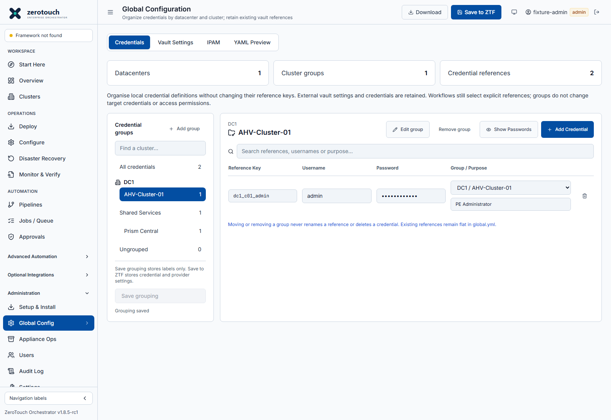
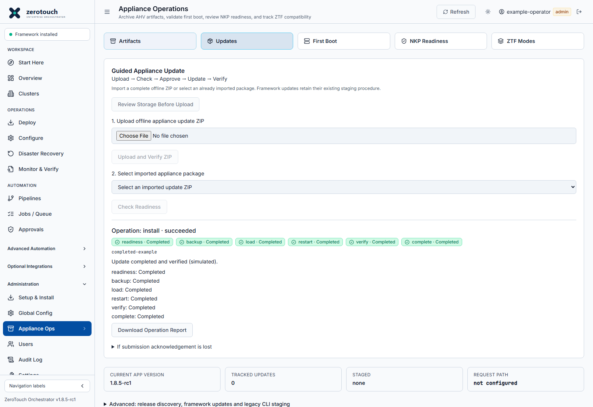

# Credential groups by datacenter and cluster

Updated v1.8.5-rc1 source adds grouping under **Administration > Global Config >
Credentials**. Use cluster groups for PE, CVM, individual BMC references and local
administrator references. Use shared-service groups for services such as Prism
Central and Foundation VM.

Grouping is organisation, not a new vault, tenant boundary or automatic target
binding. Workflow and pipeline YAML still names explicit references. Existing
credential keys stay flat in `global.yml`; do not nest passwords under cluster
names. No credentials are renamed or moved to a different vault by grouping.

## Organise existing references

1. Sign in as an Orchestrator administrator and open **Global Config**.
2. Select **Add group**, choose **Cluster**, enter a datacenter such as `DC1`
   and group name such as `AHV-Cluster-01`, then select **Apply group**.
   This updates a draft, without executing an infrastructure operation.
3. Select **All credentials**. Beside each matching reference, select the
   datacenter/cluster in **Group** and optionally enter its **Purpose**.
4. Select **Save grouping**. This saves only labels and reference assignments;
   it does not write passwords or change `global.yml`.
5. Select a cluster in the group tree to show only its definitions. Search by
   reference, username or purpose. Passwords remain masked by default and are
   never searched. **Ungrouped** retains every existing unassigned definition.
6. Add more clusters and datacenters as required. For a shared service, select
   **Shared service** as the group type. Its reference remains explicitly chosen
   in each consuming configuration; membership does not grant access.

## Add or change credential definitions

**Add Credential** in a cluster view initially assigns the new definition to
that group. Enter a unique reference, username and password, then use **Save to
ZTF** to persist local credential definitions and provider settings. This also
saves pending grouping changes. If that second save fails, the UI explicitly
reports that credential settings were saved but grouping was not.

**Save grouping** and **Save to ZTF** are distinct. Saving labels for a new,
unsaved reference does not create its secret. Retained labels for references
absent from local definitions are flagged; check external-vault availability or
missing references independently. Existing external vault credential maps and
unrelated global settings are retained when local definitions are saved.

Removing a group returns its definitions to **Ungrouped**, preserving credentials
and purposes. Removing a credential is a separate operation: configurations
using its reference may fail after **Save to ZTF**. Changing a reference key also
requires updating consuming YAML; grouping does not rewrite saved configurations.

## Persistence and recovery

Organisation is stored separately as `credential_organization.json`, using the
configured file or PostgreSQL document backend. It contains version/revision,
group names, datacenter labels, reference assignments and purposes. Do not put
secret values in labels. Existing appliance database/data backups retain it.
The downloaded `global.yml` remains runtime configuration and does not contain
these labels; preserve the document backend when transferring organisation.

The new `/api/credential-organization` GET/PUT operations are administrator-only.
Updates check a revision and reject stale saves with HTTP 409. Reload and review
the current grouping before reapplying changes. Invalid or unreadable metadata
is not silently reset. No runtime dependency, database migration or change to
credential lookup is required.

See also [guided appliance updates](guided-appliance-updates.md). Completed
installation stages now show a green check and **Completed**, the active stage
is blue, pending stages are grey, failures are red and interruptions are amber.
Recorded stage entry alone does not establish completion: an earlier recorded
stage becomes complete when execution advances, and final success comes from
the host service's successful completion report.

## Interface examples

These captures use isolated browser-test fixtures and generic references. They
show the implemented interface, not production credentials or a live update.

