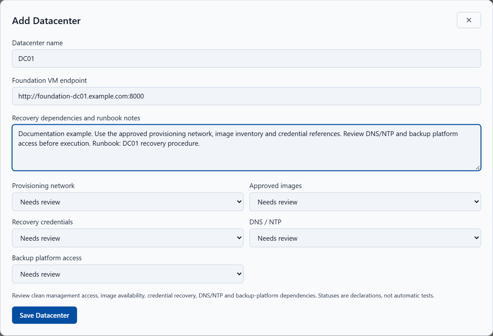
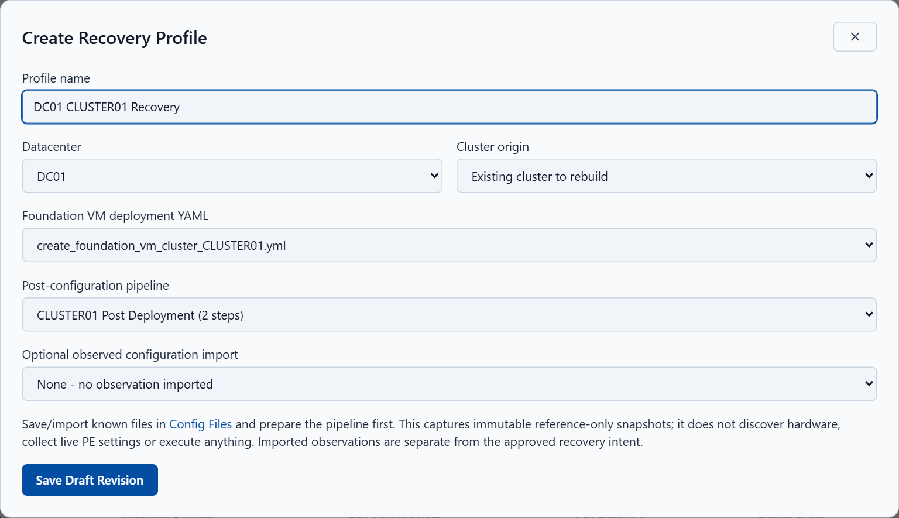
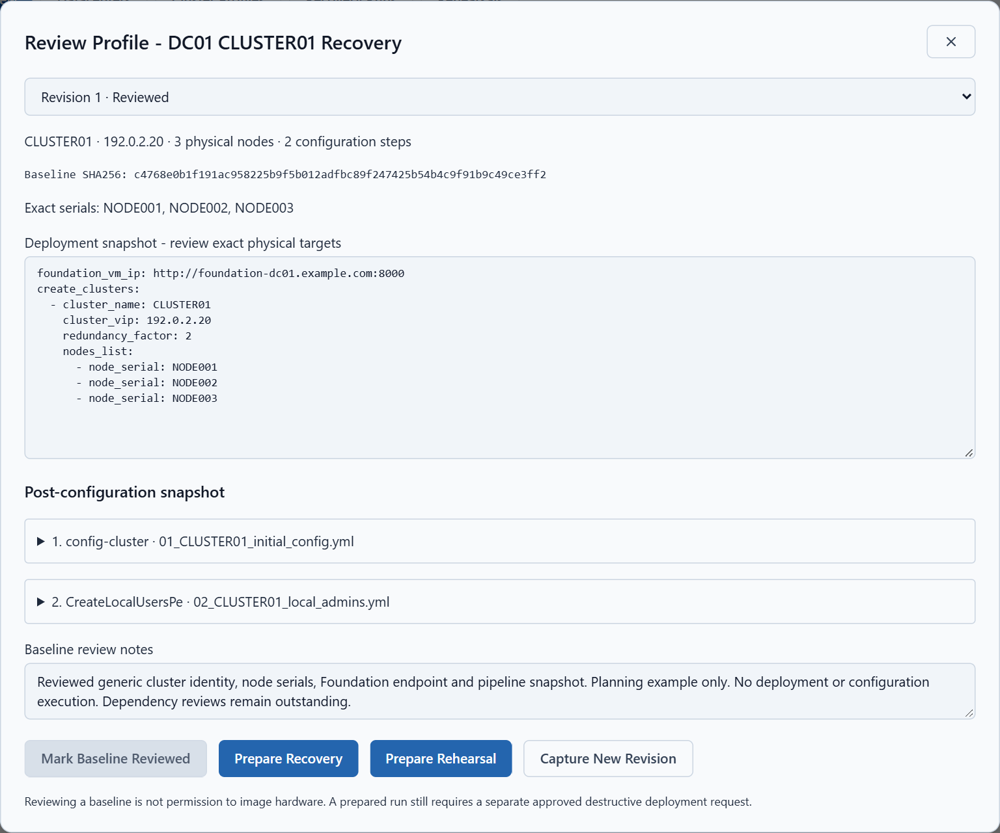

# Illustrated Disaster Recovery setup

Create a datacenter, link a saved **Cluster Create (Foundation VM)** configuration
and post-deployment pipeline, and review the recovery baseline **without deploying**.
This procedure covers **v1.8.5-rc1**, reviewed against source revision
`867fe83f6c90dff1ee785e8caf0fe2b82b969174` on 29 October 2026.
The release remains a prerelease; v1.8.4 remains Latest stable.

- [Read the illustrated PDF guide](manuals/ZTF-Orchestrator-Disaster-Recovery-Setup-v1.8.5-rc1.pdf)
- [Download the editable Word guide](manuals/ZTF-Orchestrator-Disaster-Recovery-Setup-v1.8.5-rc1.docx)
- [Screenshot provenance](assets/disaster-recovery/setup-v1.8.5-rc1/README.md)
- [Recovery execution and operating boundaries](disaster-recovery.md)

The screenshots show the implemented interface with generic **simulated API
records in an isolated browser session**. No live backend, Foundation VM or Prism
system was contacted. The YAML excerpts are illustrations, not complete runnable
templates. These screenshots do not prove appliance activation, backend persistence,
dependency readiness or successful physical recovery.

## 1 Prepare the Foundation VM configuration

Sign in as an administrator. In **Cluster Create (Foundation VM)**, save or import
the approved deployment YAML for **exactly one cluster**. Verify:

- The cluster name and VIP, and the exact physical node serial numbers.
- Foundation VM endpoint, selected images, AHV ISO checksum and network settings.
- Host, CVM and IPMI addressing and credential references.
- Cluster formation is enabled; imaging-only intent is not accepted.

Save the configuration in **Config Files**, for example
`create_foundation_vm_cluster_CLUSTER01.yml`. Use the workflow's non-mutating
**Dry Run**, resolve failures and review the output. **Do not select Run Workflow.**
Saving a recovery profile does not perform these live connectivity or credential
checks for you.

**Expected:** the saved deployment YAML is available and passes applicable
validation; no deployment job starts.

## 2 Prepare the post-deployment pipeline

Open **Pipelines** and save the cluster-specific post-configuration pipeline
without running it. Recovery profiles accept **1–30 steps** using:

- **Configure Cluster** (`config-cluster`).
- **Change Default Admin Password (PE)** (`ChangeDefaultAdminPasswordPe`).
- **Create Local Users (PE)** (`CreateLocalUsersPe`).

Every referenced YAML must target **only the recovery cluster VIP** and specify
the **exact cluster name** used by the Foundation configuration. Keep all passwords
in the existing credential store, using supported references in YAML.

Order supported steps as required: PE password change when needed; EULA, approved
Pulse, DNS and NTP; storage and supported VM networking; local administrators and
remaining supported baseline settings. Check the credential transition after a
password change. Pipeline linkage does not bypass execution approvals.

**Expected:** the saved pipeline, for example `CLUSTER01 Post Deployment`, is
available for selection. Saving it creates no execution job.

## 3 Add the datacenter

Open **Recovery → Disaster Recovery → Add Datacenter**.

| Field | Generic example or instruction |
|---|---|
| Datacenter name | `DC01` |
| Foundation VM endpoint | `http://foundation-dc01.example.com:8000` |
| Recovery dependencies and runbook notes | Record provisioning networks, image locations, credential references, backup access and the runbook reference. |

Use the HTTP(S) **origin**, including port, matching the saved Foundation YAML.
Do not append `/gui/index.html`.

Review **Provisioning network**, **Approved images**, **Recovery credentials**,
**DNS / NTP** and **Backup platform access**. Leave each as **Needs review** until
actually checked. These statuses are operator declarations, not automatic probes.
Select **Save Datacenter**.

*Figure 1. Isolated UI example; no actual dependency reviews or infrastructure changes.*

**Expected:** the datacenter is available for profile selection. If none exists,
**Create Recovery Profile** is disabled.

## 4 Create and link the recovery cluster profile

Select **Create Recovery Profile** and complete:

| Field | Selection |
|---|---|
| Profile name | `DC01 CLUSTER01 Recovery` |
| Datacenter | `DC01` |
| Cluster origin | **Existing cluster to rebuild**, or **New cluster** as appropriate |
| Foundation VM deployment YAML | `create_foundation_vm_cluster_CLUSTER01.yml` |
| Post-configuration pipeline | `CLUSTER01 Post Deployment` |
| Optional observed configuration import | Leave unselected unless a suitable saved observation is available. |

An observation remains separately labelled operator-supplied data. It is not live
discovery and does not replace the desired recovery baseline.
Select **Save Draft Revision**.

*Figure 2. Isolated UI example showing both links before saving the draft.*

**Expected:** Revision 1 appears with a **draft** review status; no Foundation job starts.

## 5 Review the captured baseline

Select **Review Profile**. Confirm the cluster name, VIP, node count, exact serials,
deployment snapshot, image references and checksum. Expand each post-configuration
snapshot and check its action, order and configuration. Review credential
references, including those required after any password change.

Record **Baseline SHA256** and enter **Baseline review notes** describing the
actual review performed. Select **Mark Baseline Reviewed** only when that review
is complete. A reviewed baseline does not mean the datacenter prerequisites have
been verified or that deployment is authorized.

*Figure 3. Simulated reviewed baseline. Prepare Recovery and Prepare Rehearsal
are visible for orientation only; neither was selected. Dependency reviews remain
outstanding. The abbreviated YAML is not a deployment template.*

**Expected:** the latest revision is **reviewed**, with review information retained.

## 6 Verify the setup without deploying

Close the profile, refresh and reopen it. Optionally sign out and sign in again.
Check the following in your actual installation:

- The datacenter and profile remain present.
- The correct deployment YAML and pipeline are linked.
- Reviewed revision, captured contents and SHA256 remain unchanged.
- Review notes and reviewer information are retained.
- **Jobs / Queue** contains no new deployment or configuration job from these steps.
- **Recovery Runs** and **Rehearsals** contain no new run from these steps.

**Stop here.** Do not select **Prepare Recovery**, **Prepare Rehearsal**,
**Deploy Reviewed Recovery** or run the pipeline during setup verification.
Deployed rehearsals perform real infrastructure changes.

**Expected:** a persistent reviewed recovery plan, with no infrastructure execution.
The isolated screenshots illustrate the interface; they do not substitute for
these checks on your appliance.

## 7 Maintain revisions and resolve setup issues

Editing saved deployment YAML or a pipeline can flag a profile as **baseline
changed**. Use **Review Profile → Capture New Revision**, save the new snapshot,
review it and mark the new baseline reviewed. Older revisions remain inspectable.
Credential references are captured; resolved secret values are not frozen.

| Symptom | Resolution |
|---|---|
| Create Recovery Profile disabled | Create a datacenter first and use an administrator account. |
| Endpoint mismatch | Match the datacenter origin and deployment YAML, including protocol and port. |
| Incomplete Foundation configuration | Correct it in the Foundation VM workflow and repeat non-mutating validation. |
| Pipeline rejected | Use 1–30 supported steps; every file must target only the same VIP and exact cluster name. |
| Secret field rejected | Use supported credential references and remove literal secrets. |
| Baseline changed | Capture and review a new revision. |

The outcome is a saved, reviewed plan. Reachability, actual cluster health and
successful physical recovery require separate validation. See the
[full recovery operating guide](disaster-recovery.md) before planning execution.
