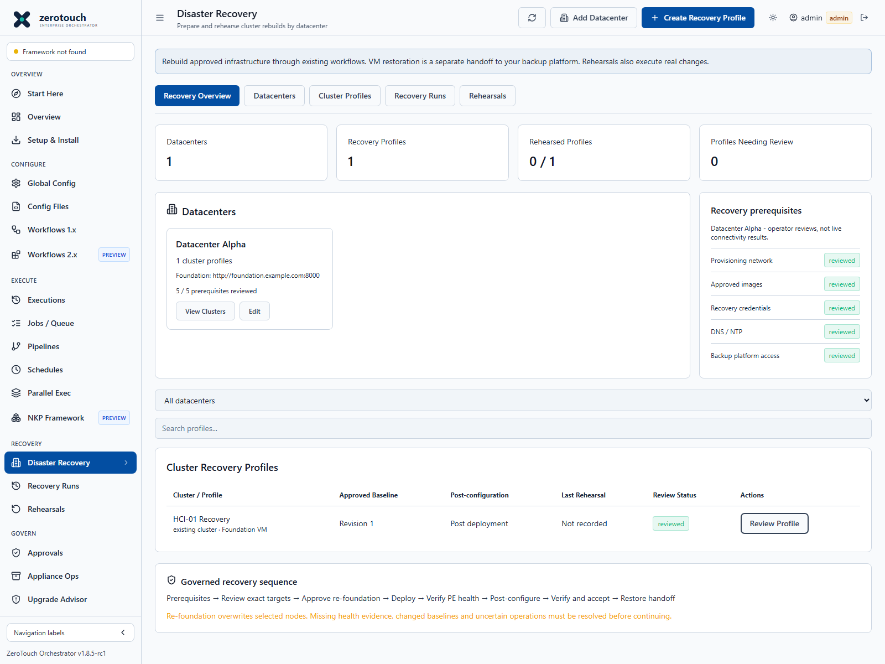

# Disaster Recovery: datacenters and cluster rebuilds

The **Recovery → Disaster Recovery** section groups cluster recovery profiles by
datacenter. Each profile captures a versioned Foundation VM configuration and a
saved post-configuration pipeline. Recovery runs and rehearsals execute through
the existing governed job APIs. They rebuild infrastructure; VM and application
restoration belongs to the backup platform.

This section is implemented in source for v1.8.5-rc1. It has isolated lifecycle,
API and UI tests. Those tests do not establish live recovery success, recovery
time objectives, vendor certification or cleanliness after a cyber incident.
The existing successful cluster deployment evidence is distinct from validation
of this new coordinator. No new runtime dependencies are required.

The screenshot is from an isolated software smoke test with generic fixtures.
It is not a production environment or evidence of a physical recovery run.

## Prepare the recovery baseline

1. Contain the incident and obtain recovery authorization. Establish trusted
   provisioning networks, credentials, software images and an Orchestrator that
   is outside the compromised trust boundary. Retain forensic evidence separately.
2. Save a valid **Cluster Create (Foundation VM)** configuration for one cluster.
   Include the real node identities, endpoint, images/checksum, network settings
   and credential references. Test the normal workflow's non-mutating validation
   and certificate/credential checks. Saving a recovery profile does not perform
   these live checks or prove that the dependencies are reachable.
3. Save the post-configuration pipeline. Each step must target only that cluster
   VIP and exact cluster name. Supported actions are **Configure Cluster**,
   **Change Default Admin Password (PE)** and **Create Local Users (PE)**.
   Keep passwords in the existing credential store, not the YAML. The recovery
   snapshot parser rejects literal password, secret, token and private-key fields.
4. Open **Disaster Recovery → Add Datacenter**. Give it a name, the Foundation VM
   HTTP(S) origin (for example `http://foundation.example.com:8000`), recovery notes
   and a review status for networking, images, credentials, DNS/NTP and backup
   access. These are dated operator reviews, not automatic connectivity probes.
5. Select **Create Recovery Profile**. Choose the datacenter, existing/new cluster
   classification, saved deployment file and pipeline. Optionally import a saved
   observation file. Observations remain separately labelled operator imports;
   they do not replace the approved desired configuration or imply live discovery.
6. Open the profile, inspect the deployment YAML, target node set, pipeline steps
   and SHA-256 fingerprint. Record baseline review notes. Every recapture adds an
   immutable revision; old revisions remain available for inspection. Execution
   preparation uses the latest reviewed revision.

Saved-file or pipeline changes flag the profile for review and block deployment
of a prepared run until a matching baseline is captured and reviewed. Credential
references are frozen; resolved secret values are not. Revalidate credential
availability and correctness before execution. Baselines are desired-state
snapshots, not automatic exports of all current cluster settings.

## Rebuild or rehearse

1. Choose **Prepare Recovery** or **Prepare Rehearsal** from the reviewed profile.
   Both prepare an immutable run. **A rehearsal performs real destructive changes**
   when deployed; use explicitly approved rehearsal targets. Preparation itself
   submits no deployment jobs.
2. Request deployment approval from the run. A different administrator must
   approve the exact run YAML in **Approvals**. Baseline review alone is not
   execution approval. Approval must be unexpired, unused and match the exact
   configuration and run-specific filename.
3. Review the cluster name, VIP, nodes, endpoint and baseline hash. Enter both
   `REFOUNDATION <cluster-name>` and `DEPLOY FOUNDATION VM`, acknowledge imaging
   risk and deploy. Existing administrator, mutation, validation and approval
   gates still apply. One Foundation endpoint or overlapping node set cannot
   have concurrent deployments through this application process.
4. Follow the linked deployment job for Foundation's phase/node telemetry and
   logs. A failed, interrupted or uncertain deployment requires reconciliation.
   No automatic imaging retry or rollback is performed.
5. After job success, independently open PE, verify the exact cluster identity,
   expected membership and services. Record health notes and an evidence
   reference in the run. This is explicitly an **operator attestation**, not
   automatically collected live health. Start post-configuration within 15
   minutes; renew the health evidence if necessary.
6. Select **Run Remaining Pipeline Steps**. Eligible steps are submitted
   sequentially as durable jobs from the immutable snapshots. PE scripts require
   their exact `RUN <script-id[,script-id]>` acknowledgement. The initiating
   administrator's session is rechecked on each submission; expiry or changed
   permissions stop further submissions. No session token is stored in recovery
   records. A failed or unverified step prevents later steps from starting.
7. If policy requires a step's own approval, unattended chaining is rejected.
   Download its exact snapshot, submit it through the existing direct workflow
   or script with the required approval/confirmation, then link the successful
   job using **Link Next Approved Direct Job**. The action, YAML and health-check
   timing must match. One job cannot satisfy multiple steps. Do not disable
   approval policy to make a pipeline run.
8. Independently read back the requested settings and current cluster health.
   Record final evidence and accept the run for backup-platform restore handoff.
   Retain job evidence until acceptance. Acceptance does not restore VMs, prove
   application availability or declare the environment free of compromise.

## Interruptions and reconciliation

- **Stop Orchestration** requests job cancellation and stops subsequent steps.
  Foundation or an in-flight write may continue. It is not a confirmed Foundation
  abort. Inspect the Foundation session and actual target state separately.
- A server restart never replays imaging/configuration. Incomplete orchestration
  is marked for reconciliation; interrupted jobs follow the normal Jobs policy.
- Close a run only after active jobs have ended, the Foundation session has ended
  and actual target state has been reconciled. Evidence notes are mandatory.
- A successfully deployed cluster can resume remaining configuration only after
  explicit reconciliation and fresh health evidence. An uncertain pending password
  change cannot be automatically replayed; use the existing direct workflow to
  reconcile credentials first. Completed steps remain recorded.
- Endpoint/node ownership remains reserved through configuration and acceptance,
  including uncertainty. Complete or reconcile the run before another rebuild.
  Datacenter/profile edits are blocked while their recovery run is active.
- Accepted rehearsal history records the baseline revision and timestamps. It is
  not a current readiness certificate, and dependencies can change afterward.

## Persistence, access and scope

The additive `/api/recovery` API uses the existing authentication, rate limiting
and generic JSON storage. Datacenters, revisions, run snapshots and evidence are
stored in `recovery.json` for file storage or the existing PostgreSQL document
store. No SQL migration is introduced. Include these records, job payloads,
configuration files and the credential store in the established backup plan.
Unreadable recovery storage fails closed rather than silently discarding locks.
Do not remove records or job evidence to clear an execution gate.

Administrators create/review/run recovery actions. Operators and viewers can
inspect records. The static demo is explicitly read-only and uses simulated
data; recovery writes never fall back to a live API.

The coordinator supports the current **single application process** deployment.
Its submission/ownership lock is not a distributed lock; multiple replicas or
external Foundation clients can bypass that serialization. Coordinate those
clients operationally. Separate Foundation VMs and disjoint nodes can have
separate runs, subject to job-worker capacity. This initial section supports
classic Foundation VM and one cluster per profile, not Foundation Central/FCA
recovery execution, cross-site dependency scheduling, automatic RTO measurement,
automatic credential recovery, backup restoration or forensic remediation.

## Implementation validation

Before production recovery use, rehearse a complete authorized rebuild and
post-configuration run on representative disposable hardware, including a
deliberate failure, session expiry, service restart, reconciliation and restore
handoff. Compare actual PE readbacks with the saved baseline. Isolated software
tests and browser smoke checks are separate from that physical exercise.

Related: [Infrastructure Recovery Guide](infrastructure-recovery.md),
[Recovery Rehearsal Checklist](recovery-rehearsal-checklist.md),
[Start Here](start-here.md), [Administrator Guide](admin-guide.md).
