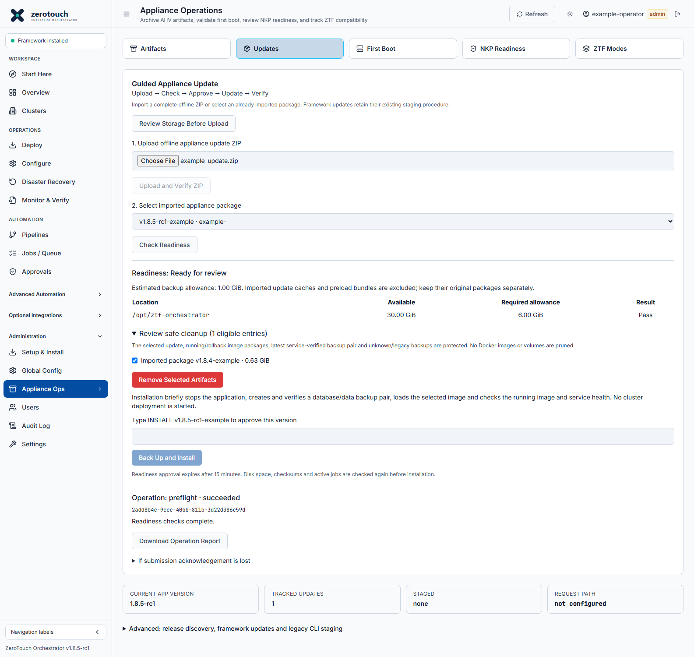

# Guided appliance updates

Updated source builds add **Appliance Ops → Updates → Guided Appliance Update**.
After the host service is installed once, routine supported appliance ZIP updates
can be requested in the console without SSH. This is an opt-in addition to the
existing CLI procedure, not a release promotion or automatic installation policy.



Illustration captured from the implemented console with simulated browser fixtures.
The pictured versions, capacity and operation identifiers are examples, not live
appliance update evidence.

## One-time host installation

Bundles built with `--include-host-service` contain `host-service/README.md`, the
checksummed worker/installer, a Compose migration helper and explicit bootstrap
instructions. Verify the bundle, then run its `bootstrap-guided-updates.sh
--maintenance-confirmed` on the idle appliance. It backs up host configuration and
preserves resolved TLS mounts, ports, networks and named volumes while adding the
restricted spool mounts. No container is restarted by host installation itself.
The matching application image is applied separately using the bundled instructions.

The CLI helper shipped in this kit also excludes reproducible imported update
caches and preload bundles from its data snapshot; keep those sources separately.

Use a reviewed source checkout containing this feature at `/opt/ztf-orchestrator`.
Existing appliances need an administrator to install the service and apply the
new Compose mounts during a planned, backed-up application cutover. Uploading an
application image alone does **not** install or upgrade host services or Compose.
New appliance firstboot installs the service before starting the application.

1. Complete/reconcile active automation. Retain the previous image, database/data
   backups and the existing Compose and `.env` before the initial cutover.
2. Review `appliance/update_service.py`, the installer and the systemd unit from
   the same trusted source revision as the updated application.
3. Install the service (requires the appliance's existing Python 3, Docker Compose
   plugin and systemd; no new Python or JavaScript runtime dependencies):

   ```bash
   sudo bash /opt/ztf-orchestrator/appliance/scripts/install-update-service.sh
   sudo systemctl status ztf-update-service --no-pager
   ```

   The installer creates the `ztf-updates` host group and records its numeric ID
   as `ZTF_UPDATE_SERVICE_GID` in the host `.env`. Only the request directory is
   writable by that group. The results directory is mounted read-only into the
   application; private plans, backups and worker state remain host-controlled.

4. As part of the approved initial application update, use the revised
   `appliance/docker-compose.appliance.yml` and a feature-containing application
   image. Preserve existing configuration and volume names. Recreate only the
   application service, following the existing upgrade/rollback runbook:

   ```bash
   sudo docker compose --env-file /opt/ztf-orchestrator/.env \
     -f /opt/ztf-orchestrator/appliance/docker-compose.appliance.yml \
     up -d --no-deps --no-build --pull never ztf-orchestrator
   ```

5. Sign in as an administrator. Open **Appliance Ops → Updates**. The host service
   should be available. Missing or stale service results disable installation;
   the legacy release import/staging controls remain available below.

This bootstrap requires CLI access once. The web application cannot install its
own privileged host service. Do not expose a Docker socket to solve this boundary.

## Routine console procedure

If space is too low to upload, first select **Review Storage Before Upload**.
Review and remove only eligible entries, then upload the ZIP. A storage-only plan
can authorize selected cleanup but can never approve installation.

1. Obtain a complete trusted offline update ZIP and its independently published
   checksum. SHA-256 verifies integrity, not publisher identity; a checksum inside
   an untrusted ZIP is not proof of authenticity. Use approved release sources.
2. Upload the ZIP using **Upload and Verify ZIP**, or select a previously imported
   appliance package. Existing import checks validate manifest paths and artifact
   checksums. No installation occurs during import.
3. Select **Check Readiness**. The host re-hashes the image, checks its exact Docker
   tag and guided-update protocol label, checks Compose/database accessibility,
   blocks queued/running automation and estimates disk requirements. It checks the
   active streamed pipeline/framework tasks as well as Jobs / Queue. It checks the
   backup/data and Docker/containerd storage locations separately. Capacity uses
   conservative uncompressed backup, database, image expansion and reserve allowances;
   it may require more free space than the eventual compressed backup consumes.
   Gzip image layers are streamed to measure expansion before installation. Zstd
   layer archives and images exceeding 64 GiB expanded are rejected; use the
   documented supported archive format or the reviewed legacy procedure.
4. If needed, expand **Review safe cleanup**. Select only listed obsolete artifacts
   and approve **Remove Selected Artifacts**. Then run readiness again. Nothing is
   automatically pruned. The selected package, running/rollback image packages,
   latest service-verified backup pair, unknown packages and legacy backups are
   protected. Docker images, containers, volumes and live configuration are never
   pruned by this cleanup operation. Deleted package records remain historical;
   their missing image files are excluded from the guided package selector.
5. Review the exact target version and interruption. Type **INSTALL &lt;version&gt;**
   exactly as shown, then select **Back Up and Install**. Approval is bound to the
   host's immutable readiness plan, which expires after 15 minutes and is single-use
   for installation. Space, image bytes, installed image and jobs are rechecked.
6. The service blocks new application mutations and execution, stops the application
   service only, then creates and verifies the PostgreSQL/data backup pair. PostgreSQL
   remains running. Imported update-package caches and preload bundles are excluded;
   retain original packages and separately managed preload sources for recovery.
   The data archive also contains a protected `__appliance_host_backup__` directory
   with the host `.env` and appliance Compose file. Treat the archive as sensitive.
7. The host loads a private checksum-verified image copy, changes only the appliance
   version setting, verifies the rendered Compose image and recreates the application
   without rebuilding, pulling or recreating PostgreSQL. It checks the exact running
   image ID/tag, installed application version, health endpoint and database readiness.
8. The browser may disconnect during restart. Reconnect or sign in again and open
   Updates. Progress is stored on the host, not in the application process. **Do not
   resubmit because a response was lost.** Review the operation ID and retained report.
   Download the JSON operation report after completion. Check existing pipelines,
   recovery profiles, credentials and required operational functions before resuming work.

## Failure and recovery

- Failed readiness checks do not stop the application. Correct the reported issue
  and generate a new plan. Unreadable or failed backups do not permit new-image startup.
- If backup/loading fails before any new-version process starts, the service attempts
  to bring back the previous application. A service restart in that same pre-start
  window can also restart the old application; it never replays the installation.
- Once the new image may have started, interrupted/failed verification keeps maintenance
  active. Do not assume the database is compatible or restore it over a running service.
- The **Recovery: previous application image** control requires independent database
  compatibility confirmation and **ROLLBACK &lt;previous version&gt;**. It verifies the
  retained image ID and restores the application image only, with no pull or rebuild.
  It does not automatically restore PostgreSQL, configuration data or host settings.
- If database/data restoration is required, follow the existing approved host recovery
  procedure using the matching receipt and backup pair. Manual reconciliation is also
  required for unsupported custom layouts or a lost private service state directory.
- If the new application cannot serve the console at all, use the host/VM recovery
  procedure. The worker retains progress but does not expose a separate recovery web
  server. GUI rollback is available only while the application console is reachable.
- Root-only service state is under `/var/lib/ztf-update-service/private`; sanitized
  operation reports are under `results`. Verified backup pairs and hash receipts are
  under `/opt/ztf-orchestrator/update-artifacts/pre-update-backups/guided-*`.

## Compatibility and boundaries

Guided installation supports complete offline appliance Docker image packages,
the named appliance data volume and PostgreSQL appliance layout. Target images
must include `io.ztf.appliance-update-protocol=1`; older images and framework updates
use the existing procedure. There is no arbitrary host command, URL, path, image
namespace or automatic database-restore operation in this interface.

Connected release discovery remains metadata-only. Connected downloads, unattended
updates, arbitrary image pruning and automated database rollback are not enabled.
The host service itself is upgraded separately from the application image, after
review and within a maintenance window.

Validation of the implementation uses isolated file/archive tests, authenticated
API tests and browser fixtures. A full Linux/systemd appliance cutover and restore
rehearsal must be completed in UAT before production enablement. Test doubles are
not evidence that a real appliance update or recovery has run successfully.

The disposable PostgreSQL smoke test performs a real dump, archive listing and
restore/readback against its own temporary database container. The host-protocol
smoke runs the real Linux daemon with non-root request/result permissions, but
simulates Docker responses. Neither test modifies an existing appliance.
