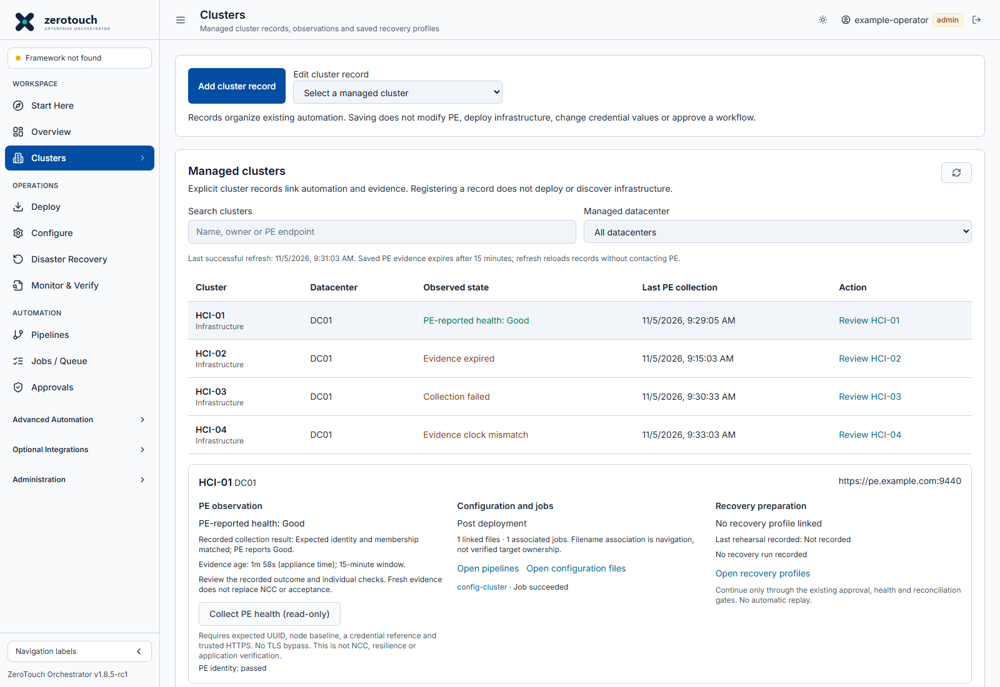

# PE health reporting: evidence age and collection outcomes

Source update for v1.8.5-rc1. This changes reporting, not deployment or recovery gates. Existing appliance ZIPs retain their original contents; install the consolidated update containing this fix.

## What each state means

| State | Meaning | Operator action |
|---|---|---|
| PE-reported health: Good | Fresh readback matched the expected UUID, name and complete physical membership, with explicit PE cluster/host Good reports | Review age and individual checks; this does not replace NCC or acceptance |
| Evidence expired | Saved evidence is older than 15 minutes according to appliance time | Collect a new PE health readback |
| Collection failed | The latest request failed, including connection/TLS, credential or unsupported-response failures | Review the safe collection message, fix the connection/trust/reference issue and collect again |
| Evidence clock mismatch | The evidence timestamp is ahead of appliance time | Check appliance time/NTP and collect new evidence |
| Invalid evidence timestamp | Timestamp cannot be parsed or has no timezone | Collect new timestamped evidence; inspect old/imported operational metadata if it persists |
| Unknown / review required | Collection completed but health/identity/membership is missing or mismatched, or the baseline/outcome is unavailable | Review checks and independently verify baseline/API compatibility |
| Not checked | No saved observation exists | Configure the baseline and collect PE health |
| Dashboard refresh failed | The console could not reload operational records | Restore console/API connectivity and refresh; this does not establish a PE collection failure |

A collection failure remains visible even when its attempt is older than 15 minutes. Its age line also says the evidence window expired. Unsupported or missing health fields never become Good just because the HTTPS request succeeded. Older records without an explicit collection outcome remain compatible; an old Unknown record is not retroactively classified as a known connection failure. Collect again for the new outcome metadata.

## Specific collection failure messages

Updated source preserves the cause of a failed verified-HTTPS read. The recorded collection result identifies **cluster identity/health** or **host inventory/health**, followed by safe, application-authored guidance:

| Message | Meaning and action |
|---|---|
| Credential reference could not be resolved | Check the exact saved reference and selected vault. No PE authentication was attempted. |
| Authentication rejected (HTTP 401) | Check the selected username/current password and account state; avoid repeated retries that could lock an account. |
| Access denied (HTTP 403) | Check account permissions and PE access policy. This alone does not prove that the password is wrong. |
| TLS certificate trust failed | Install the approved issuer/CA chain in persistent container trust. |
| TLS hostname/IP mismatch | The target is not covered by the certificate SAN; use a covered reachable name/IP or replace the certificate. |
| TLS certificate validity failed | Check certificate dates and appliance UTC/NTP. |
| TLS trust configuration could not be loaded | Check the container CA bundle and SSL_CERT_FILE configuration. |
| TLS handshake failed | Check the HTTPS port and supported TLS configuration. |
| DNS resolution failed | Check the target hostname and container DNS. |
| Network timeout / connection refused / network unreachable | Check routing, firewall access, configured port and PE responsiveness as indicated. |
| API returned HTTP status / invalid JSON / unsupported response format | Check PE service availability, endpoint and API compatibility. Redirects are not followed. |

Messages do not include raw exception strings, response bodies, authorization headers or passwords. Unknown internal failures keep a generic safe message rather than echoing arbitrary text. These are failed collections, not a claim that the cluster is unhealthy. Existing recorded failures retain their old message until an authorized new collection replaces them.

The Upgrade Advisor's existing inventory error contract is retained; detailed diagnostics are requested only by the PE operational-health collector. No new response field, database migration or runtime dependency is required.

## Browser and appliance clocks

Evidence age is computed against the appliance response timestamp. The browser advances that age with elapsed monotonic time while displaying the response; changing the workstation wall clock does not expire a recent valid observation.

A browser/appliance time difference of more than 60 seconds produces a separate clock warning. Check workstation and appliance time/NTP. This is a relative time check, not proof of absolute UTC accuracy; a delayed response can also contribute to a difference. A timezone display setting alone does not create a mismatch when the underlying UTC instants agree. The warning does not silently discard a fresh, valid appliance readback.

Invalid or future evidence timestamps still fail closed. Local display timers do not collect PE or submit any job. Closing/hiding the page does not create a PE monitoring schedule.

## Collect and review

1. Open **Overview** or **Clusters**, then **Review** the intended cluster.
2. Confirm its PE HTTPS endpoint, credential reference, independently verified UUID and complete node baseline. Trusted certificate and hostname/SAN verification remain mandatory.
3. Select **Collect PE health (read-only)** as an administrator or operator. Viewers cannot collect.
4. Review the primary state, **Last PE collection**, evidence age, collection completion time, safe message and individual checks.
5. If evidence expired, collect again. If collection failed, resolve the credential, certificate trust/SAN, connectivity or API issue before retrying. If refresh failed, fix the dashboard/API connection first.
6. Review historical attention items separately. A later successful readback does not automatically close earlier review obligations.

**Refresh** reloads saved records. It does not query PE. The collector still makes only the two existing fixed verified-HTTPS GETs; it introduces no TLS bypass, redirects, extra permissions or live writes. A failed new collection replaces an old Good observation.

## Attention, compatibility and rollback

Attention titles distinguish expired evidence, failed collection, future timestamps and invalid timestamps. Existing review identities, notes, owners and history remain. Refining a title alone does not reopen a resolved/acknowledged item; a new failed observation or existing expiry transition can still reopen it under the prior rules.

The API adds transient `observationDiagnostics` (state, age, 900-second TTL and safe guidance). New saved observations add `collectionStatus` (`completed`, `failed`, `not_attempted`). Existing observation health values (`good`, `unknown`, `not_good`) and `observationFresh` remain. No database migration, credential/reference rewriting or change to recovery evidence is introduced. Older builds ignore the new outcome field and retain their older generic display/clock behavior after rollback.

The screenshot uses simulated generic browser fixtures. It is UI evidence, not a live PE health assessment.
