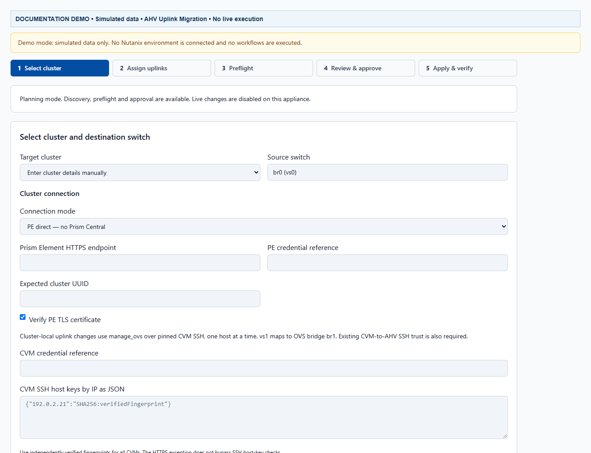

# AHV Uplink Migration Quick Guide

Guide ID: `QG-O-ahv-uplink-migration` · Reviewed: 20 November 2026 · Source: `79c3ecc`

Status: Current source procedure. Read [Using the quick guides](../using-the-guides.md) first.

## Purpose

Move selected physical uplinks to a reviewed destination switch, one healthy AHV host at a time.

## Prerequisites

Use an Orchestrator administrator. Complete the common preparation checklist and confirm the target/build and a reviewed recovery plan before any change.

## Required inputs

Administrator; 3–16 healthy AHV hosts; reviewed fabric/VLAN/MTU and out-of-band access. For PE direct prepare PE HTTPS endpoint/UUID/reference, CVM nutanix reference and independently verified SSH pins for every CVM. Strict CVM-to-local-AHV SSH trust must already work.

## Procedure

1. Open Configure → AHV Uplink Migration. Choose PE direct — no Prism Central unless you deliberately need the PC-managed transport. Keep Verify PE TLS certificate selected; use only the documented per-run, reasoned exception if separately approved.
2. Paste one valid JSON object mapping all CVM IPv4 addresses to their independently verified SHA256: host-key fingerprints. Do not paste separate JSON objects per line. A pin has SHA256: followed by 43 base64 characters; no trailing full stop. Verify identity through a trusted console; an unverified key scan is insufficient.
3. Run Discover cluster (read-only) and review serials, health and current OVS membership. Choose a new or consistently existing destination. In PE-direct mode vs1 means local bridge br1, not a PC distributed-switch object.
4. Assign at least two destination uplinks per host while retaining at least two operational br0 uplinks. A new destination therefore needs at least four suitable physical NICs on every host. Check the real cabling and VLAN/MTU design independently.
5. Run Preflight, review the hashed plan and obtain a different administrator's approval. Planning mode permits no live changes. Apply only after the deployment owner has validated and enabled the exact transport/hardware combination; follow the displayed cluster-bound confirmation.

## Validation and expected result

Verify each host's retained and destination uplinks plus PE/PC reachability, cluster health and real guest VLAN connectivity before accepting the migration.

## Failure and recovery

Live writes default off. Missing pins, inconsistent inventory or unhealthy hosts block execution. A disconnect may leave a host changed; inspect OVS and durable job state before another request. Workload subnet moves and CVM backplane segmentation are separate procedures.

## Evidence to capture

Record the exact target, installed build, reviewed config filename/hash, approval if applicable, job/task/run IDs and redacted before/after checks. Keep unresolved follow-up with the change record.

## Screen reference

Local demonstration of **Configure / initial draft** at `/configure/ahv-uplink-migration`, captured from source `79c3ecc` on 20 November 2026. Values and credential references are synthetic; required fields may intentionally be incomplete. This is the initial screen or selected configuration panel, not evidence of a successful run. Lower form sections may be outside the captured viewport. Follow this guide's preparation, approval and verification steps.

## References

- [Detailed procedure](../../ahv-uplink-migration.md)
- [Route and access controls](../../../src/App.tsx)
- [Guide index](../README.md)
