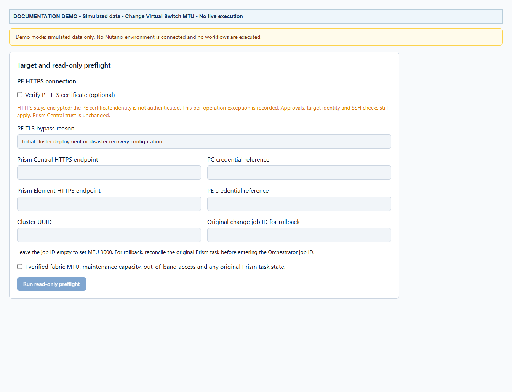

# Change Virtual Switch MTU Quick Guide

Guide ID: `QG-O-change-virtual-switch-mtu` · Reviewed: 21 November 2026 · Source: `48eb875`

Status: Current source procedure. Read [Using the quick guides](../using-the-guides.md) first.

## Purpose

Change default vs0/br0 physical-uplink MTU from 1500 to 9000 through the guarded PC-managed operation.

## Prerequisites

Use an Orchestrator administrator. Complete the common preparation checklist and confirm the target/build and a reviewed recovery plan before any change.

## Required inputs

Administrator; healthy 3–16 host AHV cluster, active-backup bond, trusted PC/PE HTTPS endpoints and references, cluster UUID, verified physical jumbo-frame support, maintenance capacity and out-of-band access.

## Procedure

1. After registration and any planned uplink migration, open Advanced Automation → Scripts → Change Virtual Switch MTU.
2. Run read-only preflight. Review the default switch and every physical uplink's observed MTU; missing or mismatched host evidence blocks Apply.
3. Review the plan and obtain a different administrator's approval. Live writes default off pending exact PC/AOS/AHV hardware validation.
4. When approved live operation is available, type the displayed cluster-bound confirmation and submit once. Keep quick mode off and preserve the existing bond/uplinks.

## Validation and expected result

Review the Prism task and per-host physical-NIC readback. Test end-to-end traffic over intended VLANs; keep CVM interface MTU at 1500 as specified by the detailed procedure.

## Failure and recovery

Readback is not end-to-end jumbo-frame proof. Reconcile actual switch and NIC state after an interruption; application/container rollback does not restore network configuration.

## Evidence to capture

Record the exact target, installed build, reviewed config filename/hash, approval if applicable, job/task/run IDs and redacted before/after checks. Keep unresolved follow-up with the change record.

## References

- [Detailed procedure](../../change-virtual-switch-mtu.md)
- [Route and access controls](../../../src/App.tsx)
- [Guide index](../README.md)

## Screen reference

Simulated initial/authoring view captured 21 November 2026 from application source `48eb875`. State: **Configure / initial draft** at `/scripts/change-virtual-switch-mtu`. Values are synthetic and required inputs may be incomplete. This is not evidence of a successful run, live target authentication or hardware compatibility. Lower form sections may be outside the captured viewport. Follow the preparation, approval, verification and recovery instructions.
