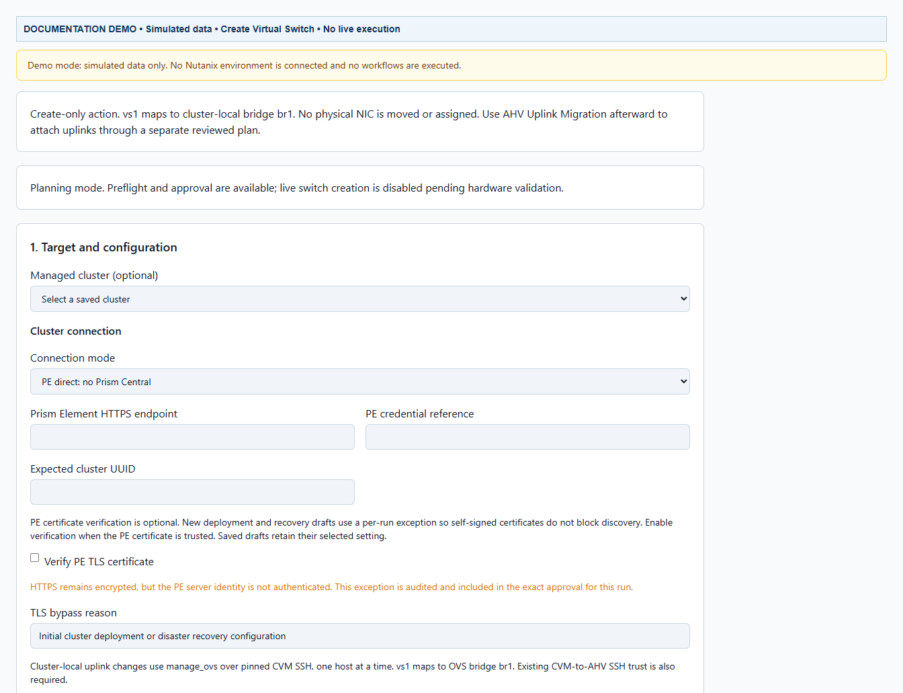

# Create Virtual Switch Quick Guide

Guide ID: `QG-O-create-virtual-switch` · Reviewed: 21 November 2026 · Source: `48eb875`

Status: Current source procedure. Read [Using the quick guides](../using-the-guides.md) first.

## Purpose

Create an empty cluster-local AHV OVS bridge without moving physical uplinks.

## Prerequisites

Use an Orchestrator administrator. Complete the common preparation checklist and confirm the target/build and a reviewed recovery plan before any change.

## Required inputs

Administrator; independently confirmed PE endpoint and cluster UUID, saved PE and CVM credential references, verified CVM SSH fingerprints, healthy hosts and out-of-band access.

## Procedure

1. Open Configure > Create Virtual Switch. Select the cluster and review the per-operation PE TLS choice and exception reason. Prefer verification when the certificate is trusted.
2. Supply the CVM credential reference and independently verified fingerprints for every CVM. HTTPS exceptions never bypass SSH identity checks. Select a new name from vs1 through vs999; vs1 maps to br1.
3. Review prior jobs and reconcile any uncertain operation. Generate or download the YAML, then run read-only preflight and inspect every host and the exact plan hash.
4. Request approval from a different administrator for the exact canonical plan. After representative hardware validation and deployment-owner enablement, enter CREATE SWITCH followed by the cluster UUID and switch name, and submit once.
5. Verify each created bridge is empty and that observed br0, physical NICs, serials and management addresses are unchanged. Use the separate AHV Uplink Migration action and a fresh preflight/approval to attach NICs later.

## Validation and expected result

Per-host readback shows the expected empty bridge; reported MTU is observed evidence, not a requested change. Retain the exact plan, independent approval and durable job diagnostics.

## Failure and recovery

Packaged builds enable reviewed creation by default; explicit false overrides retain planning mode. Response loss, failed readback or ambiguous state stops later hosts. No write is automatically retried or rolled back. Reconcile actual state and obtain a fresh exact-plan approval before continuing.

## Evidence to capture

Record the exact target, installed build, reviewed config filename/hash, approval if applicable, job/task/run IDs and redacted before/after checks. Keep unresolved follow-up with the change record.

## References

- [Detailed procedure](../../create-virtual-switch.md)
- [Route and access controls](../../../src/App.tsx)
- [Guide index](../README.md)

## Screen reference

Simulated initial/authoring view captured 21 November 2026 from application source `48eb875`. State: **Configure / initial draft** at `/configure/create-virtual-switch`. Values are synthetic and required inputs may be incomplete. This is not evidence of a successful run, live target authentication or hardware compatibility. Lower form sections may be outside the captured viewport. Follow the preparation, approval, verification and recovery instructions.
