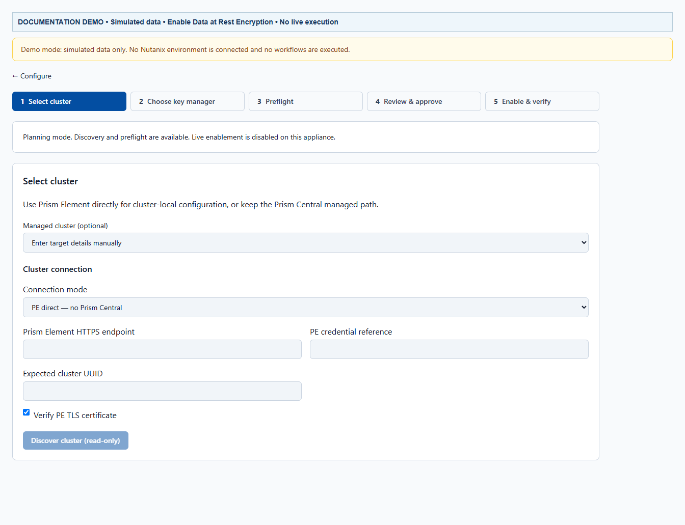

# Enable Data at Rest Encryption Quick Guide

Guide ID: `QG-O-dare` · Reviewed: 20 November 2026 · Source: `79c3ecc`

Status: Current source procedure. Read [Using the quick guides](../using-the-guides.md) first.

## Purpose

Enable cluster-wide software encryption using an already established Local KMS through the dedicated approved wizard.

## Prerequisites

Use an Orchestrator administrator. Complete the common preparation checklist and confirm the target/build and a reviewed recovery plan before any change.

## Required inputs

Administrator; expected cluster UUID and PE endpoint/credential; supported healthy 3–16 host AHV inventory reporting LKM, approved licensing and an off-appliance key-backup/recovery owner.

## Procedure

1. Open Configure → Enable Data-at-Rest Encryption (DARE). Select PE direct — no Prism Central for that transport. Keep certificate verification on, or follow its explicitly approved scoped exception procedure.
2. Run Discover cluster (read-only). Review complete membership, Good health, encryption readiness and existing LKM. Stop for external/PC key managers, drive encryption or ambiguous state; this wizard does not convert them.
3. Acknowledge licensing, irreversibility, exclusive change ownership and key recovery; record the change reference. Run Preflight and obtain approval from a different administrator for the exact hashed plan.
4. Live writes default off. Only after representative lab validation and approved enablement, type ENCRYPT followed by the cluster UUID and submit once.
5. Inspect the job and fresh configuration readback. Follow Prism's key-backup procedure and monitor background encryption separately.

## Validation and expected result

PE reports cluster-wide software encryption with LKM. Confirm encryption progress/completion and independently verify key backup/recoverability and workload acceptance.

## Failure and recovery

Software encryption cannot be disabled after enablement. Appliance rollback does not undo it. On uncertain submission/readback inspect PE state/tasks before any new request; never automatically retry.

## Evidence to capture

Record the exact target, installed build, reviewed config filename/hash, approval if applicable, job/task/run IDs and redacted before/after checks. Keep unresolved follow-up with the change record.

## Screen reference

Local demonstration of **Configure / initial draft** at `/configure/dare`, captured from source `79c3ecc` on 20 November 2026. Values and credential references are synthetic; required fields may intentionally be incomplete. This is the initial screen or selected configuration panel, not evidence of a successful run. Lower form sections may be outside the captured viewport. Follow this guide's preparation, approval and verification steps.

## References

- [Detailed procedure](../../dare-workflow.md)
- [Route and access controls](../../../src/App.tsx)
- [Guide index](../README.md)
