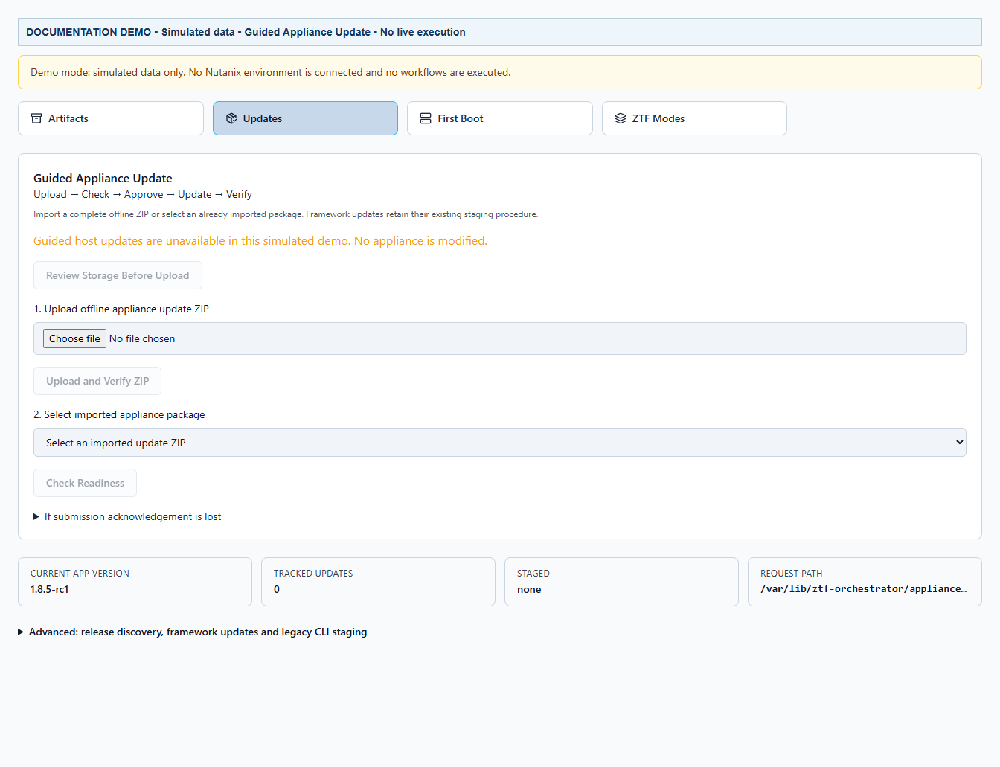

# Guided Appliance Update Quick Guide

Guide ID: `QG-O-guided-appliance-update` · Reviewed: 21 November 2026 · Source: `48eb875`

Status: Current source procedure. Read [Using the quick guides](../using-the-guides.md) first.

## Purpose

Import, verify and install one trusted offline appliance update with a retained rollback path.

## Prerequisites

Use an Orchestrator administrator. Complete the common preparation checklist and confirm the target/build and a reviewed recovery plan before any change.

## Required inputs

Appliance administrator; installed guided-update host service, complete trusted offline ZIP and independent checksum, idle automation, verified database/data backup and enough space on all relevant filesystems.

## Procedure

1. Open Appliance Ops → Updates. If upload space is low, use Review Storage Before Upload and select only explicitly eligible obsolete artifacts.
2. Use Upload and Verify ZIP or choose a previously imported package. Check exact version, manifest and checksums. Import stages a package; it does not install the host service or update the app.
3. Select Check Readiness. Review image identity/protocol, database/Compose accessibility, queued/running tasks and disk estimates. Resolve blockers before proceeding.
4. Review the exact install plan and interruption, retain the previous image/backup, then type INSTALL followed by the exact version when prompted. Submit once and follow stage indicators.
5. After reconnecting, verify the installed build and direct application health, login and a representative read-only workflow. Preserve update and backup records.

## Validation and expected result

The intended running image and persistent Compose configuration agree, direct health/login work, and data/configuration remain intact. Keep backup validity distinct from update success.

## Failure and recovery

Do not force through busy, backup or space blockers. An uncertain install requires host-service/job inspection before another submission. Container rollback does not revert target infrastructure changes or automatically restore a database.

## Evidence to capture

Record the exact target, installed build, reviewed config filename/hash, approval if applicable, job/task/run IDs and redacted before/after checks. Keep unresolved follow-up with the change record.

## References

- [Detailed procedure](../../guided-appliance-updates.md)
- [Route and access controls](../../../src/App.tsx)
- [Guide index](../README.md)

## Screen reference

Simulated initial/authoring view captured 21 November 2026 from application source `48eb875`. State: **Appliance Ops / Updates / no install submitted** at `/appliance`. Values are synthetic and required inputs may be incomplete. This is not evidence of a successful run, live target authentication or hardware compatibility. Lower form sections may be outside the captured viewport. Follow the preparation, approval, verification and recovery instructions.
