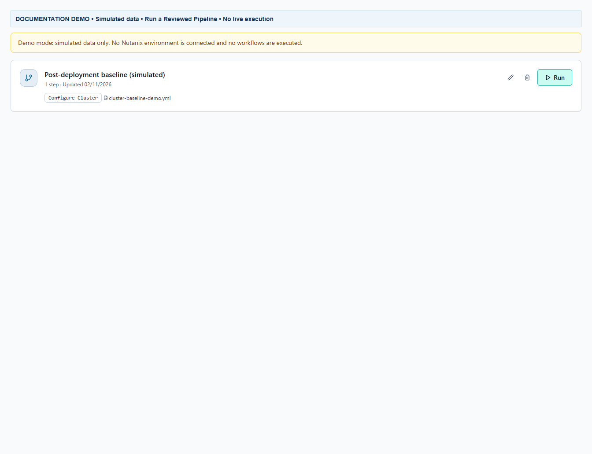

# Run a Reviewed Pipeline Quick Guide

Guide ID: `QG-O-pipelines` · Reviewed: 20 November 2026 · Source: `79c3ecc`

Status: Current source procedure. Read [Using the quick guides](../using-the-guides.md) first.

## Purpose

Execute an ordered set of reviewed ZTF 1.x workflow/script configurations and stop on failure.

## Prerequisites

Use the role authorized for this operation by the installed policy. Complete the common preparation checklist and confirm the target/build and a reviewed recovery plan before any change.

## Required inputs

Healthy installed ZTF 1.x runtime; exact saved configuration files and action types; reviewed target/credential sequence, required approvals and backup/recovery plan.

## Procedure

1. In Config Files, save each reviewed YAML under its intended filename and datacenter/cluster grouping. Confirm sensitive overrides are protected.
2. Open Pipelines and choose the matching workflow or Script action for each saved file. Inspect the order, exact filenames and target scope; adding steps does not execute them.
3. Avoid repeating PE password changes. Subsequent steps must use the verified replacement credential; an optional initial AHV/CVM password action belongs after PE bootstrap without renaming the established baseline files.
4. Use available validation/Dry Run, satisfy required approvals and type the displayed confirmations at run time. If a mandatory-approval action is unsupported in pipelines, use its direct approved workflow.
5. Run once and monitor step logs/results. Stop on FAIL, CAN'T VERIFY, failed authentication or ambiguous target state; do not skip ahead because a subprocess returned zero.

## Validation and expected result

Every intended step has successful job evidence and target-side property checks; capture final cluster identity, health and registration separately.

## Failure and recovery

Retired Native pipelines remain blocked until an administrator reviews and explicitly converts them to ZTF 1.x. Editing/converting is not target validation. Reconcile partial completion before any restart.

## Evidence to capture

Record the exact target, installed build, reviewed config filename/hash, approval if applicable, job/task/run IDs and redacted before/after checks. Keep unresolved follow-up with the change record.

## Screen reference

Local demonstration of **Configure / initial draft** at `/pipelines`, captured from source `79c3ecc` on 20 November 2026. Values and credential references are synthetic; required fields may intentionally be incomplete. This is the initial screen or selected configuration panel, not evidence of a successful run. Lower form sections may be outside the captured viewport. Follow this guide's preparation, approval and verification steps.

## References

- [Detailed procedure](../../user-guide.md)
- [Route and access controls](../../../src/App.tsx)
- [Guide index](../README.md)
