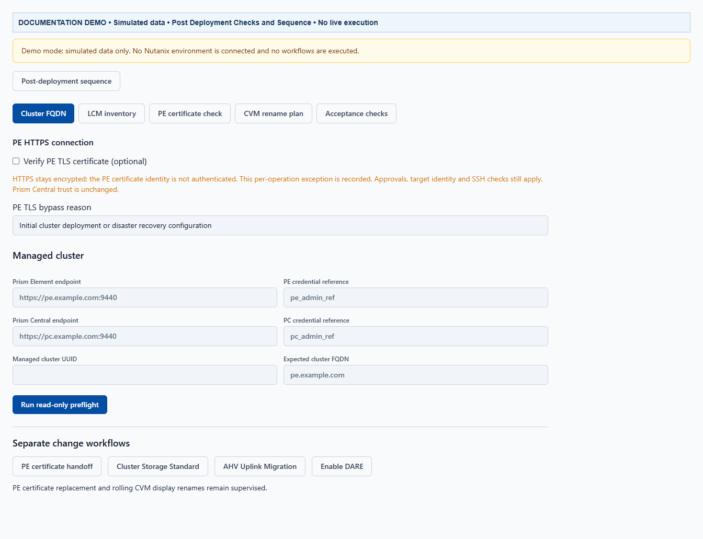

# Post Deployment Checks and Sequence Quick Guide

Guide ID: `QG-O-post-deployment` · Reviewed: 21 November 2026 · Source: `48eb875`

Status: Current source procedure. Read [Using the quick guides](../using-the-guides.md) first.

## Purpose

Coordinate acceptance after the baseline has registered the cluster with Prism Central.

## Prerequisites

Use an Orchestrator administrator. Complete the common preparation checklist and confirm the target/build and a reviewed recovery plan before any change.

## Required inputs

Administrator; healthy registered cluster, reviewed host serials/containers, trusted PE/PC access, intended FQDN, Dark Site URL if used and a selected NCC CVM.

## Procedure

1. Open Start Here → Configure → Post-deployment checks. Review each check's actual execution/evidence boundary.
2. Open Post-deployment sequence and create one persisted run. Complete certificate replacement externally and record its evidence and approved leaf fingerprint for live verification.
3. Verify/set FQDN with its exact-plan approval and cluster confirmation. Complete CVM display renames externally, one node at a time, retaining supervised evidence and fresh health.
4. Run storage, uplink and DARE jobs separately if in scope. Record their verification evidence or approved exclusions; this checkpoint does not submit them.
5. Submit the separately approved LCM inventory stage, then NCC and fresh acceptance checks. Reload runs and Check job and advance when a managed job completes. Record final sign-off with NCC less than 24 hours old.

## Validation and expected result

Every stage has its appropriate fresh target checks and explicit manual evidence. Final acceptance distinguishes recorded claims, managed job readbacks and approved exclusions.

## Failure and recovery

The sequence does not import certificates, perform CVM renames or launch storage/uplink/DARE automatically. Preserve its run ID; reconcile uncertain tasks and obtain fresh approvals before continuing.

## Evidence to capture

Record the exact target, installed build, reviewed config filename/hash, approval if applicable, job/task/run IDs and redacted before/after checks. Keep unresolved follow-up with the change record.

## References

- [Detailed procedure](../../post-deployment-checks.md)
- [Route and access controls](../../../src/App.tsx)
- [Guide index](../README.md)

## Screen reference

Simulated initial/authoring view captured 21 November 2026 from application source `48eb875`. State: **Configure / initial draft** at `/configure/post-deployment`. Values are synthetic and required inputs may be incomplete. This is not evidence of a successful run, live target authentication or hardware compatibility. Lower form sections may be outside the captured viewport. Follow the preparation, approval, verification and recovery instructions.
