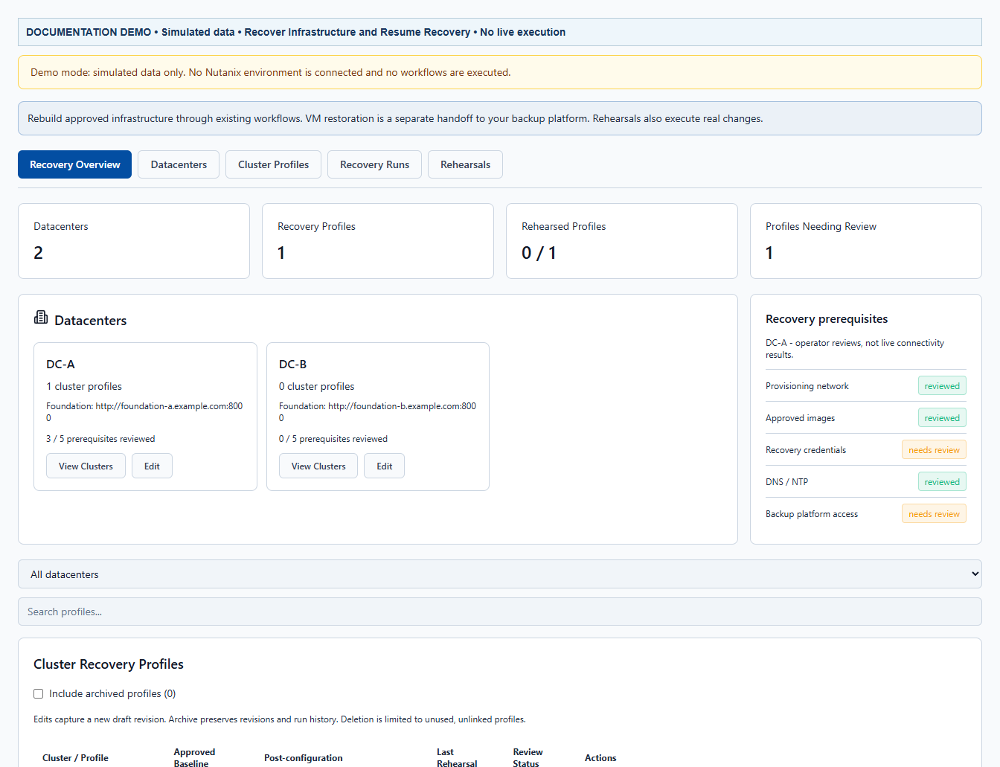

# Recover Infrastructure and Resume Recovery Quick Guide

Guide ID: `QG-O-recover-infrastructure` · Reviewed: 21 November 2026 · Source: `48eb875`

Status: Current source procedure. Read [Using the quick guides](../using-the-guides.md) first.

## Purpose

Rebuild and configure the reviewed infrastructure baseline while preserving recovery evidence and completed work.

## Prerequisites

Use the role authorized for this operation by the installed policy. Complete the common preparation checklist and confirm the target/build and a reviewed recovery plan before any change.

## Required inputs

Authorized incident/recovery scope, externally retained reviewed profile revision and trusted artifacts, exact node identities, isolation decision, credentials/SSH trust, backup and workload-restore owners.

## Procedure

1. Open Recovery and review the intended datacenter/cluster profile and revision. Confirm Foundation VM/pipeline links and baseline configuration; preserve the existing numbered sequence.
2. Authorize destructive rebuild only after checking target serials and outstanding remote tasks. Run Recover Infrastructure/Recover Cluster through its approval path.
3. Follow durable stage results, verify imaging/cluster formation and complete only the approved post-configuration scope. Preserve the recovery run ID and actual target evidence.
4. Use Resume Recovery for an interrupted run after reconciling uncertain work. Retained snapshots and completed work keep their approval/identity constraints; do not start a fresh full rebuild to clear a status.
5. If only final PE-to-PC registration failed, use the guarded step 08-only retry after reconciliation, fresh health and approval. It does not repeat imaging or initial password setup.
6. Hand the accepted infrastructure to backup/application owners for a separately authorized workload restore and service acceptance.

## Validation and expected result

Verify exact node membership/versions, PE health and baseline properties. Keep infrastructure rebuild timing separate from workload restore and achieved application RPO/RTO.

## Failure and recovery

A successful infrastructure job does not prove restored data or applications. Cancellation may leave Foundation/Prism tasks running. Preserve evidence and stop on identity or recovery-source uncertainty.

## Evidence to capture

Record the exact target, installed build, reviewed config filename/hash, approval if applicable, job/task/run IDs and redacted before/after checks. Keep unresolved follow-up with the change record.

## References

- [Detailed procedure](../../disaster-recovery.md)
- [Route and access controls](../../../src/App.tsx)
- [Guide index](../README.md)

## Screen reference

Simulated initial/authoring view captured 21 November 2026 from application source `48eb875`. State: **Configure / initial draft** at `/recovery`. Values are synthetic and required inputs may be incomplete. This is not evidence of a successful run, live target authentication or hardware compatibility. Lower form sections may be outside the captured viewport. Follow the preparation, approval, verification and recovery instructions.
