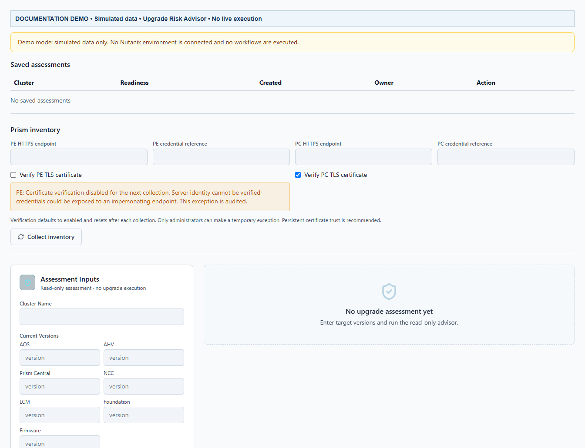

# Upgrade Risk Advisor Quick Guide

Guide ID: `QG-O-upgrade-advisor` · Reviewed: 21 November 2026 · Source: `48eb875`

Status: Current source procedure. Read [Using the quick guides](../using-the-guides.md) first.

## Purpose

Prepare a read-only pre-upgrade assessment and retain the evidence needed for a change decision.

## Prerequisites

Use the role authorized for this operation by the installed policy. Complete the common preparation checklist and confirm the target/build and a reviewed recovery plan before any change.

## Required inputs

Actual current/target component versions, cluster identity, compatibility and release-note review, LCM prechecks, dark-site bundle evidence and trusted collector credentials when deliberately collecting.

## Procedure

1. Open Upgrade Advisor. Enter actual inventory and intended versions; do not mark evidence reviewed unless the check was performed.
2. Optionally collect supported live inventory over verified HTTPS. Review collector errors, identity and timestamps; a failed collector is missing evidence.
3. Run the assessment and inspect each finding, missing evidence and rule source. Import a curated source pack only from an approved maintained source.
4. Save/export the immutable assessment and Markdown change summary. Resolve blockers and obtain the separate upgrade authorization and vendor procedure.

## Validation and expected result

The saved assessment has the correct targets/versions and traceable fresh evidence. The owner understands every unresolved finding before approving an upgrade.

## Failure and recovery

The advisor does not execute upgrades, scrape private KBs or guarantee compatibility. A pass is evidence-based guidance, not vendor certification or a substitute for LCM and application acceptance.

## Evidence to capture

Record the exact target, installed build, reviewed config filename/hash, approval if applicable, job/task/run IDs and redacted before/after checks. Keep unresolved follow-up with the change record.

## References

- [Detailed procedure](../../nutanix-upgrade-risk-advisor.md)
- [Route and access controls](../../../src/App.tsx)
- [Guide index](../README.md)

## Screen reference

Simulated initial/authoring view captured 21 November 2026 from application source `48eb875`. State: **Configure / initial draft** at `/upgrade-advisor`. Values are synthetic and required inputs may be incomplete. This is not evidence of a successful run, live target authentication or hardware compatibility. Lower form sections may be outside the captured viewport. Follow the preparation, approval, verification and recovery instructions.
