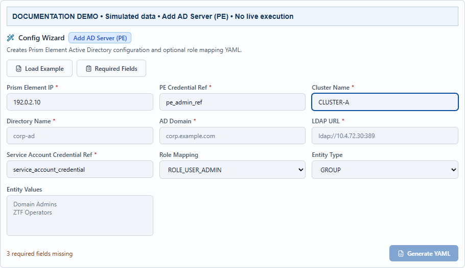

# Add AD Server (PE) Quick Guide

Guide ID: `QG-S-AddAdServerPe` · Reviewed: 20 November 2026 · Source: `79c3ecc`

Status: Current source procedure. Read [Using the quick guides](../using-the-guides.md) first.

## Purpose

Adds Active Directory server configuration to Prism Element.

## Prerequisites

Confirm the directory URL/domain, bind-account credential reference and the exact AD names/groups. Use the intended role and entity mapping; retain an independent local administrator session.

## Required inputs

| Input in wizard | Form requirement | How to supply it |
|---|---|---|
| Prism Element IP (`cluster_ip`) | Required | The intended service management address; confirm its identity. |
| PE Credential Ref (`pe_credential`) | Required | Exact saved reference in the selected Global Config vault; not a literal password. |
| Cluster Name (`cluster_name`) | Required | Use the exact approved target value; review its generated YAML representation. |
| Directory Name (`ad_name`) | Required | Use the exact approved target value; review its generated YAML representation. |
| AD Domain (`ad_domain`) | Required | Use the exact approved target value; review its generated YAML representation. |
| LDAP URL (`ad_directory_url`) | Required | Use the exact approved target value; review its generated YAML representation. |
| Service Account Credential Ref (`service_account_credential`) | Required | Exact saved reference in the selected Global Config vault; not a literal password. |
| Role Mapping (`role_type`) | Optional in form | Choose: ROLE_CLUSTER_ADMIN, ROLE_USER_ADMIN, ROLE_CLUSTER_VIEWER, ROLE_BACKUP_ADMIN. |
| Entity Type (`entity_type`) | Optional in form | Choose: GROUP, OU, USER. |
| Entity Values (`entity_values`) | Optional in form | Review the field separator and each exact entry before generation. |

## Procedure

1. Open Scripts 1.x and select only Add AD Server (PE) (AddAdServerPe).
2. Complete the required inputs, including operation-specific optional fields needed by your design. Select Generate YAML and review every target and value in the editor.
3. Run Dry Run where available and inspect its diagnostics. It does not prove the change will succeed on the target. Obtain the approvals required by the installed policy.
4. Submit the approved single-script scope once. Follow the terminal job/task results and perform the target checks below.

## Validation and expected result

Verify the directory connection and exact group-to-role assignment in the target Prism instance; test a designated account for the intended rights.

## Failure and recovery

Do not widen a role to make a failed login work. Correct directory reachability, bind credentials or mapping values and review the existing object before retry.

## Evidence to capture

Record the exact target, installed build, reviewed config filename/hash, approval if applicable, job/task/run IDs and redacted before/after checks. Keep unresolved follow-up with the change record.

## Screen reference

Local demonstration of **Single-script configuration wizard / authoring only** at `/scripts`, captured from source `79c3ecc` on 20 November 2026. Values and credential references are synthetic; required fields may intentionally be incomplete. This is the initial screen or selected configuration panel, not evidence of a successful run. Lower form sections may be outside the captured viewport. Follow this guide's preparation, approval and verification steps.

## References

- [Script wizard schema](../../../src/scriptConfigSchemas.ts)
- [Script execution UI](../../../src/pages/Scripts.tsx)
- [Common execution and recovery](../using-the-guides.md)
- [Guide index](../README.md)
