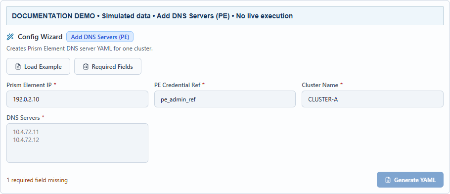

# Add DNS Servers (PE) Quick Guide

Guide ID: `QG-S-AddNameServersPe` · Reviewed: 21 November 2026 · Source: `48eb875`

Status: Current source procedure. Read [Using the quick guides](../using-the-guides.md) first.

## Purpose

Adds DNS name servers in Prism Element.

## Prerequisites

Supply the approved DNS server list and ensure management routes reach those resolvers. Retain the existing list for recovery.

## Required inputs

| Input in wizard | Form requirement | How to supply it |
|---|---|---|
| Prism Element IP (`cluster_ip`) | Required | The intended service management address; confirm its identity. |
| PE Credential Ref (`pe_credential`) | Required | Exact saved reference in the selected Global Config vault; not a literal password. |
| Cluster Name (`cluster_name`) | Required | Use the exact approved target value; review its generated YAML representation. |
| DNS Servers (`dns_servers`) | Required | Review the field separator and each exact entry before generation. |

## Procedure

1. Open Scripts 1.x and select only Add DNS Servers (PE) (AddNameServersPe).
2. Complete the required inputs, including operation-specific optional fields needed by your design. Select Generate YAML and review every target and value in the editor.
3. Run Dry Run where available and inspect its diagnostics. It does not prove the change will succeed on the target. Obtain the approvals required by the installed policy.
4. Submit the approved single-script scope once. Follow the terminal job/task results and perform the target checks below.

## Validation and expected result

Compare the configured resolver list and test resolution of the required management names from the target environment.

## Failure and recovery

Adding a resolver does not prove DNS works. Review actual list semantics and connectivity before retry; avoid removing working resolvers blindly.

## Evidence to capture

Record the exact target, installed build, reviewed config filename/hash, approval if applicable, job/task/run IDs and redacted before/after checks. Keep unresolved follow-up with the change record.

## References

- [Script wizard schema](../../../src/scriptConfigSchemas.ts)
- [Script execution UI](../../../src/pages/Scripts.tsx)
- [Common execution and recovery](../using-the-guides.md)
- [Guide index](../README.md)

## Screen reference

Simulated initial/authoring view captured 21 November 2026 from application source `48eb875`. State: **Single-script configuration wizard / authoring only** at `/scripts`. Values are synthetic and required inputs may be incomplete. This is not evidence of a successful run, live target authentication or hardware compatibility. Lower form sections may be outside the captured viewport. Follow the preparation, approval, verification and recovery instructions.
