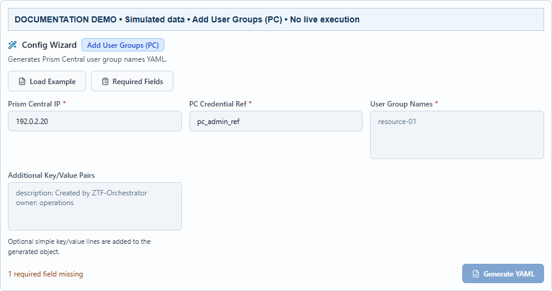

# Add User Groups (PC) Quick Guide

Guide ID: `QG-S-AddUserGroups` · Reviewed: 21 November 2026 · Source: `48eb875`

Status: Current source procedure. Read [Using the quick guides](../using-the-guides.md) first.

## Purpose

Adds IAM user groups in Prism Central.

## Prerequisites

Review the exact IAM users, groups or roles and their intended source/permissions. For generic extra key=value properties, use the installed framework contract rather than guessing nested IAM fields.

## Required inputs

| Input in wizard | Form requirement | How to supply it |
|---|---|---|
| Prism Central IP (`pc_ip`) | Required | The intended service management address; confirm its identity. |
| PC Credential Ref (`pc_credential`) | Required | Exact saved reference in the selected Global Config vault; not a literal password. |
| User Group Names (`resource_names`) | Required | Review the field separator and each exact entry before generation. |
| Additional Key/Value Pairs (`extra_pairs`) | Optional in form | Optional simple key/value lines are added to the generated object. |

## Procedure

1. Open Scripts 1.x and select only Add User Groups (PC) (AddUserGroups).
2. Complete the required inputs, including operation-specific optional fields needed by your design. Select Generate YAML and review every target and value in the editor.
3. Run Dry Run where available and inspect its diagnostics. It does not prove the change will succeed on the target. Obtain the approvals required by the installed policy.
4. Submit the approved single-script scope once. Follow the terminal job/task results and perform the target checks below.

## Validation and expected result

Inspect the intended IAM objects and membership/permissions in PC; test a representative authorized account.

## Failure and recovery

Object presence alone does not establish correct privileges. Reconcile duplicates or unexpected rights before rerun.

## Evidence to capture

Record the exact target, installed build, reviewed config filename/hash, approval if applicable, job/task/run IDs and redacted before/after checks. Keep unresolved follow-up with the change record.

## References

- [Script wizard schema](../../../src/scriptConfigSchemas.ts)
- [Script execution UI](../../../src/pages/Scripts.tsx)
- [Common execution and recovery](../using-the-guides.md)
- [Guide index](../README.md)

## Screen reference

Simulated initial/authoring view captured 21 November 2026 from application source `48eb875`. State: **Single-script configuration wizard / authoring only** at `/scripts`. Values are synthetic and required inputs may be incomplete. This is not evidence of a successful run, live target authentication or hardware compatibility. Lower form sections may be outside the captured viewport. Follow the preparation, approval, verification and recovery instructions.
