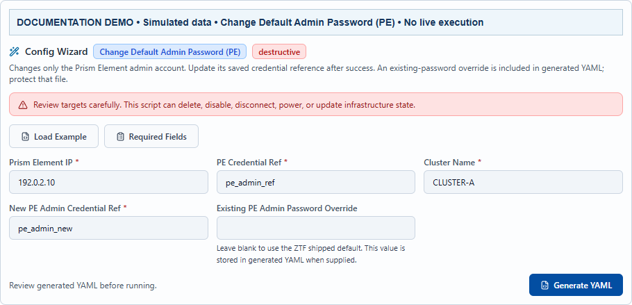

# Change Default Admin Password (PE) Quick Guide

Guide ID: `QG-S-ChangeDefaultAdminPasswordPe` · Reviewed: 21 November 2026 · Source: `48eb875`

Status: Current source procedure. Read [Using the quick guides](../using-the-guides.md) first.

## Purpose

Changes the Prism Element admin password using a new credential reference; does not rotate AHV, CVM, or iDRAC accounts.

## Prerequisites

Create a separate replacement credential reference for PE admin and retain the current one. An optional existing-password override is sensitive plaintext in exported YAML.

## Required inputs

| Input in wizard | Form requirement | How to supply it |
|---|---|---|
| Prism Element IP (`cluster_ip`) | Required | The intended service management address; confirm its identity. |
| PE Credential Ref (`pe_credential`) | Required | Exact saved reference in the selected Global Config vault; not a literal password. |
| Cluster Name (`cluster_name`) | Required | Use the exact approved target value; review its generated YAML representation. |
| New PE Admin Credential Ref (`new_pe_admin_credential`) | Required | Exact saved reference in the selected Global Config vault; not a literal password. |
| Existing PE Admin Password Override (`default_pe_password`) | Optional in form | Leave blank to use the ZTF shipped default. This value is stored in generated YAML when supplied. |

## Procedure

1. Open Scripts 1.x and select only Change Default Admin Password (PE) (ChangeDefaultAdminPasswordPe).
2. Complete the required inputs, including operation-specific optional fields needed by your design. Select Generate YAML and review every target and value in the editor.
3. Run Dry Run where available and inspect its diagnostics. It does not prove the change will succeed on the target. Obtain the approvals required by the installed policy.
4. To execute the approved single-script scope, enter exactly RUN ChangeDefaultAdminPasswordPe when prompted, then submit once. Follow the terminal job/task results and perform the target checks below.

## Validation and expected result

Require fresh authentication with the replacement reference and PE cluster identity; independently verify the new Prism login before downstream steps.

## Failure and recovery

This changes PE admin only, not AHV/CVM/iDRAC. Do not repeat after an ambiguous failure. Later files must use the verified reference and omit another password-change request.

## Evidence to capture

Record the exact target, installed build, reviewed config filename/hash, approval if applicable, job/task/run IDs and redacted before/after checks. Keep unresolved follow-up with the change record.

## References

- [Detailed procedure](../../pe-admin-password-change.md)
- [Script wizard schema](../../../src/scriptConfigSchemas.ts)
- [Script execution UI](../../../src/pages/Scripts.tsx)
- [Common execution and recovery](../using-the-guides.md)
- [Guide index](../README.md)

## Screen reference

Simulated initial/authoring view captured 21 November 2026 from application source `48eb875`. State: **Single-script configuration wizard / authoring only** at `/scripts`. Values are synthetic and required inputs may be incomplete. This is not evidence of a successful run, live target authentication or hardware compatibility. Lower form sections may be outside the captured viewport. Follow the preparation, approval, verification and recovery instructions.
