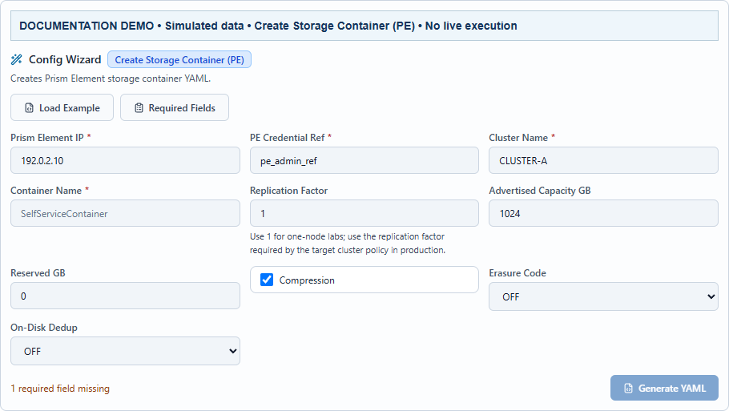

# Create Storage Container (PE) Quick Guide

Guide ID: `QG-S-CreateContainerPe` · Reviewed: 20 November 2026 · Source: `79c3ecc`

Status: Current source procedure. Read [Using the quick guides](../using-the-guides.md) first.

## Purpose

Creates a storage container in Prism Element.

## Prerequisites

Check the exact container name, replication factor and capacity/features against cluster support. Before deletion confirm complete VDisk/VM dependency inventory and a separate data-protection/recreation plan.

## Required inputs

| Input in wizard | Form requirement | How to supply it |
|---|---|---|
| Prism Element IP (`cluster_ip`) | Required | The intended service management address; confirm its identity. |
| PE Credential Ref (`pe_credential`) | Required | Exact saved reference in the selected Global Config vault; not a literal password. |
| Cluster Name (`cluster_name`) | Required | Use the exact approved target value; review its generated YAML representation. |
| Container Name (`container_name`) | Required | Use the exact approved target value; review its generated YAML representation. |
| Replication Factor (`replication_factor`) | Optional in form | Use 1 for one-node labs; use the replication factor required by the target cluster policy in production. |
| Advertised Capacity GB (`advertised_capacity_gb`) | Optional in form | Use the approved value and units shown in the wizard; defaults are not sizing guidance. |
| Reserved GB (`reserved_gb`) | Optional in form | Use the approved value and units shown in the wizard; defaults are not sizing guidance. |
| Compression (`compression_enabled`) | Optional in form | Set deliberately to match the approved change; check the generated boolean. |
| Erasure Code (`erasure_code`) | Optional in form | Choose: OFF, ON. |
| On-Disk Dedup (`on_disk_dedup`) | Optional in form | Choose: OFF, ON. |

## Procedure

1. Open Scripts 1.x and select only Create Storage Container (PE) (CreateContainerPe).
2. Complete the required inputs, including operation-specific optional fields needed by your design. Select Generate YAML and review every target and value in the editor.
3. Run Dry Run where available and inspect its diagnostics. It does not prove the change will succeed on the target. Obtain the approvals required by the installed policy.
4. Submit the approved single-script scope once. Follow the terminal job/task results and perform the target checks below.

## Validation and expected result

For creation, compare requested properties in fresh PE inventory. For deletion, confirm the intended container is absent and remaining storage is healthy.

## Failure and recovery

Existing mismatched containers are not automatically repaired. Deletion can lose data and has no automatic rollback; never force dependency removal.

## Evidence to capture

Record the exact target, installed build, reviewed config filename/hash, approval if applicable, job/task/run IDs and redacted before/after checks. Keep unresolved follow-up with the change record.

## Screen reference

Local demonstration of **Single-script configuration wizard / authoring only** at `/scripts`, captured from source `79c3ecc` on 20 November 2026. Values and credential references are synthetic; required fields may intentionally be incomplete. This is the initial screen or selected configuration panel, not evidence of a successful run. Lower form sections may be outside the captured viewport. Follow this guide's preparation, approval and verification steps.

## References

- [Detailed procedure](../../pe-post-configuration-verification.md)
- [Script wizard schema](../../../src/scriptConfigSchemas.ts)
- [Script execution UI](../../../src/pages/Scripts.tsx)
- [Common execution and recovery](../using-the-guides.md)
- [Guide index](../README.md)
