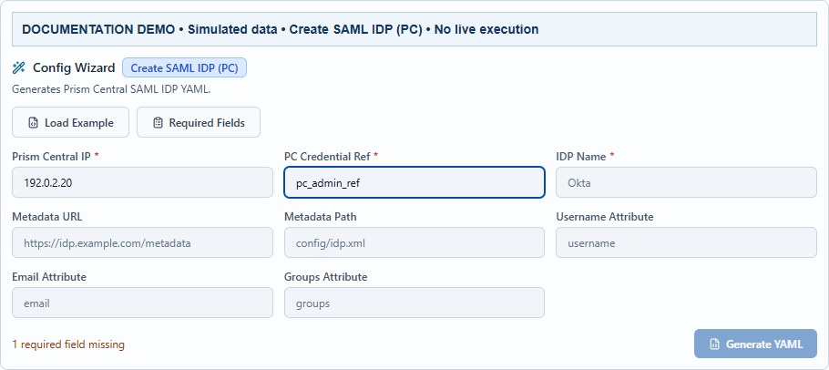

# Create SAML IDP (PC) Quick Guide

Guide ID: `QG-S-CreateIdp` · Reviewed: 20 November 2026 · Source: `79c3ecc`

Status: Current source procedure. Read [Using the quick guides](../using-the-guides.md) first.

## Purpose

Configures a SAML identity provider in Prism Central.

## Prerequisites

Prepare approved IdP metadata URL or appliance-readable metadata path and the agreed username/email/group attributes. Confirm certificate trust and a separate local-admin recovery path.

## Required inputs

| Input in wizard | Form requirement | How to supply it |
|---|---|---|
| Prism Central IP (`pc_ip`) | Required | The intended service management address; confirm its identity. |
| PC Credential Ref (`pc_credential`) | Required | Exact saved reference in the selected Global Config vault; not a literal password. |
| IDP Name (`name`) | Required | Use the exact approved target value; review its generated YAML representation. |
| Metadata URL (`metadata_url`) | Optional in form | Use the exact approved target value; review its generated YAML representation. |
| Metadata Path (`metadata_path`) | Optional in form | Use the exact approved target value; review its generated YAML representation. |
| Username Attribute (`username_attr`) | Optional in form | Use the exact approved target value; review its generated YAML representation. |
| Email Attribute (`email_attr`) | Optional in form | Use the exact approved target value; review its generated YAML representation. |
| Groups Attribute (`groups_attr`) | Optional in form | Use the exact approved target value; review its generated YAML representation. |

## Procedure

1. Open Scripts 1.x and select only Create SAML IDP (PC) (CreateIdp).
2. Complete the required inputs, including operation-specific optional fields needed by your design. Select Generate YAML and review every target and value in the editor.
3. Run Dry Run where available and inspect its diagnostics. It does not prove the change will succeed on the target. Obtain the approvals required by the installed policy.
4. Submit the approved single-script scope once. Follow the terminal job/task results and perform the target checks below.

## Validation and expected result

Verify the IdP metadata and attribute mapping in PC; test the intended SAML sign-in without ending the recovery session.

## Failure and recovery

A reachable metadata document is not successful SSO. Reconcile IdP settings and trust before repeating creation.

## Evidence to capture

Record the exact target, installed build, reviewed config filename/hash, approval if applicable, job/task/run IDs and redacted before/after checks. Keep unresolved follow-up with the change record.

## Screen reference

Local demonstration of **Single-script configuration wizard / authoring only** at `/scripts`, captured from source `79c3ecc` on 20 November 2026. Values and credential references are synthetic; required fields may intentionally be incomplete. This is the initial screen or selected configuration panel, not evidence of a successful run. Lower form sections may be outside the captured viewport. Follow this guide's preparation, approval and verification steps.

## References

- [Script wizard schema](../../../src/scriptConfigSchemas.ts)
- [Script execution UI](../../../src/pages/Scripts.tsx)
- [Common execution and recovery](../using-the-guides.md)
- [Guide index](../README.md)
