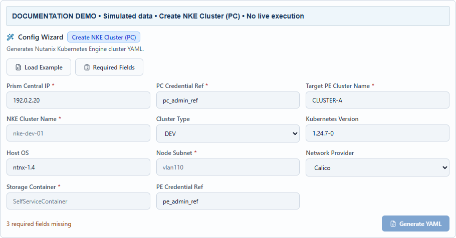

# Create NKE Cluster (PC) Quick Guide

Guide ID: `QG-S-CreateKarbonClusterPc` · Reviewed: 21 November 2026 · Source: `48eb875`

Status: Current source procedure. Read [Using the quick guides](../using-the-guides.md) first.

## Purpose

Creates a Nutanix Kubernetes Engine cluster.

## Prerequisites

Confirm the target PC/PE versions still support the NKE contract, plus Kubernetes/host-OS versions, node subnet, storage container and required capacity/licensing.

## Required inputs

| Input in wizard | Form requirement | How to supply it |
|---|---|---|
| Prism Central IP (`pc_ip`) | Required | The intended service management address; confirm its identity. |
| PC Credential Ref (`pc_credential`) | Required | Exact saved reference in the selected Global Config vault; not a literal password. |
| Target PE Cluster Name (`cluster_name`) | Required | Use the exact approved target value; review its generated YAML representation. |
| NKE Cluster Name (`nke_name`) | Required | Use the exact approved target value; review its generated YAML representation. |
| Cluster Type (`cluster_type`) | Optional in form | Choose: DEV, PROD. |
| Kubernetes Version (`k8s_version`) | Optional in form | Use the exact approved target value; review its generated YAML representation. |
| Host OS (`host_os`) | Optional in form | Use the exact approved target value; review its generated YAML representation. |
| Node Subnet (`node_subnet`) | Required | Use the exact approved target value; review its generated YAML representation. |
| Network Provider (`network_provider`) | Optional in form | Choose: Calico, Flannel. |
| Storage Container (`storage_container`) | Required | Use the exact approved target value; review its generated YAML representation. |
| PE Credential Ref (`pe_credential`) | Optional in form | Exact saved reference in the selected Global Config vault; not a literal password. |

## Procedure

1. Open Scripts 1.x and select only Create NKE Cluster (PC) (CreateKarbonClusterPc).
2. Complete the required inputs, including operation-specific optional fields needed by your design. Select Generate YAML and review every target and value in the editor.
3. Run Dry Run where available and inspect its diagnostics. It does not prove the change will succeed on the target. Obtain the approvals required by the installed policy.
4. Submit the approved single-script scope once. Follow the terminal job/task results and perform the target checks below.

## Validation and expected result

Follow NKE provisioning tasks and verify node readiness and the intended Kubernetes version; run a separately approved workload check.

## Failure and recovery

NKE is not the retired NKP integration. Catalogue presence does not prove support on the target release; reconcile partial provisioning before retry.

## Evidence to capture

Record the exact target, installed build, reviewed config filename/hash, approval if applicable, job/task/run IDs and redacted before/after checks. Keep unresolved follow-up with the change record.

## References

- [Script wizard schema](../../../src/scriptConfigSchemas.ts)
- [Script execution UI](../../../src/pages/Scripts.tsx)
- [Common execution and recovery](../using-the-guides.md)
- [Guide index](../README.md)

## Screen reference

Simulated initial/authoring view captured 21 November 2026 from application source `48eb875`. State: **Single-script configuration wizard / authoring only** at `/scripts`. Values are synthetic and required inputs may be incomplete. This is not evidence of a successful run, live target authentication or hardware compatibility. Lower form sections may be outside the captured viewport. Follow the preparation, approval, verification and recovery instructions.
