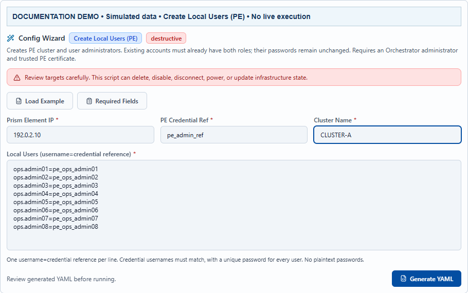

# Create Local Users (PE) Quick Guide

Guide ID: `QG-S-CreateLocalUsersPe` · Reviewed: 20 November 2026 · Source: `79c3ecc`

Status: Current source procedure. Read [Using the quick guides](../using-the-guides.md) first.

## Purpose

Creates named PE administrators using separate credential references; verifies cluster and user administrator roles without changing existing passwords.

## Prerequisites

Use distinct username=credential_reference entries with matching credential usernames and unique passwords. This action requires an Orchestrator administrator and trusted PE HTTPS.

## Required inputs

| Input in wizard | Form requirement | How to supply it |
|---|---|---|
| Prism Element IP (`cluster_ip`) | Required | The intended service management address; confirm its identity. |
| PE Credential Ref (`pe_credential`) | Required | Exact saved reference in the selected Global Config vault; not a literal password. |
| Cluster Name (`cluster_name`) | Required | Use the exact approved target value; review its generated YAML representation. |
| Local Users (username=credential reference) (`local_user_refs`) | Required | One username=credential reference per line. Credential usernames must match, with a unique password for every user. No plaintext passwords. |

## Procedure

1. Open Scripts 1.x and select only Create Local Users (PE) (CreateLocalUsersPe).
2. Complete the required inputs, including operation-specific optional fields needed by your design. Select Generate YAML and review every target and value in the editor.
3. Run Dry Run where available and inspect its diagnostics. It does not prove the change will succeed on the target. Obtain the approvals required by the installed policy.
4. To execute the approved single-script scope, enter exactly RUN CreateLocalUsersPe when prompted, then submit once. Follow the terminal job/task results and perform the target checks below.

## Validation and expected result

Verify each exact PE user has both cluster-administrator and user-administrator roles. Existing matching users keep their passwords.

## Failure and recovery

Existing accounts with missing roles fail verification; this action does not reset passwords or silently repair access. Review the conflict separately.

## Evidence to capture

Record the exact target, installed build, reviewed config filename/hash, approval if applicable, job/task/run IDs and redacted before/after checks. Keep unresolved follow-up with the change record.

## Screen reference

Local demonstration of **Single-script configuration wizard / authoring only** at `/scripts`, captured from source `79c3ecc` on 20 November 2026. Values and credential references are synthetic; required fields may intentionally be incomplete. This is the initial screen or selected configuration panel, not evidence of a successful run. Lower form sections may be outside the captured viewport. Follow this guide's preparation, approval and verification steps.

## References

- [Detailed procedure](../../pe-local-users.md)
- [Script wizard schema](../../../src/scriptConfigSchemas.ts)
- [Script execution UI](../../../src/pages/Scripts.tsx)
- [Common execution and recovery](../using-the-guides.md)
- [Guide index](../README.md)
