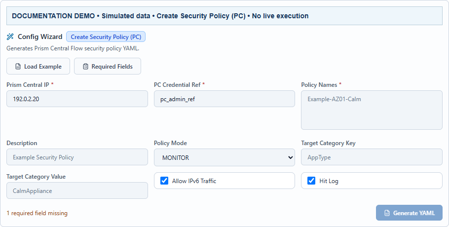

# Create Security Policy (PC) Quick Guide

Guide ID: `QG-S-CreateNetworkSecurityPolicy` · Reviewed: 20 November 2026 · Source: `79c3ecc`

Status: Current source procedure. Read [Using the quick guides](../using-the-guides.md) first.

## Purpose

Creates a Flow network security policy.

## Prerequisites

Review exact policy/group names, categories, address/service membership and consumers. Choose monitor/enforce mode intentionally and retain a separately approved access-recovery plan.

## Required inputs

| Input in wizard | Form requirement | How to supply it |
|---|---|---|
| Prism Central IP (`pc_ip`) | Required | The intended service management address; confirm its identity. |
| PC Credential Ref (`pc_credential`) | Required | Exact saved reference in the selected Global Config vault; not a literal password. |
| Policy Names (`policy_names`) | Required | Review the field separator and each exact entry before generation. |
| Description (`description`) | Optional in form | Use the exact approved target value; review its generated YAML representation. |
| Policy Mode (`policy_mode`) | Optional in form | Choose: MONITOR, APPLY. |
| Target Category Key (`target_category_key`) | Optional in form | Use the exact approved target value; review its generated YAML representation. |
| Target Category Value (`target_category_value`) | Optional in form | Use the exact approved target value; review its generated YAML representation. |
| Allow IPv6 Traffic (`allow_ipv6_traffic`) | Optional in form | Set deliberately to match the approved change; check the generated boolean. |
| Hit Log (`hitlog`) | Optional in form | Set deliberately to match the approved change; check the generated boolean. |

## Procedure

1. Open Scripts 1.x and select only Create Security Policy (PC) (CreateNetworkSecurityPolicy).
2. Complete the required inputs, including operation-specific optional fields needed by your design. Select Generate YAML and review every target and value in the editor.
3. Run Dry Run where available and inspect its diagnostics. It does not prove the change will succeed on the target. Obtain the approvals required by the installed policy.
4. Submit the approved single-script scope once. Follow the terminal job/task results and perform the target checks below.

## Validation and expected result

Read back the intended policy/group and its membership or absence. Test both an allowed and a denied flow against the approved policy.

## Failure and recovery

Category/group existence does not prove isolation. Deletion or enforcement can interrupt connectivity; inspect actual policy state and dependencies before retry.

## Evidence to capture

Record the exact target, installed build, reviewed config filename/hash, approval if applicable, job/task/run IDs and redacted before/after checks. Keep unresolved follow-up with the change record.

## Screen reference

Local demonstration of **Single-script configuration wizard / authoring only** at `/scripts`, captured from source `79c3ecc` on 20 November 2026. Values and credential references are synthetic; required fields may intentionally be incomplete. This is the initial screen or selected configuration panel, not evidence of a successful run. Lower form sections may be outside the captured viewport. Follow this guide's preparation, approval and verification steps.

## References

- [Script wizard schema](../../../src/scriptConfigSchemas.ts)
- [Script execution UI](../../../src/pages/Scripts.tsx)
- [Common execution and recovery](../using-the-guides.md)
- [Guide index](../README.md)
