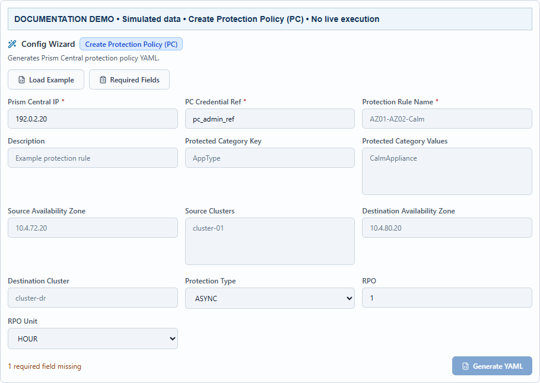

# Create Protection Policy (PC) Quick Guide

Guide ID: `QG-S-CreateProtectionPolicy` · Reviewed: 21 November 2026 · Source: `48eb875`

Status: Current source procedure. Read [Using the quick guides](../using-the-guides.md) first.

## Purpose

Creates a VM protection policy with RPO/RTO settings.

## Prerequisites

Review exact policy/plan/AZ identities, source and destination clusters, category scope, network mapping and supported RPO settings. Check existing replication and failover dependencies.

## Required inputs

| Input in wizard | Form requirement | How to supply it |
|---|---|---|
| Prism Central IP (`pc_ip`) | Required | The intended service management address; confirm its identity. |
| PC Credential Ref (`pc_credential`) | Required | Exact saved reference in the selected Global Config vault; not a literal password. |
| Protection Rule Name (`rule_name`) | Required | Use the exact approved target value; review its generated YAML representation. |
| Description (`description`) | Optional in form | Use the exact approved target value; review its generated YAML representation. |
| Protected Category Key (`category_key`) | Optional in form | Use the exact approved target value; review its generated YAML representation. |
| Protected Category Values (`category_values`) | Optional in form | Review the field separator and each exact entry before generation. |
| Source Availability Zone (`source_az`) | Optional in form | Use the exact approved target value; review its generated YAML representation. |
| Source Clusters (`source_clusters`) | Optional in form | Review the field separator and each exact entry before generation. |
| Destination Availability Zone (`destination_az`) | Optional in form | Use the exact approved target value; review its generated YAML representation. |
| Destination Cluster (`destination_cluster`) | Optional in form | Use the exact approved target value; review its generated YAML representation. |
| Protection Type (`protection_type`) | Optional in form | Choose: ASYNC, SYNC. |
| RPO (`rpo`) | Optional in form | Use the approved value and units shown in the wizard; defaults are not sizing guidance. |
| RPO Unit (`rpo_unit`) | Optional in form | Choose: MINUTE, HOUR, DAY, WEEK. |

## Procedure

1. Open Scripts 1.x and select only Create Protection Policy (PC) (CreateProtectionPolicy).
2. Complete the required inputs, including operation-specific optional fields needed by your design. Select Generate YAML and review every target and value in the editor.
3. Run Dry Run where available and inspect its diagnostics. It does not prove the change will succeed on the target. Obtain the approvals required by the installed policy.
4. Submit the approved single-script scope once. Follow the terminal job/task results and perform the target checks below.

## Validation and expected result

Inspect the requested policy/plan/AZ state and underlying tasks. Verify replication/recovery readiness through a separate approved rehearsal.

## Failure and recovery

Configuration success does not establish achieved RPO/RTO or application recoverability. Delete/disconnect can remove protection; inspect dependencies and partial state before retry.

## Evidence to capture

Record the exact target, installed build, reviewed config filename/hash, approval if applicable, job/task/run IDs and redacted before/after checks. Keep unresolved follow-up with the change record.

## References

- [Script wizard schema](../../../src/scriptConfigSchemas.ts)
- [Script execution UI](../../../src/pages/Scripts.tsx)
- [Common execution and recovery](../using-the-guides.md)
- [Guide index](../README.md)

## Screen reference

Simulated initial/authoring view captured 21 November 2026 from application source `48eb875`. State: **Single-script configuration wizard / authoring only** at `/scripts`. Values are synthetic and required inputs may be incomplete. This is not evidence of a successful run, live target authentication or hardware compatibility. Lower form sections may be outside the captured viewport. Follow the preparation, approval, verification and recovery instructions.
