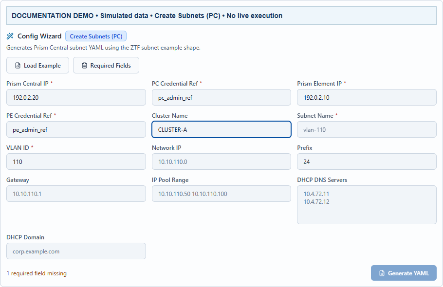

# Create Subnets (PC) Quick Guide

Guide ID: `QG-S-CreateSubnetsPc` · Reviewed: 20 November 2026 · Source: `79c3ecc`

Status: Current source procedure. Read [Using the quick guides](../using-the-guides.md) first.

## Purpose

Creates network subnets on Prism Central.

## Prerequisites

Confirm cluster identity, exact subnet name and VLAN. For managed IPAM supply network address, prefix, gateway and reviewed pool/DHCP settings; a VLAN-only network needs no IPAM block.

## Required inputs

| Input in wizard | Form requirement | How to supply it |
|---|---|---|
| Prism Central IP (`pc_ip`) | Required | The intended service management address; confirm its identity. |
| PC Credential Ref (`pc_credential`) | Required | Exact saved reference in the selected Global Config vault; not a literal password. |
| Prism Element IP (`cluster_ip`) | Required | The intended service management address; confirm its identity. |
| PE Credential Ref (`pe_credential`) | Required | Exact saved reference in the selected Global Config vault; not a literal password. |
| Cluster Name (`cluster_name`) | Optional in form | Use the exact approved target value; review its generated YAML representation. |
| Subnet Name (`subnet_name`) | Required | Use the exact approved target value; review its generated YAML representation. |
| VLAN ID (`vlan_id`) | Required | Use the approved value and units shown in the wizard; defaults are not sizing guidance. |
| Network IP (`network_ip`) | Optional in form | Use the exact approved target value; review its generated YAML representation. |
| Prefix (`network_prefix`) | Optional in form | Use the approved value and units shown in the wizard; defaults are not sizing guidance. |
| Gateway (`default_gateway_ip`) | Optional in form | Use the exact approved target value; review its generated YAML representation. |
| IP Pool Range (`pool_range`) | Optional in form | Use the exact approved target value; review its generated YAML representation. |
| DHCP DNS Servers (`dhcp_dns_servers`) | Optional in form | Review the field separator and each exact entry before generation. |
| DHCP Domain (`dhcp_domain`) | Optional in form | Use the exact approved target value; review its generated YAML representation. |

## Procedure

1. Open Scripts 1.x and select only Create Subnets (PC) (CreateSubnetsPc).
2. Complete the required inputs, including operation-specific optional fields needed by your design. Select Generate YAML and review every target and value in the editor.
3. Run Dry Run where available and inspect its diagnostics. It does not prove the change will succeed on the target. Obtain the approvals required by the installed policy.
4. Submit the approved single-script scope once. Follow the terminal job/task results and perform the target checks below.

## Validation and expected result

Inspect VLAN and IPAM properties in the intended PE/PC, then test the intended guest network path. Verify the physical VLAN separately.

## Failure and recovery

A prefix-only ip_config can fail in the legacy helper. For a plain VLAN omit ip_config entirely. For managed IPAM verify the complete contract, including dhcp_options, before execution.

## Evidence to capture

Record the exact target, installed build, reviewed config filename/hash, approval if applicable, job/task/run IDs and redacted before/after checks. Keep unresolved follow-up with the change record.

## Screen reference

Local demonstration of **Single-script configuration wizard / authoring only** at `/scripts`, captured from source `79c3ecc` on 20 November 2026. Values and credential references are synthetic; required fields may intentionally be incomplete. This is the initial screen or selected configuration panel, not evidence of a successful run. Lower form sections may be outside the captured viewport. Follow this guide's preparation, approval and verification steps.

## References

- [Script wizard schema](../../../src/scriptConfigSchemas.ts)
- [Script execution UI](../../../src/pages/Scripts.tsx)
- [Common execution and recovery](../using-the-guides.md)
- [Guide index](../README.md)
