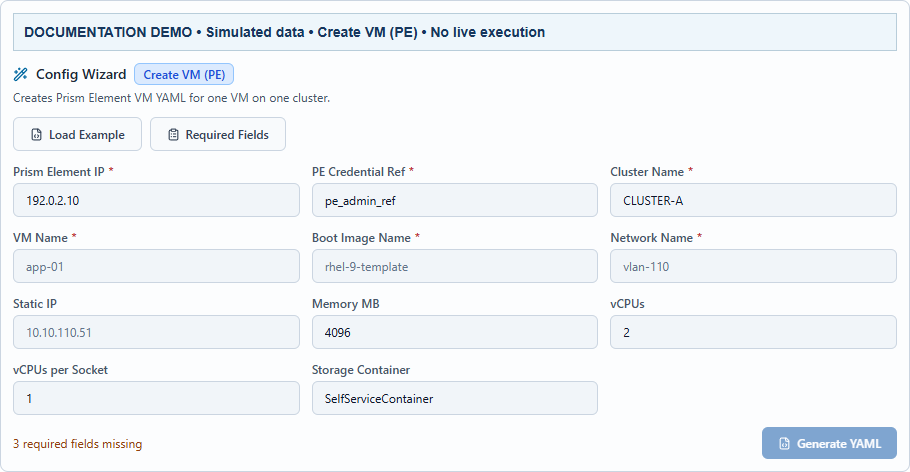

# Create VM (PE) Quick Guide

Guide ID: `QG-S-CreateVmPe` · Reviewed: 20 November 2026 · Source: `79c3ecc`

Status: Current source procedure. Read [Using the quick guides](../using-the-guides.md) first.

## Purpose

Creates virtual machines directly through Prism Element.

## Prerequisites

Confirm image and network names, CPU topology, memory units, storage placement and address uniqueness. Review requested power state and licensed capacity.

## Required inputs

| Input in wizard | Form requirement | How to supply it |
|---|---|---|
| Prism Element IP (`cluster_ip`) | Required | The intended service management address; confirm its identity. |
| PE Credential Ref (`pe_credential`) | Required | Exact saved reference in the selected Global Config vault; not a literal password. |
| Cluster Name (`cluster_name`) | Required | Use the exact approved target value; review its generated YAML representation. |
| VM Name (`vm_name`) | Required | Use the exact approved target value; review its generated YAML representation. |
| Boot Image Name (`image_name`) | Required | Use the exact approved target value; review its generated YAML representation. |
| Network Name (`network_name`) | Required | Use the exact approved target value; review its generated YAML representation. |
| Static IP (`static_ip`) | Optional in form | Use the exact approved target value; review its generated YAML representation. |
| Memory MB (`memory_mb`) | Optional in form | Use the approved value and units shown in the wizard; defaults are not sizing guidance. |
| vCPUs (`num_vcpus`) | Optional in form | Use the approved value and units shown in the wizard; defaults are not sizing guidance. |
| vCPUs per Socket (`num_vcpus_per_socket`) | Optional in form | Use the approved value and units shown in the wizard; defaults are not sizing guidance. |
| Storage Container (`container_name`) | Optional in form | Use the exact approved target value; review its generated YAML representation. |

## Procedure

1. Open Scripts 1.x and select only Create VM (PE) (CreateVmPe).
2. Complete the required inputs, including operation-specific optional fields needed by your design. Select Generate YAML and review every target and value in the editor.
3. Run Dry Run where available and inspect its diagnostics. It does not prove the change will succeed on the target. Obtain the approvals required by the installed policy.
4. Submit the approved single-script scope once. Follow the terminal job/task results and perform the target checks below.

## Validation and expected result

Verify exact VM count, cluster placement, image/disks, NIC/VLAN and requested power state; check guest boot and application health separately.

## Failure and recovery

A created VM is not a working application. Reconcile partially created VMs before rerun; do not delete unrelated VMs with similar names.

## Evidence to capture

Record the exact target, installed build, reviewed config filename/hash, approval if applicable, job/task/run IDs and redacted before/after checks. Keep unresolved follow-up with the change record.

## Screen reference

Local demonstration of **Single-script configuration wizard / authoring only** at `/scripts`, captured from source `79c3ecc` on 20 November 2026. Values and credential references are synthetic; required fields may intentionally be incomplete. This is the initial screen or selected configuration panel, not evidence of a successful run. Lower form sections may be outside the captured viewport. Follow this guide's preparation, approval and verification steps.

## References

- [Script wizard schema](../../../src/scriptConfigSchemas.ts)
- [Script execution UI](../../../src/pages/Scripts.tsx)
- [Common execution and recovery](../using-the-guides.md)
- [Guide index](../README.md)
