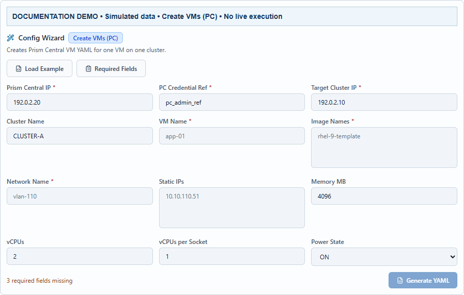

# Create VMs (PC) Quick Guide

Guide ID: `QG-S-CreateVmsPc` · Reviewed: 21 November 2026 · Source: `48eb875`

Status: Current source procedure. Read [Using the quick guides](../using-the-guides.md) first.

## Purpose

Creates virtual machines through Prism Central.

## Prerequisites

Confirm image and network names, CPU topology, memory units, storage placement and address uniqueness. Review requested power state and licensed capacity.

## Required inputs

| Input in wizard | Form requirement | How to supply it |
|---|---|---|
| Prism Central IP (`pc_ip`) | Required | The intended service management address; confirm its identity. |
| PC Credential Ref (`pc_credential`) | Required | Exact saved reference in the selected Global Config vault; not a literal password. |
| Target Cluster IP (`cluster_ip`) | Required | The intended service management address; confirm its identity. |
| Cluster Name (`cluster_name`) | Optional in form | Use the exact approved target value; review its generated YAML representation. |
| VM Name (`vm_name`) | Required | Use the exact approved target value; review its generated YAML representation. |
| Image Names (`image_names`) | Required | Review the field separator and each exact entry before generation. |
| Network Name (`network_name`) | Required | Use the exact approved target value; review its generated YAML representation. |
| Static IPs (`static_ips`) | Optional in form | Review the field separator and each exact entry before generation. |
| Memory MB (`memory_mb`) | Optional in form | Use the approved value and units shown in the wizard; defaults are not sizing guidance. |
| vCPUs (`num_vcpus`) | Optional in form | Use the approved value and units shown in the wizard; defaults are not sizing guidance. |
| vCPUs per Socket (`num_vcpus_per_socket`) | Optional in form | Use the approved value and units shown in the wizard; defaults are not sizing guidance. |
| Power State (`power_state`) | Optional in form | Choose: ON, OFF. |

## Procedure

1. Open Scripts 1.x and select only Create VMs (PC) (CreateVmsPc).
2. Complete the required inputs, including operation-specific optional fields needed by your design. Select Generate YAML and review every target and value in the editor.
3. Run Dry Run where available and inspect its diagnostics. It does not prove the change will succeed on the target. Obtain the approvals required by the installed policy.
4. Submit the approved single-script scope once. Follow the terminal job/task results and perform the target checks below.

## Validation and expected result

Verify exact VM count, cluster placement, image/disks, NIC/VLAN and requested power state; check guest boot and application health separately.

## Failure and recovery

A created VM is not a working application. Reconcile partially created VMs before rerun; do not delete unrelated VMs with similar names.

## Evidence to capture

Record the exact target, installed build, reviewed config filename/hash, approval if applicable, job/task/run IDs and redacted before/after checks. Keep unresolved follow-up with the change record.

## References

- [Script wizard schema](../../../src/scriptConfigSchemas.ts)
- [Script execution UI](../../../src/pages/Scripts.tsx)
- [Common execution and recovery](../using-the-guides.md)
- [Guide index](../README.md)

## Screen reference

Simulated initial/authoring view captured 21 November 2026 from application source `48eb875`. State: **Single-script configuration wizard / authoring only** at `/scripts`. Values are synthetic and required inputs may be incomplete. This is not evidence of a successful run, live target authentication or hardware compatibility. Lower form sections may be outside the captured viewport. Follow the preparation, approval, verification and recovery instructions.
