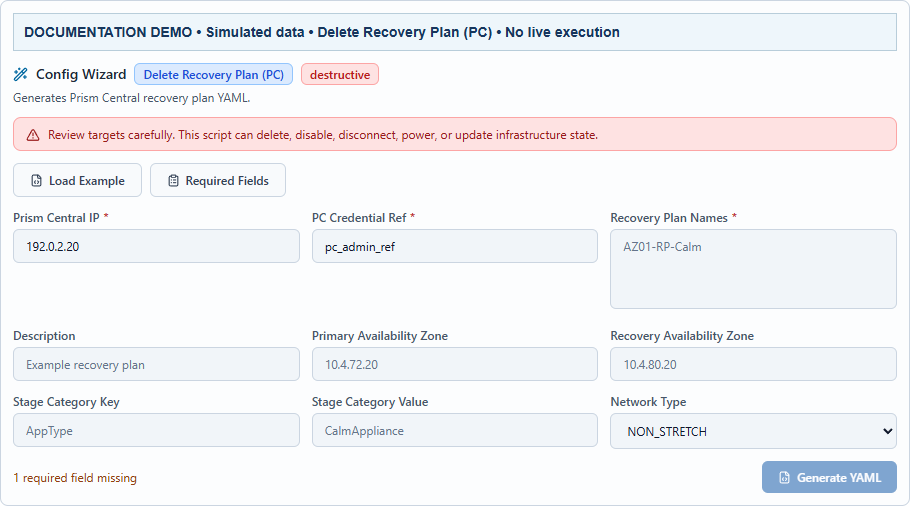

# Delete Recovery Plan (PC) Quick Guide

Guide ID: `QG-S-DeleteRecoveryPlan` · Reviewed: 20 November 2026 · Source: `79c3ecc`

Status: Current source procedure. Read [Using the quick guides](../using-the-guides.md) first.

## Purpose

Deletes a disaster recovery plan.

## Prerequisites

Review exact policy/plan/AZ identities, source and destination clusters, category scope, network mapping and supported RPO settings. Check existing replication and failover dependencies.

## Required inputs

| Input in wizard | Form requirement | How to supply it |
|---|---|---|
| Prism Central IP (`pc_ip`) | Required | The intended service management address; confirm its identity. |
| PC Credential Ref (`pc_credential`) | Required | Exact saved reference in the selected Global Config vault; not a literal password. |
| Recovery Plan Names (`plan_names`) | Required | Review the field separator and each exact entry before generation. |
| Description (`description`) | Optional in form | Use the exact approved target value; review its generated YAML representation. |
| Primary Availability Zone (`primary_az`) | Optional in form | Use the exact approved target value; review its generated YAML representation. |
| Recovery Availability Zone (`recovery_az`) | Optional in form | Use the exact approved target value; review its generated YAML representation. |
| Stage Category Key (`category_key`) | Optional in form | Use the exact approved target value; review its generated YAML representation. |
| Stage Category Value (`category_value`) | Optional in form | Use the exact approved target value; review its generated YAML representation. |
| Network Type (`network_type`) | Optional in form | Choose: NON_STRETCH, STRETCH. |

## Procedure

1. Open Scripts 1.x and select only Delete Recovery Plan (PC) (DeleteRecoveryPlan).
2. Complete the required inputs, including operation-specific optional fields needed by your design. Select Generate YAML and review every target and value in the editor.
3. Run Dry Run where available and inspect its diagnostics. It does not prove the change will succeed on the target. Obtain the approvals required by the installed policy.
4. To execute the approved single-script scope, enter exactly RUN DeleteRecoveryPlan when prompted, then submit once. Follow the terminal job/task results and perform the target checks below.

## Validation and expected result

Inspect the requested policy/plan/AZ state and underlying tasks. Verify replication/recovery readiness through a separate approved rehearsal.

## Failure and recovery

Configuration success does not establish achieved RPO/RTO or application recoverability. Delete/disconnect can remove protection; inspect dependencies and partial state before retry.

## Evidence to capture

Record the exact target, installed build, reviewed config filename/hash, approval if applicable, job/task/run IDs and redacted before/after checks. Keep unresolved follow-up with the change record.

## Screen reference

Local demonstration of **Single-script configuration wizard / authoring only** at `/scripts`, captured from source `79c3ecc` on 20 November 2026. Values and credential references are synthetic; required fields may intentionally be incomplete. This is the initial screen or selected configuration panel, not evidence of a successful run. Lower form sections may be outside the captured viewport. Follow this guide's preparation, approval and verification steps.

## References

- [Script wizard schema](../../../src/scriptConfigSchemas.ts)
- [Script execution UI](../../../src/pages/Scripts.tsx)
- [Common execution and recovery](../using-the-guides.md)
- [Guide index](../README.md)
