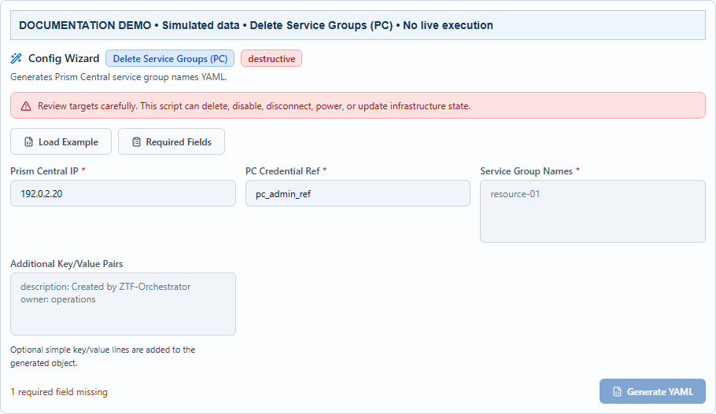

# Delete Service Groups (PC) Quick Guide

Guide ID: `QG-S-DeleteServiceGroups` · Reviewed: 21 November 2026 · Source: `48eb875`

Status: Current source procedure. Read [Using the quick guides](../using-the-guides.md) first.

## Purpose

Deletes service groups.

## Prerequisites

Review exact policy/group names, categories, address/service membership and consumers. Choose monitor/enforce mode intentionally and retain a separately approved access-recovery plan.

## Required inputs

| Input in wizard | Form requirement | How to supply it |
|---|---|---|
| Prism Central IP (`pc_ip`) | Required | The intended service management address; confirm its identity. |
| PC Credential Ref (`pc_credential`) | Required | Exact saved reference in the selected Global Config vault; not a literal password. |
| Service Group Names (`resource_names`) | Required | Review the field separator and each exact entry before generation. |
| Additional Key/Value Pairs (`extra_pairs`) | Optional in form | Optional simple key/value lines are added to the generated object. |

## Procedure

1. Open Scripts 1.x and select only Delete Service Groups (PC) (DeleteServiceGroups).
2. Complete the required inputs, including operation-specific optional fields needed by your design. Select Generate YAML and review every target and value in the editor.
3. Run Dry Run where available and inspect its diagnostics. It does not prove the change will succeed on the target. Obtain the approvals required by the installed policy.
4. To execute the approved single-script scope, enter exactly RUN DeleteServiceGroups when prompted, then submit once. Follow the terminal job/task results and perform the target checks below.

## Validation and expected result

Read back the intended policy/group and its membership or absence. Test both an allowed and a denied flow against the approved policy.

## Failure and recovery

Category/group existence does not prove isolation. Deletion or enforcement can interrupt connectivity; inspect actual policy state and dependencies before retry.

## Evidence to capture

Record the exact target, installed build, reviewed config filename/hash, approval if applicable, job/task/run IDs and redacted before/after checks. Keep unresolved follow-up with the change record.

## References

- [Script wizard schema](../../../src/scriptConfigSchemas.ts)
- [Script execution UI](../../../src/pages/Scripts.tsx)
- [Common execution and recovery](../using-the-guides.md)
- [Guide index](../README.md)

## Screen reference

Simulated initial/authoring view captured 21 November 2026 from application source `48eb875`. State: **Single-script configuration wizard / authoring only** at `/scripts`. Values are synthetic and required inputs may be incomplete. This is not evidence of a successful run, live target authentication or hardware compatibility. Lower form sections may be outside the captured viewport. Follow the preparation, approval, verification and recovery instructions.
