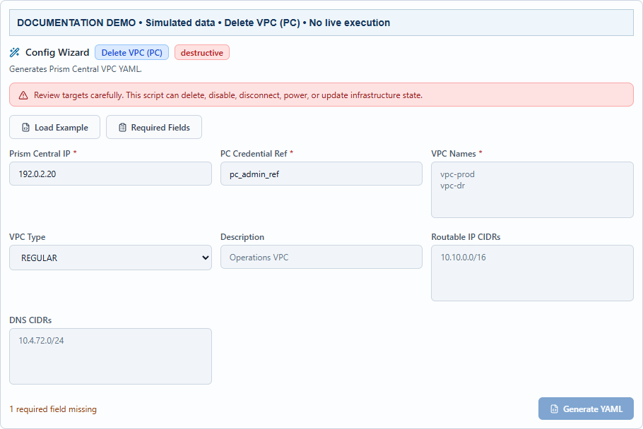

# Delete VPC (PC) Quick Guide

Guide ID: `QG-S-DeleteVPC` · Reviewed: 21 November 2026 · Source: `48eb875`

Status: Current source procedure. Read [Using the quick guides](../using-the-guides.md) first.

## Purpose

Deletes a Virtual Private Cloud in Prism Central.

## Prerequisites

Review exact VPC names, type, routable IPs and DNS, plus subnet, route, NAT and policy dependencies. For deletion approve the full connectivity impact.

## Required inputs

| Input in wizard | Form requirement | How to supply it |
|---|---|---|
| Prism Central IP (`pc_ip`) | Required | The intended service management address; confirm its identity. |
| PC Credential Ref (`pc_credential`) | Required | Exact saved reference in the selected Global Config vault; not a literal password. |
| VPC Names (`vpc_names`) | Required | Review the field separator and each exact entry before generation. |
| VPC Type (`vpc_type`) | Optional in form | Choose: REGULAR, TRANSIT. |
| Description (`description`) | Optional in form | Use the exact approved target value; review its generated YAML representation. |
| Routable IP CIDRs (`routable_ips`) | Optional in form | Review the field separator and each exact entry before generation. |
| DNS CIDRs (`dns`) | Optional in form | Review the field separator and each exact entry before generation. |

## Procedure

1. Open Scripts 1.x and select only Delete VPC (PC) (DeleteVPC).
2. Complete the required inputs, including operation-specific optional fields needed by your design. Select Generate YAML and review every target and value in the editor.
3. Run Dry Run where available and inspect its diagnostics. It does not prove the change will succeed on the target. Obtain the approvals required by the installed policy.
4. To execute the approved single-script scope, enter exactly RUN DeleteVPC when prompted, then submit once. Follow the terminal job/task results and perform the target checks below.

## Validation and expected result

Inspect the intended VPC object and requested properties, or its absence for deletion; test the affected routed paths.

## Failure and recovery

VPC creation is not proof of routing or isolation. A delete has no automatic rollback; reconcile dependencies and partial changes before another submission.

## Evidence to capture

Record the exact target, installed build, reviewed config filename/hash, approval if applicable, job/task/run IDs and redacted before/after checks. Keep unresolved follow-up with the change record.

## References

- [Script wizard schema](../../../src/scriptConfigSchemas.ts)
- [Script execution UI](../../../src/pages/Scripts.tsx)
- [Common execution and recovery](../using-the-guides.md)
- [Guide index](../README.md)

## Screen reference

Simulated initial/authoring view captured 21 November 2026 from application source `48eb875`. State: **Single-script configuration wizard / authoring only** at `/scripts`. Values are synthetic and required inputs may be incomplete. This is not evidence of a successful run, live target authentication or hardware compatibility. Lower form sections may be outside the captured viewport. Follow the preparation, approval, verification and recovery instructions.
