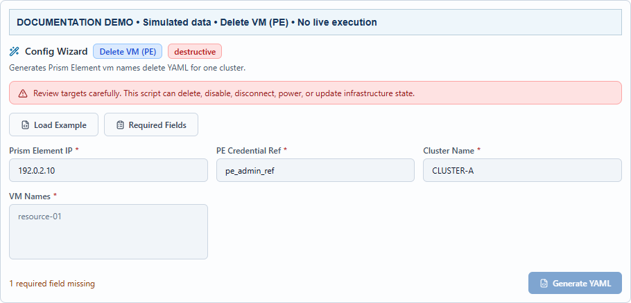

# Delete VM (PE) Quick Guide

Guide ID: `QG-S-DeleteVmPe` · Reviewed: 20 November 2026 · Source: `79c3ecc`

Status: Current source procedure. Read [Using the quick guides](../using-the-guides.md) first.

## Purpose

Deletes virtual machines directly through Prism Element.

## Prerequisites

Confirm exact VM names and cluster identity against the approved inventory. Obtain a verified backup/restore plan and approval for VM and associated-disk loss.

## Required inputs

| Input in wizard | Form requirement | How to supply it |
|---|---|---|
| Prism Element IP (`cluster_ip`) | Required | The intended service management address; confirm its identity. |
| PE Credential Ref (`pe_credential`) | Required | Exact saved reference in the selected Global Config vault; not a literal password. |
| Cluster Name (`cluster_name`) | Required | Use the exact approved target value; review its generated YAML representation. |
| VM Names (`resource_names`) | Required | Review the field separator and each exact entry before generation. |

## Procedure

1. Open Scripts 1.x and select only Delete VM (PE) (DeleteVmPe).
2. Complete the required inputs, including operation-specific optional fields needed by your design. Select Generate YAML and review every target and value in the editor.
3. Run Dry Run where available and inspect its diagnostics. It does not prove the change will succeed on the target. Obtain the approvals required by the installed policy.
4. To execute the approved single-script scope, enter exactly RUN DeleteVmPe when prompted, then submit once. Follow the terminal job/task results and perform the target checks below.

## Validation and expected result

Read fresh inventory to confirm only the named VMs were removed; check remaining workloads and storage.

## Failure and recovery

Deletion is destructive and not automatically reversible. Resolve dependencies without widening the target list; restore only through the approved backup procedure.

## Evidence to capture

Record the exact target, installed build, reviewed config filename/hash, approval if applicable, job/task/run IDs and redacted before/after checks. Keep unresolved follow-up with the change record.

## Screen reference

Local demonstration of **Single-script configuration wizard / authoring only** at `/scripts`, captured from source `79c3ecc` on 20 November 2026. Values and credential references are synthetic; required fields may intentionally be incomplete. This is the initial screen or selected configuration panel, not evidence of a successful run. Lower form sections may be outside the captured viewport. Follow this guide's preparation, approval and verification steps.

## References

- [Script wizard schema](../../../src/scriptConfigSchemas.ts)
- [Script execution UI](../../../src/pages/Scripts.tsx)
- [Common execution and recovery](../using-the-guides.md)
- [Guide index](../README.md)
