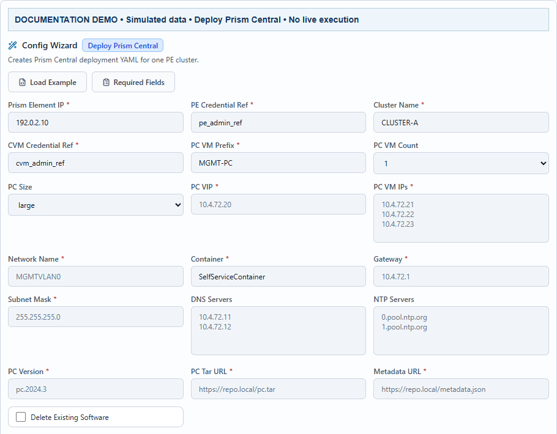

# Deploy Prism Central Quick Guide

Guide ID: `QG-S-DeployPC` · Reviewed: 20 November 2026 · Source: `79c3ecc`

Status: Current source procedure. Read [Using the quick guides](../using-the-guides.md) first.

## Purpose

Deploys a Prism Central VM.

## Prerequisites

Supply PE/CVM references, PC image and metadata URLs/version, VM size/count, exact network/container, VIP and IP list, gateway/mask and DNS/NTP. Review delete-existing-software explicitly.

## Required inputs

| Input in wizard | Form requirement | How to supply it |
|---|---|---|
| Prism Element IP (`cluster_ip`) | Required | The intended service management address; confirm its identity. |
| PE Credential Ref (`pe_credential`) | Required | Exact saved reference in the selected Global Config vault; not a literal password. |
| Cluster Name (`cluster_name`) | Required | Use the exact approved target value; review its generated YAML representation. |
| CVM Credential Ref (`cvm_credential`) | Required | Exact saved reference in the selected Global Config vault; not a literal password. |
| PC VM Prefix (`pc_vm_name_prefix`) | Required | Use the exact approved target value; review its generated YAML representation. |
| PC VM Count (`num_pc_vms`) | Optional in form | Choose: 1, 3. |
| PC Size (`pc_size`) | Optional in form | Choose: small, large, xlarge. |
| PC VIP (`pc_vip`) | Required | Use the exact approved target value; review its generated YAML representation. |
| PC VM IPs (`ip_list`) | Required | Review the field separator and each exact entry before generation. |
| Network Name (`network_name`) | Required | Use the exact approved target value; review its generated YAML representation. |
| Container (`container_name`) | Required | Use the exact approved target value; review its generated YAML representation. |
| Gateway (`default_gateway`) | Required | Use the exact approved target value; review its generated YAML representation. |
| Subnet Mask (`subnet_mask`) | Required | Use the exact approved target value; review its generated YAML representation. |
| DNS Servers (`dns_servers`) | Optional in form | Review the field separator and each exact entry before generation. |
| NTP Servers (`ntp_servers`) | Optional in form | Review the field separator and each exact entry before generation. |
| PC Version (`pc_version`) | Required | Use the exact approved target value; review its generated YAML representation. |
| PC Tar URL (`file_url`) | Required | Use the exact approved target value; review its generated YAML representation. |
| Metadata URL (`metadata_file_url`) | Required | Use the exact approved target value; review its generated YAML representation. |
| Delete Existing Software (`delete_existing_software`) | Optional in form | Set deliberately to match the approved change; check the generated boolean. |

## Procedure

1. Open Scripts 1.x and select only Deploy Prism Central (DeployPC).
2. Complete the required inputs, including operation-specific optional fields needed by your design. Select Generate YAML and review every target and value in the editor.
3. Run Dry Run where available and inspect its diagnostics. It does not prove the change will succeed on the target. Obtain the approvals required by the installed policy.
4. Submit the approved single-script scope once. Follow the terminal job/task results and perform the target checks below.

## Validation and expected result

Track deployment completion, then verify PC HTTPS identity, version and intended node membership and service health.

## Failure and recovery

A VM appearing is not healthy PC. Reconcile software/deployment tasks and partial VMs before resubmitting; do not delete existing software casually.

## Evidence to capture

Record the exact target, installed build, reviewed config filename/hash, approval if applicable, job/task/run IDs and redacted before/after checks. Keep unresolved follow-up with the change record.

## Screen reference

Local demonstration of **Single-script configuration wizard / authoring only** at `/scripts`, captured from source `79c3ecc` on 20 November 2026. Values and credential references are synthetic; required fields may intentionally be incomplete. This is the initial screen or selected configuration panel, not evidence of a successful run. Lower form sections may be outside the captured viewport. Follow this guide's preparation, approval and verification steps.

## References

- [Script wizard schema](../../../src/scriptConfigSchemas.ts)
- [Script execution UI](../../../src/pages/Scripts.tsx)
- [Common execution and recovery](../using-the-guides.md)
- [Guide index](../README.md)
