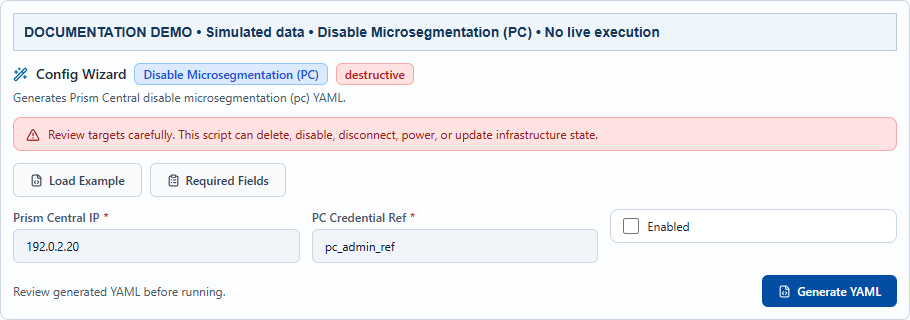

# Disable Microsegmentation (PC) Quick Guide

Guide ID: `QG-S-DisableMicrosegmentation` · Reviewed: 20 November 2026 · Source: `79c3ecc`

Status: Current source procedure. Read [Using the quick guides](../using-the-guides.md) first.

## Purpose

Disables Flow microsegmentation on Prism Central.

## Prerequisites

Check licensing, target version, capacity and service-specific prerequisites. Confirm that the selected enable/disable value matches the script name and approved impact.

## Required inputs

| Input in wizard | Form requirement | How to supply it |
|---|---|---|
| Prism Central IP (`pc_ip`) | Required | The intended service management address; confirm its identity. |
| PC Credential Ref (`pc_credential`) | Required | Exact saved reference in the selected Global Config vault; not a literal password. |
| Enabled (`enabled`) | Optional in form | Set deliberately to match the approved change; check the generated boolean. |

## Procedure

1. Open Scripts 1.x and select only Disable Microsegmentation (PC) (DisableMicrosegmentation).
2. Complete the required inputs, including operation-specific optional fields needed by your design. Select Generate YAML and review every target and value in the editor.
3. Run Dry Run where available and inspect its diagnostics. It does not prove the change will succeed on the target. Obtain the approvals required by the installed policy.
4. To execute the approved single-script scope, enter exactly RUN DisableMicrosegmentation when prompted, then submit once. Follow the terminal job/task results and perform the target checks below.

## Validation and expected result

Inspect the feature status and underlying service/task health in PC; exercise one relevant service function separately.

## Failure and recovery

A feature flag does not prove workload readiness. Disabling services can affect consumers; use the vendor procedure and inspect asynchronous tasks before rerun.

## Evidence to capture

Record the exact target, installed build, reviewed config filename/hash, approval if applicable, job/task/run IDs and redacted before/after checks. Keep unresolved follow-up with the change record.

## Screen reference

Local demonstration of **Single-script configuration wizard / authoring only** at `/scripts`, captured from source `79c3ecc` on 20 November 2026. Values and credential references are synthetic; required fields may intentionally be incomplete. This is the initial screen or selected configuration panel, not evidence of a successful run. Lower form sections may be outside the captured viewport. Follow this guide's preparation, approval and verification steps.

## References

- [Script wizard schema](../../../src/scriptConfigSchemas.ts)
- [Script execution UI](../../../src/pages/Scripts.tsx)
- [Common execution and recovery](../using-the-guides.md)
- [Guide index](../README.md)
