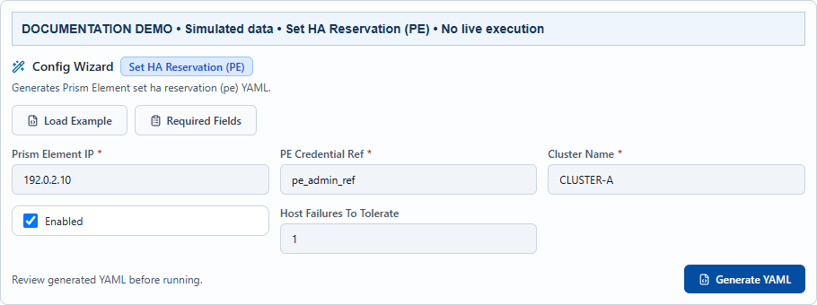

# Set HA Reservation (PE) Quick Guide

Guide ID: `QG-S-HaReservation` · Reviewed: 20 November 2026 · Source: `79c3ecc`

Status: Current source procedure. Read [Using the quick guides](../using-the-guides.md) first.

## Purpose

Configures high-availability host reservation.

## Prerequisites

Review cluster host count, failure tolerance, free capacity and the approved HA/rebuild reservation design. Confirm the selected enabled value and host-failure count where offered.

## Required inputs

| Input in wizard | Form requirement | How to supply it |
|---|---|---|
| Prism Element IP (`cluster_ip`) | Required | The intended service management address; confirm its identity. |
| PE Credential Ref (`pe_credential`) | Required | Exact saved reference in the selected Global Config vault; not a literal password. |
| Cluster Name (`cluster_name`) | Required | Use the exact approved target value; review its generated YAML representation. |
| Enabled (`enabled`) | Optional in form | Set deliberately to match the approved change; check the generated boolean. |
| Host Failures To Tolerate (`host_failures`) | Optional in form | Use the approved value and units shown in the wizard; defaults are not sizing guidance. |

## Procedure

1. Open Scripts 1.x and select only Set HA Reservation (PE) (HaReservation).
2. Complete the required inputs, including operation-specific optional fields needed by your design. Select Generate YAML and review every target and value in the editor.
3. Run Dry Run where available and inspect its diagnostics. It does not prove the change will succeed on the target. Obtain the approvals required by the installed policy.
4. Submit the approved single-script scope once. Follow the terminal job/task results and perform the target checks below.

## Validation and expected result

Compare HA or rebuild reservation in PE and confirm cluster capacity/health meet the approved design.

## Failure and recovery

A reservation can reduce usable capacity. Do not treat form defaults as sizing advice; restore prior values only through a reviewed change.

## Evidence to capture

Record the exact target, installed build, reviewed config filename/hash, approval if applicable, job/task/run IDs and redacted before/after checks. Keep unresolved follow-up with the change record.

## Screen reference

Local demonstration of **Single-script configuration wizard / authoring only** at `/scripts`, captured from source `79c3ecc` on 20 November 2026. Values and credential references are synthetic; required fields may intentionally be incomplete. This is the initial screen or selected configuration panel, not evidence of a successful run. Lower form sections may be outside the captured viewport. Follow this guide's preparation, approval and verification steps.

## References

- [Script wizard schema](../../../src/scriptConfigSchemas.ts)
- [Script execution UI](../../../src/pages/Scripts.tsx)
- [Common execution and recovery](../using-the-guides.md)
- [Guide index](../README.md)
