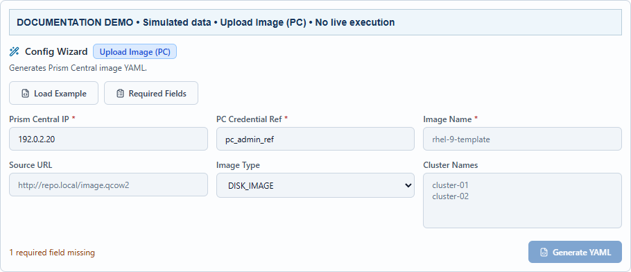

# Upload Image (PC) Quick Guide

Guide ID: `QG-S-PcImageUpload` · Reviewed: 20 November 2026 · Source: `79c3ecc`

Status: Current source procedure. Read [Using the quick guides](../using-the-guides.md) first.

## Purpose

Uploads disk images through Prism Central.

## Prerequisites

Review exact image/OVA name, type and cluster placement. For upload confirm source URL reachability from the target and a trusted checksum; for deletion review all image/template consumers.

## Required inputs

| Input in wizard | Form requirement | How to supply it |
|---|---|---|
| Prism Central IP (`pc_ip`) | Required | The intended service management address; confirm its identity. |
| PC Credential Ref (`pc_credential`) | Required | Exact saved reference in the selected Global Config vault; not a literal password. |
| Image Name (`artifact_name`) | Required | Use the exact approved target value; review its generated YAML representation. |
| Source URL (`url`) | Optional in form | Use the exact approved target value; review its generated YAML representation. |
| Image Type (`image_type`) | Optional in form | Choose: DISK_IMAGE, ISO_IMAGE. |
| Cluster Names (`cluster_names`) | Optional in form | Review the field separator and each exact entry before generation. |

## Procedure

1. Open Scripts 1.x and select only Upload Image (PC) (PcImageUpload).
2. Complete the required inputs, including operation-specific optional fields needed by your design. Select Generate YAML and review every target and value in the editor.
3. Run Dry Run where available and inspect its diagnostics. It does not prove the change will succeed on the target. Obtain the approvals required by the installed policy.
4. Submit the approved single-script scope once. Follow the terminal job/task results and perform the target checks below.

## Validation and expected result

For upload confirm transfer/task completion and the intended image identity/type/size. For deletion confirm only the selected artifact is absent.

## Failure and recovery

The wizard may leave URL optional for shared upload/delete schemas; an upload still needs a valid source. A registered image does not prove it boots. Inspect tasks before retry.

## Evidence to capture

Record the exact target, installed build, reviewed config filename/hash, approval if applicable, job/task/run IDs and redacted before/after checks. Keep unresolved follow-up with the change record.

## Screen reference

Local demonstration of **Single-script configuration wizard / authoring only** at `/scripts`, captured from source `79c3ecc` on 20 November 2026. Values and credential references are synthetic; required fields may intentionally be incomplete. This is the initial screen or selected configuration panel, not evidence of a successful run. Lower form sections may be outside the captured viewport. Follow this guide's preparation, approval and verification steps.

## References

- [Script wizard schema](../../../src/scriptConfigSchemas.ts)
- [Script execution UI](../../../src/pages/Scripts.tsx)
- [Common execution and recovery](../using-the-guides.md)
- [Guide index](../README.md)
