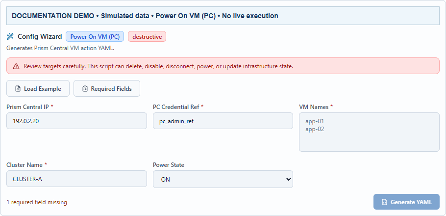

# Power On VM (PC) Quick Guide

Guide ID: `QG-S-PowerOnVmPc` · Reviewed: 21 November 2026 · Source: `48eb875`

Status: Current source procedure. Read [Using the quick guides](../using-the-guides.md) first.

## Purpose

Powers on virtual machines through Prism Central.

## Prerequisites

Identify exact VM names and cluster, select the reviewed transition/power state and confirm application-owner acceptance of interruption.

## Required inputs

| Input in wizard | Form requirement | How to supply it |
|---|---|---|
| Prism Central IP (`pc_ip`) | Required | The intended service management address; confirm its identity. |
| PC Credential Ref (`pc_credential`) | Required | Exact saved reference in the selected Global Config vault; not a literal password. |
| VM Names (`vm_names`) | Required | Review the field separator and each exact entry before generation. |
| Cluster Name (`cluster_name`) | Required | Use the exact approved target value; review its generated YAML representation. |
| Power State (`power_state`) | Optional in form | Choose: ON. |

## Procedure

1. Open Scripts 1.x and select only Power On VM (PC) (PowerOnVmPc).
2. Complete the required inputs, including operation-specific optional fields needed by your design. Select Generate YAML and review every target and value in the editor.
3. Run Dry Run where available and inspect its diagnostics. It does not prove the change will succeed on the target. Obtain the approvals required by the installed policy.
4. To execute the approved single-script scope, enter exactly RUN PowerOnVmPc when prompted, then submit once. Follow the terminal job/task results and perform the target checks below.

## Validation and expected result

Check each VM reaches the requested state and verify guest/application health after a start or restart.

## Failure and recovery

Power changes can interrupt service and do not repair application failures. Recheck actual power/task state before another request.

## Evidence to capture

Record the exact target, installed build, reviewed config filename/hash, approval if applicable, job/task/run IDs and redacted before/after checks. Keep unresolved follow-up with the change record.

## References

- [Script wizard schema](../../../src/scriptConfigSchemas.ts)
- [Script execution UI](../../../src/pages/Scripts.tsx)
- [Common execution and recovery](../using-the-guides.md)
- [Guide index](../README.md)

## Screen reference

Simulated initial/authoring view captured 21 November 2026 from application source `48eb875`. State: **Single-script configuration wizard / authoring only** at `/scripts`. Values are synthetic and required inputs may be incomplete. This is not evidence of a successful run, live target authentication or hardware compatibility. Lower form sections may be outside the captured viewport. Follow the preparation, approval, verification and recovery instructions.
