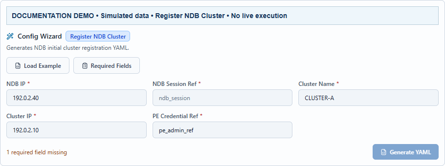

# Register NDB Cluster Quick Guide

Guide ID: `QG-S-RegisterInitClusterNdb` · Reviewed: 21 November 2026 · Source: `48eb875`

Status: Current source procedure. Read [Using the quick guides](../using-the-guides.md) first.

## Purpose

Registers and initializes a cluster with NDB.

## Prerequisites

Check NDB compatibility, healthy PE, NDB credentials and VM/service addressing. Registration requires the correct NDB session reference and existing cluster identity.

## Required inputs

| Input in wizard | Form requirement | How to supply it |
|---|---|---|
| NDB IP (`ndb_ip`) | Required | The intended service management address; confirm its identity. |
| NDB Session Ref (`ndb_session`) | Required | Use the exact approved target value; review its generated YAML representation. |
| Cluster Name (`cluster_name`) | Required | Use the exact approved target value; review its generated YAML representation. |
| Cluster IP (`cluster_ip`) | Required | The intended service management address; confirm its identity. |
| PE Credential Ref (`pe_credential`) | Required | Exact saved reference in the selected Global Config vault; not a literal password. |

## Procedure

1. Open Scripts 1.x and select only Register NDB Cluster (RegisterInitClusterNdb).
2. Complete the required inputs, including operation-specific optional fields needed by your design. Select Generate YAML and review every target and value in the editor.
3. Run Dry Run where available and inspect its diagnostics. It does not prove the change will succeed on the target. Obtain the approvals required by the installed policy.
4. Submit the approved single-script scope once. Follow the terminal job/task results and perform the target checks below.

## Validation and expected result

Verify NDB service health and the requested registered/initialized cluster and profiles; inspect NDB task results.

## Failure and recovery

A session field may be sensitive; protect YAML and logs. Registration is not database backup or restore proof. Reconcile partial initialization before retry.

## Evidence to capture

Record the exact target, installed build, reviewed config filename/hash, approval if applicable, job/task/run IDs and redacted before/after checks. Keep unresolved follow-up with the change record.

## References

- [Script wizard schema](../../../src/scriptConfigSchemas.ts)
- [Script execution UI](../../../src/pages/Scripts.tsx)
- [Common execution and recovery](../using-the-guides.md)
- [Guide index](../README.md)

## Screen reference

Simulated initial/authoring view captured 21 November 2026 from application source `48eb875`. State: **Single-script configuration wizard / authoring only** at `/scripts`. Values are synthetic and required inputs may be incomplete. This is not evidence of a successful run, live target authentication or hardware compatibility. Lower form sections may be outside the captured viewport. Follow the preparation, approval, verification and recovery instructions.
