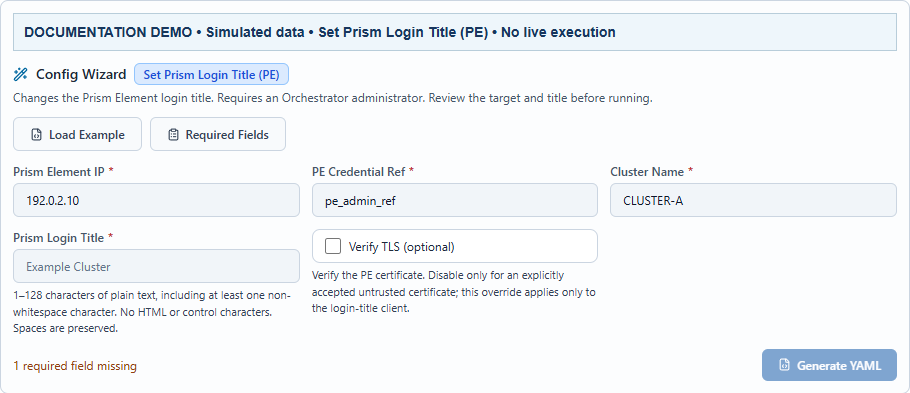

# Set Prism Login Title (PE) Quick Guide

Guide ID: `QG-S-SetPrismLoginTitlePe` · Reviewed: 21 November 2026 · Source: `48eb875`

Status: Current source procedure. Read [Using the quick guides](../using-the-guides.md) first.

## Purpose

Updates the Prism Element login title using a credential reference; requires an Orchestrator administrator.

## Prerequisites

Use the PE endpoint/name, saved credential reference and approved login title. An Orchestrator administrator is required; keep certificate verification enabled.

## Required inputs

| Input in wizard | Form requirement | How to supply it |
|---|---|---|
| Prism Element IP (`cluster_ip`) | Required | The intended service management address; confirm its identity. |
| PE Credential Ref (`pe_credential`) | Required | Exact saved reference in the selected Global Config vault; not a literal password. |
| Cluster Name (`cluster_name`) | Required | Use the exact approved target value; review its generated YAML representation. |
| Prism Login Title (`prism_login_title`) | Required | 1–128 characters of plain text, including at least one non-whitespace character. No HTML or control characters. Spaces are preserved. |
| Verify TLS (optional) (`prism_login_title_verify_tls`) | Optional in form | Verify the PE certificate. Disable only for an explicitly accepted untrusted certificate; this override applies only to the login-title client. |

## Procedure

1. Open Scripts 1.x and select only Set Prism Login Title (PE) (SetPrismLoginTitlePe).
2. Complete the required inputs, including operation-specific optional fields needed by your design. Select Generate YAML and review every target and value in the editor.
3. Run Dry Run where available and inspect its diagnostics. It does not prove the change will succeed on the target. Obtain the approvals required by the installed policy.
4. Submit the approved single-script scope once. Follow the terminal job/task results and perform the target checks below.

## Validation and expected result

Read back the title and independently view the intended PE login page; confirm no other cluster was targeted.

## Failure and recovery

Fix certificate trust rather than globally disabling verification. A displayed title does not prove any other cluster baseline setting.

## Evidence to capture

Record the exact target, installed build, reviewed config filename/hash, approval if applicable, job/task/run IDs and redacted before/after checks. Keep unresolved follow-up with the change record.

## References

- [Detailed procedure](../../pe-login-title.md)
- [Script wizard schema](../../../src/scriptConfigSchemas.ts)
- [Script execution UI](../../../src/pages/Scripts.tsx)
- [Common execution and recovery](../using-the-guides.md)
- [Guide index](../README.md)

## Screen reference

Simulated initial/authoring view captured 21 November 2026 from application source `48eb875`. State: **Single-script configuration wizard / authoring only** at `/scripts`. Values are synthetic and required inputs may be incomplete. This is not evidence of a successful run, live target authentication or hardware compatibility. Lower form sections may be outside the captured viewport. Follow the preparation, approval, verification and recovery instructions.
