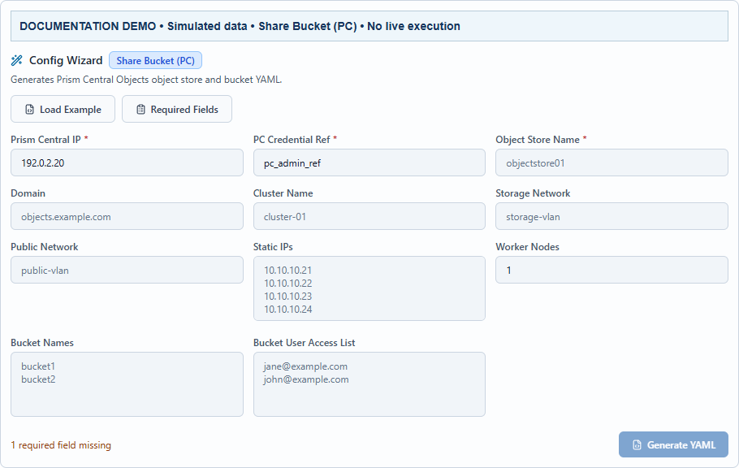

# Share Bucket (PC) Quick Guide

Guide ID: `QG-S-ShareBucket` · Reviewed: 20 November 2026 · Source: `79c3ecc`

Status: Current source procedure. Read [Using the quick guides](../using-the-guides.md) first.

## Purpose

Shares a bucket with users.

## Prerequisites

Review the exact object-store/bucket identity, cluster/network placement, worker capacity and intended user access. Supply operation-relevant optional fields even if the wizard does not mark them required.

## Required inputs

| Input in wizard | Form requirement | How to supply it |
|---|---|---|
| Prism Central IP (`pc_ip`) | Required | The intended service management address; confirm its identity. |
| PC Credential Ref (`pc_credential`) | Required | Exact saved reference in the selected Global Config vault; not a literal password. |
| Object Store Name (`objectstore_name`) | Required | Use the exact approved target value; review its generated YAML representation. |
| Domain (`domain`) | Optional in form | Use the exact approved target value; review its generated YAML representation. |
| Cluster Name (`cluster`) | Optional in form | Use the exact approved target value; review its generated YAML representation. |
| Storage Network (`storage_network`) | Optional in form | Use the exact approved target value; review its generated YAML representation. |
| Public Network (`public_network`) | Optional in form | Use the exact approved target value; review its generated YAML representation. |
| Static IPs (`static_ips`) | Optional in form | Review the field separator and each exact entry before generation. |
| Worker Nodes (`num_worker_nodes`) | Optional in form | Use the approved value and units shown in the wizard; defaults are not sizing guidance. |
| Bucket Names (`bucket_names`) | Optional in form | Review the field separator and each exact entry before generation. |
| Bucket User Access List (`user_access_list`) | Optional in form | Review the field separator and each exact entry before generation. |

## Procedure

1. Open Scripts 1.x and select only Share Bucket (PC) (ShareBucket).
2. Complete the required inputs, including operation-specific optional fields needed by your design. Select Generate YAML and review every target and value in the editor.
3. Run Dry Run where available and inspect its diagnostics. It does not prove the change will succeed on the target. Obtain the approvals required by the installed policy.
4. Submit the approved single-script scope once. Follow the terminal job/task results and perform the target checks below.

## Validation and expected result

Verify the specific object store, bucket or sharing policy in PC; test a designated S3 client with the intended level of access.

## Failure and recovery

Service creation may be asynchronous. Deleting a store can destroy bucket data; sharing changes permissions. Inspect actual tasks and data dependencies before retry.

## Evidence to capture

Record the exact target, installed build, reviewed config filename/hash, approval if applicable, job/task/run IDs and redacted before/after checks. Keep unresolved follow-up with the change record.

## Screen reference

Local demonstration of **Single-script configuration wizard / authoring only** at `/scripts`, captured from source `79c3ecc` on 20 November 2026. Values and credential references are synthetic; required fields may intentionally be incomplete. This is the initial screen or selected configuration panel, not evidence of a successful run. Lower form sections may be outside the captured viewport. Follow this guide's preparation, approval and verification steps.

## References

- [Script wizard schema](../../../src/scriptConfigSchemas.ts)
- [Script execution UI](../../../src/pages/Scripts.tsx)
- [Common execution and recovery](../using-the-guides.md)
- [Guide index](../README.md)
