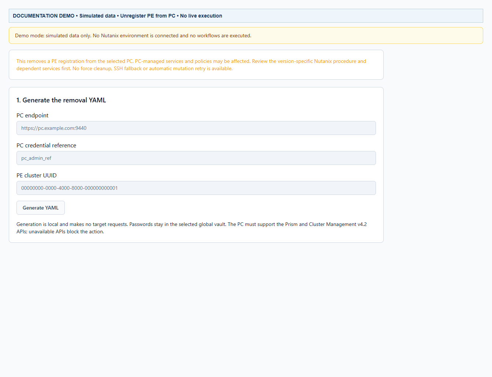

# Unregister PE from PC Quick Guide

Guide ID: `QG-S-UnregisterPeFromPc` · Reviewed: 21 November 2026 · Source: `48eb875`

Status: Current source procedure. Read [Using the quick guides](../using-the-guides.md) first.

## Purpose

Opens the administrator removal wizard; exact-content approval and verification required.

## Prerequisites

Trusted PC HTTPS endpoint on port 9440, selected-vault PC credential reference and exact PE cluster UUID; reviewed vendor dependencies.

## Required inputs

| Input in wizard | Form requirement | How to supply it |
|---|---|---|
| PC endpoint (`pc_endpoint`) | Required | Use the exact approved target value; review its generated YAML representation. |
| PC credential reference (`pc_credential`) | Required | Exact saved reference in the selected Global Config vault; not a literal password. |
| PE cluster UUID (`pe_cluster_uuid`) | Required | Use the exact approved target value; review its generated YAML representation. |

## Procedure

1. Open Scripts → Unregister PE from PC. Follow its link to the dedicated administrator removal wizard; do not queue it with other scripts.
2. Select Look up target (read-only). Check captured PC UUID and PE name, acknowledge dependencies and obtain a different administrator's exact-YAML approval. Type UNREGISTER followed by the PE UUID and submit once.

## Validation and expected result

A successful PC task and fresh PC inventory show the PE absent. Capture pcInventoryRemovalVerified, peSideCleanupVerified and followupRequired.

## Failure and recovery

PC-side removal does not prove PE cleanup or service health. Reconcile ambiguous tasks before another approval. This action cannot run through script composition, scheduling or pipelines.

## Evidence to capture

Record the exact target, installed build, reviewed config filename/hash, approval if applicable, job/task/run IDs and redacted before/after checks. Keep unresolved follow-up with the change record.

## References

- [Full workflow quick guide](../workflows/unregister-pe-from-pc.md)
- [Detailed procedure](../../unregister-pe-from-pc.md)
- [Guide index](../README.md)

## Screen reference

Simulated initial/authoring view captured 21 November 2026 from application source `48eb875`. State: **Configure / initial draft** at `/workflows/unregister-pe-from-pc`. Values are synthetic and required inputs may be incomplete. This is not evidence of a successful run, live target authentication or hardware compatibility. Lower form sections may be outside the captured viewport. Follow the preparation, approval, verification and recovery instructions.
