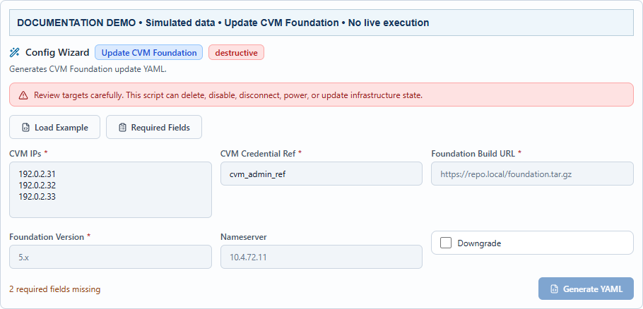

# Update CVM Foundation Quick Guide

Guide ID: `QG-S-UpdateCvmFoundation` · Reviewed: 20 November 2026 · Source: `79c3ecc`

Status: Current source procedure. Read [Using the quick guides](../using-the-guides.md) first.

## Purpose

Updates Foundation on CVM nodes.

## Prerequisites

Review every CVM IP and credential, approved Foundation build URL/version and checksum, plus the vendor compatibility and downgrade policy.

## Required inputs

| Input in wizard | Form requirement | How to supply it |
|---|---|---|
| CVM IPs (`cvm_ips`) | Required | Review the field separator and each exact entry before generation. |
| CVM Credential Ref (`cvm_credential`) | Required | Exact saved reference in the selected Global Config vault; not a literal password. |
| Foundation Build URL (`foundation_build_url`) | Required | Use the exact approved target value; review its generated YAML representation. |
| Foundation Version (`foundation_version`) | Required | Use the exact approved target value; review its generated YAML representation. |
| Nameserver (`nameserver`) | Optional in form | Use the exact approved target value; review its generated YAML representation. |
| Downgrade (`downgrade`) | Optional in form | Set deliberately to match the approved change; check the generated boolean. |

## Procedure

1. Open Scripts 1.x and select only Update CVM Foundation (UpdateCvmFoundation).
2. Complete the required inputs, including operation-specific optional fields needed by your design. Select Generate YAML and review every target and value in the editor.
3. Run Dry Run where available and inspect its diagnostics. It does not prove the change will succeed on the target. Obtain the approvals required by the installed policy.
4. To execute the approved single-script scope, enter exactly RUN UpdateCvmFoundation when prompted, then submit once. Follow the terminal job/task results and perform the target checks below.

## Validation and expected result

Verify the installed Foundation version on every requested CVM and service health; retain per-node task results.

## Failure and recovery

Changing Foundation software can affect deployment services. Keep downgrade off unless separately approved; reconcile partial node updates before retry.

## Evidence to capture

Record the exact target, installed build, reviewed config filename/hash, approval if applicable, job/task/run IDs and redacted before/after checks. Keep unresolved follow-up with the change record.

## Screen reference

Local demonstration of **Single-script configuration wizard / authoring only** at `/scripts`, captured from source `79c3ecc` on 20 November 2026. Values and credential references are synthetic; required fields may intentionally be incomplete. This is the initial screen or selected configuration panel, not evidence of a successful run. Lower form sections may be outside the captured viewport. Follow this guide's preparation, approval and verification steps.

## References

- [Script wizard schema](../../../src/scriptConfigSchemas.ts)
- [Script execution UI](../../../src/pages/Scripts.tsx)
- [Common execution and recovery](../using-the-guides.md)
- [Guide index](../README.md)
