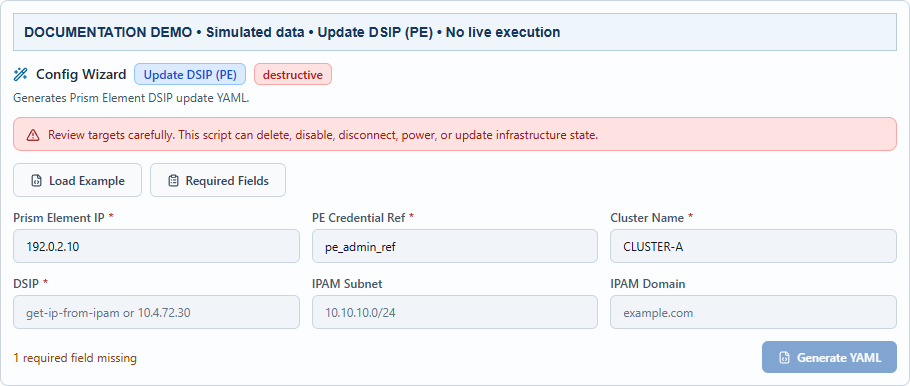

# Update DSIP (PE) Quick Guide

Guide ID: `QG-S-UpdateDsip` · Reviewed: 21 November 2026 · Source: `48eb875`

Status: Current source procedure. Read [Using the quick guides](../using-the-guides.md) first.

## Purpose

Updates DSIP in Prism Element.

## Prerequisites

Confirm a free, routed data-services IP and the intended cluster. Review any IPAM subnet/domain settings and storage-client impact.

## Required inputs

| Input in wizard | Form requirement | How to supply it |
|---|---|---|
| Prism Element IP (`cluster_ip`) | Required | The intended service management address; confirm its identity. |
| PE Credential Ref (`pe_credential`) | Required | Exact saved reference in the selected Global Config vault; not a literal password. |
| Cluster Name (`cluster_name`) | Required | Use the exact approved target value; review its generated YAML representation. |
| DSIP (`dsip`) | Required | Use the exact approved target value; review its generated YAML representation. |
| IPAM Subnet (`ipam_subnet`) | Optional in form | Use the exact approved target value; review its generated YAML representation. |
| IPAM Domain (`ipam_domain`) | Optional in form | Use the exact approved target value; review its generated YAML representation. |

## Procedure

1. Open Scripts 1.x and select only Update DSIP (PE) (UpdateDsip).
2. Complete the required inputs, including operation-specific optional fields needed by your design. Select Generate YAML and review every target and value in the editor.
3. Run Dry Run where available and inspect its diagnostics. It does not prove the change will succeed on the target. Obtain the approvals required by the installed policy.
4. To execute the approved single-script scope, enter exactly RUN UpdateDsip when prompted, then submit once. Follow the terminal job/task results and perform the target checks below.

## Validation and expected result

Read back the data-services IP and verify relevant client connectivity from the intended storage network.

## Failure and recovery

Changing DSIP can interrupt clients. Keep prior values and a recovery plan; investigate address conflicts and actual target state before retry.

## Evidence to capture

Record the exact target, installed build, reviewed config filename/hash, approval if applicable, job/task/run IDs and redacted before/after checks. Keep unresolved follow-up with the change record.

## References

- [Script wizard schema](../../../src/scriptConfigSchemas.ts)
- [Script execution UI](../../../src/pages/Scripts.tsx)
- [Common execution and recovery](../using-the-guides.md)
- [Guide index](../README.md)

## Screen reference

Simulated initial/authoring view captured 21 November 2026 from application source `48eb875`. State: **Single-script configuration wizard / authoring only** at `/scripts`. Values are synthetic and required inputs may be incomplete. This is not evidence of a successful run, live target authentication or hardware compatibility. Lower form sections may be outside the captured viewport. Follow the preparation, approval, verification and recovery instructions.
