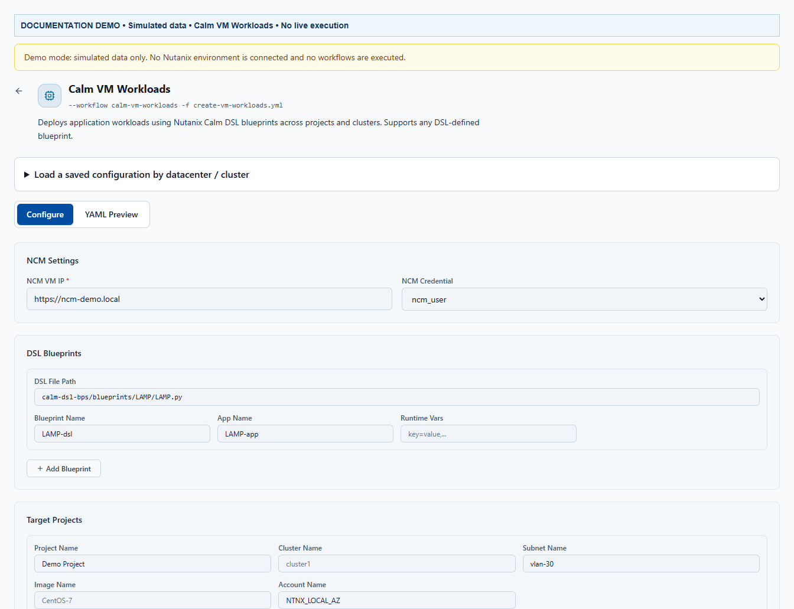

# Calm VM Workloads Quick Guide

Guide ID: `QG-W-calm-vm-workloads` · Reviewed: 20 November 2026 · Source: `79c3ecc`

Status: Current source procedure. Read [Using the quick guides](../using-the-guides.md) first.

## Purpose

Creates and deploys VM workloads via Calm DSL blueprints.

## Prerequisites

Use the role authorized by the installed workflow policy. Complete the common preparation checklist, confirm service health and review the impact/recovery plan for this target.

## Required inputs

Configuration filename: `create-vm-workloads.yml`. Compatible Calm/NCM service and DSL runtime, approved blueprint list, projects and provider/account/network references.

## Procedure

1. Open Workflows 1.x → Calm VM Workloads; confirm the ID is calm-vm-workloads.
2. Select reviewed blueprints and project targets. Inspect generated bp_list and projects, confirm workload counts/costs, then validate and execute the approved scope.
3. Inspect the full generated/imported YAML, including optional settings and target scope. Save the reviewed file; perform the supported validation before submission.
4. Use the action's required approval and confirmation path. Submit once and follow Jobs / Queue plus any remote service task to its documented completion.

## Validation and expected result

Follow blueprint application/deployment tasks, verify expected VMs and application health in the destination project.

## Failure and recovery

Blueprint launch can create billable resources and partially deploy. Use the blueprint's approved teardown or recovery procedure; deleting a job does not remove workloads.

## Evidence to capture

Record the exact target, installed build, reviewed config filename/hash, approval if applicable, job/task/run IDs and redacted before/after checks. Keep unresolved follow-up with the change record.

## Screen reference

Local demonstration of **Configure / initial draft** at `/workflows/calm-vm-workloads`, captured from source `79c3ecc` on 20 November 2026. Values and credential references are synthetic; required fields may intentionally be incomplete. This is the initial screen or selected configuration panel, not evidence of a successful run. Lower form sections may be outside the captured viewport. Follow this guide's preparation, approval and verification steps.

## References

- [Detailed procedure](../../user-guide.md)
- [Catalogue and details](../../../src/data.ts)
- [Execution form](../../../src/pages/WorkflowDetail.tsx)
- [Guide index](../README.md)
