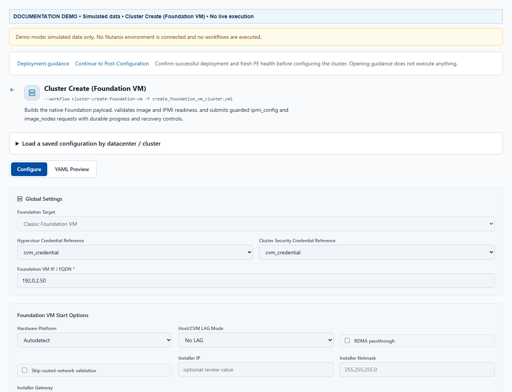

# Cluster Create (Foundation VM) Quick Guide

Guide ID: `QG-W-cluster-create-foundation-vm` · Reviewed: 20 November 2026 · Source: `79c3ecc`

Status: Current source procedure. Read [Using the quick guides](../using-the-guides.md) first.

## Purpose

Creates clusters through the classic Foundation VM 5.x API.

## Prerequisites

Use the role authorized by the installed workflow policy. Complete the common preparation checklist, confirm service health and review the impact/recovery plan for this target.

## Required inputs

Configuration filename: `create_foundation_vm_cluster.yml`. Reachable Foundation 5.x VM, existing image inventory and checksums, BMC credential references, node serials and separate host/CVM/BMC network plans.

## Procedure

1. Open Workflows 1.x → Cluster Create (Foundation VM); confirm the ID is cluster-create-foundation-vm.
2. Choose Foundation VM, verify scheme/port and connectivity from the service. Select images already present on that VM; review each node's IPMI results and generated native payload before approved deployment.
3. Inspect the full generated/imported YAML, including optional settings and target scope. Save the reviewed file; perform the supported validation before submission.
4. Use the action's required approval and confirmation path. Submit once and follow Jobs / Queue plus any remote service task to its documented completion.

## Validation and expected result

Retain the Foundation session ID, follow image_nodes progress and confirm cluster VIP, membership and PE health after completion.

## Failure and recovery

Do not upload or type an image again when the correct existing inventory item is available. Reconcile the remote session after timeout; do not start duplicate imaging.

## Evidence to capture

Record the exact target, installed build, reviewed config filename/hash, approval if applicable, job/task/run IDs and redacted before/after checks. Keep unresolved follow-up with the change record.

## Screen reference

Local demonstration of **Configure / initial draft** at `/workflows/cluster-create-foundation-vm`, captured from source `79c3ecc` on 20 November 2026. Values and credential references are synthetic; required fields may intentionally be incomplete. This is the initial screen or selected configuration panel, not evidence of a successful run. Lower form sections may be outside the captured viewport. Follow this guide's preparation, approval and verification steps.

## References

- [Detailed procedure](../../start-here.md)
- [Catalogue and details](../../../src/data.ts)
- [Execution form](../../../src/pages/WorkflowDetail.tsx)
- [Guide index](../README.md)
