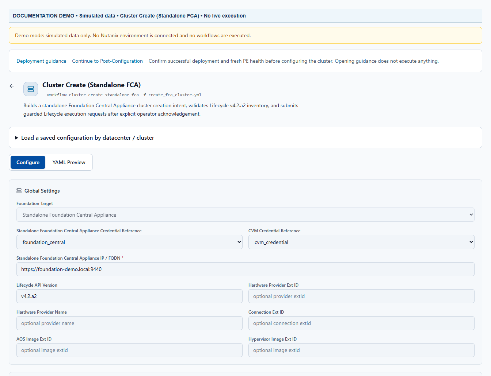

# Cluster Create (Standalone FCA) Quick Guide

Guide ID: `QG-W-cluster-create-standalone-fca` · Reviewed: 20 November 2026 · Source: `79c3ecc`

Status: Current source procedure. Read [Using the quick guides](../using-the-guides.md) first.

## Purpose

Creates clusters through standalone Foundation Central Appliance Lifecycle APIs.

## Prerequisites

Use the role authorized by the installed workflow policy. Complete the common preparation checklist, confirm service health and review the impact/recovery plan for this target.

## Required inputs

Configuration filename: `create_fca_cluster.yml`. Standalone FCA endpoint and credential, matching Lifecycle v4.2.a2 inventory, approved image references, node serials and cluster networking.

## Procedure

1. Open Workflows 1.x → Cluster Create (Standalone FCA); confirm the ID is cluster-create-standalone-fca.
2. Use the Standalone FCA form, not the PC-associated FC target. Review read-only Dry Run and the exact RUN STANDALONE-FCA cluster-create-standalone-fca acknowledgement before submission.
3. Inspect the full generated/imported YAML, including optional settings and target scope. Save the reviewed file; perform the supported validation before submission.
4. Use the action's required approval and confirmation path. Submit once and follow Jobs / Queue plus any remote service task to its documented completion.

## Validation and expected result

Check the returned Lifecycle deployment ID and final status in FCA, then verify PE cluster identity and healthy membership.

## Failure and recovery

Validate the actual appliance API contract. A successful local handoff can precede FCA completion; never treat it as deployed infrastructure or resubmit while FCA remains active.

## Evidence to capture

Record the exact target, installed build, reviewed config filename/hash, approval if applicable, job/task/run IDs and redacted before/after checks. Keep unresolved follow-up with the change record.

## Screen reference

Local demonstration of **Configure / initial draft** at `/workflows/cluster-create-standalone-fca`, captured from source `79c3ecc` on 20 November 2026. Values and credential references are synthetic; required fields may intentionally be incomplete. This is the initial screen or selected configuration panel, not evidence of a successful run. Lower form sections may be outside the captured viewport. Follow this guide's preparation, approval and verification steps.

## References

- [Detailed procedure](../../foundation-central-validation.md)
- [Catalogue and details](../../../src/data.ts)
- [Execution form](../../../src/pages/WorkflowDetail.tsx)
- [Guide index](../README.md)
