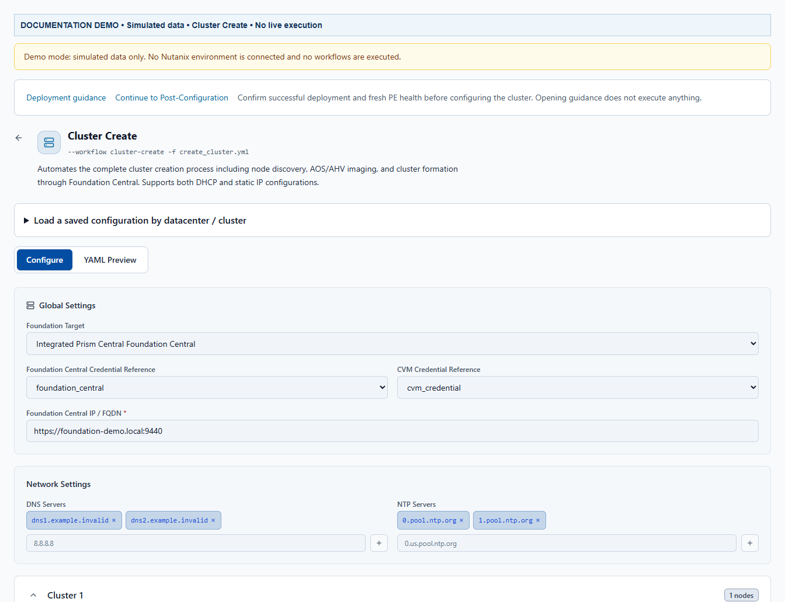

# Cluster Create Quick Guide

Guide ID: `QG-W-cluster-create` · Reviewed: 21 November 2026 · Source: `48eb875`

Status: Current source procedure. Read [Using the quick guides](../using-the-guides.md) first.

## Purpose

Creates clusters using Foundation Central with full node imaging.

## Prerequisites

Use the role authorized by the installed workflow policy. Complete the common preparation checklist, confirm service health and review the impact/recovery plan for this target.

## Required inputs

Configuration filename: `create_cluster.yml`. Foundation Central endpoint associated with PC, eligible discovered nodes, credential references, approved AOS/AHV images and complete addressing.

## Procedure

1. Open Workflows 1.x → Cluster Create; confirm the ID is cluster-create.
2. Select the intended discovered nodes by serial; check image versions, VLANs, host/CVM addresses and cluster VIP. Generate YAML, review Dry Run and approve the imaging change before Run Workflow.
3. Inspect the full generated/imported YAML, including optional settings and target scope. Save the reviewed file; perform the supported validation before submission.
4. Use the action's required approval and confirmation path. Submit once and follow Jobs / Queue plus any remote service task to its documented completion.

## Validation and expected result

Track the Foundation deployment to completion and verify PE identity, membership and health; continue with the reviewed post-configuration sequence.

## Failure and recovery

Imaging can overwrite node data. Stop on unexpected serials, image mismatch or occupied addresses. A local handoff is not completed imaging; reconcile Foundation history before retry.

## Evidence to capture

Record the exact target, installed build, reviewed config filename/hash, approval if applicable, job/task/run IDs and redacted before/after checks. Keep unresolved follow-up with the change record.

## References

- [Detailed procedure](../../start-here.md)
- [Catalogue and details](../../../src/data.ts)
- [Execution form](../../../src/pages/WorkflowDetail.tsx)
- [Guide index](../README.md)

## Screen reference

Simulated initial/authoring view captured 21 November 2026 from application source `48eb875`. State: **Configure / initial draft** at `/workflows/cluster-create`. Values are synthetic and required inputs may be incomplete. This is not evidence of a successful run, live target authentication or hardware compatibility. Lower form sections may be outside the captured viewport. Follow the preparation, approval, verification and recovery instructions.
