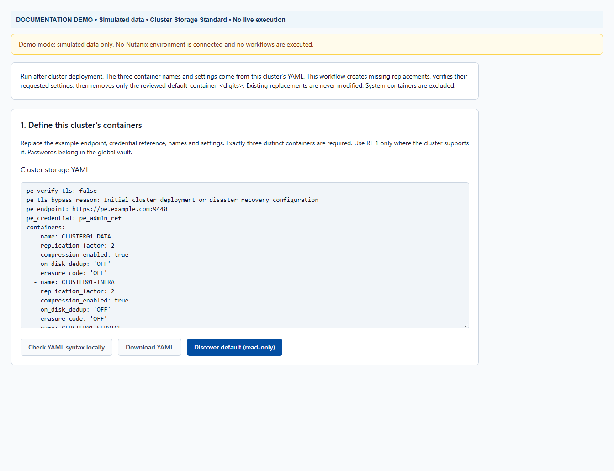

# Cluster Storage Standard Quick Guide

Guide ID: `QG-W-cluster-storage-standard` · Reviewed: 21 November 2026 · Source: `48eb875`

Status: Current source procedure. Read [Using the quick guides](../using-the-guides.md) first.

## Purpose

Create three cluster-specific containers and clean up the discovered default container.

## Prerequisites

Use an Orchestrator administrator. Complete the common preparation checklist, confirm service health and review the impact/recovery plan for this target.

## Required inputs

Configuration filename: `cluster-storage-standard.yml`. PE endpoint, reviewed certificate policy and exception reason if needed, saved PE credential, three distinct replacement container names and reviewed storage properties.

## Procedure

1. Open Workflows 1.x → Cluster Storage Standard; confirm the ID is cluster-storage-standard.
2. Use Discover default (read-only) to bind the cluster UUID and exact default container. Review dependencies, obtain independent approval for the exact YAML and filename, then type APPLY STORAGE followed by the cluster UUID.
3. Inspect the full generated/imported YAML, including optional settings and target scope. Save the reviewed file; perform the supported validation before submission.
4. Use the action's required approval and confirmation path. Submit once and follow Jobs / Queue plus any remote service task to its documented completion.

## Validation and expected result

All three replacements match requested properties and fresh inventory proves the reviewed default UUID/name is absent; retain deleted versus already_absent diagnostics.

## Failure and recovery

VDisk dependencies or incomplete inventories block cleanup. Replacements may already exist. Resolve owners separately and obtain new approval; never force deletion or remove workloads to satisfy the standard.

## Evidence to capture

Record the exact target, installed build, reviewed config filename/hash, approval if applicable, job/task/run IDs and redacted before/after checks. Keep unresolved follow-up with the change record.

## References

- [Detailed procedure](../../cluster-storage-standard.md)
- [Catalogue and details](../../../src/data.ts)
- [Execution form](../../../src/pages/WorkflowDetail.tsx)
- [Guide index](../README.md)

## Screen reference

Simulated initial/authoring view captured 21 November 2026 from application source `48eb875`. State: **Configure / initial draft** at `/workflows/cluster-storage-standard`. Values are synthetic and required inputs may be incomplete. This is not evidence of a successful run, live target authentication or hardware compatibility. Lower form sections may be outside the captured viewport. Follow the preparation, approval, verification and recovery instructions.
